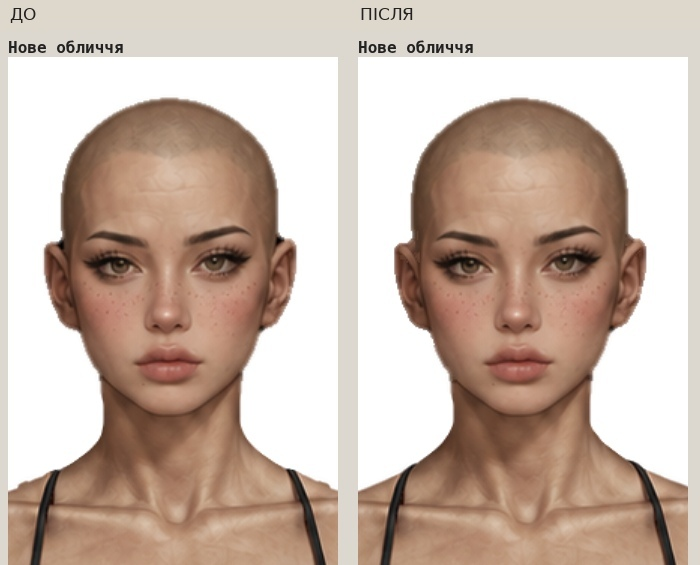
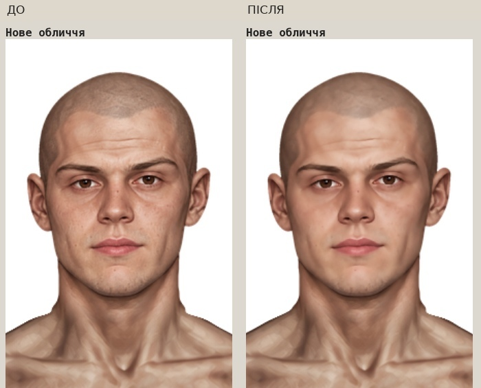
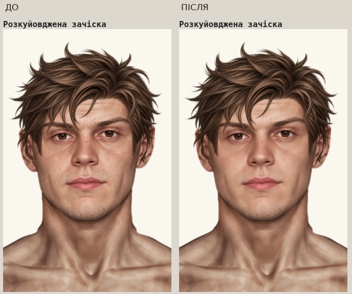
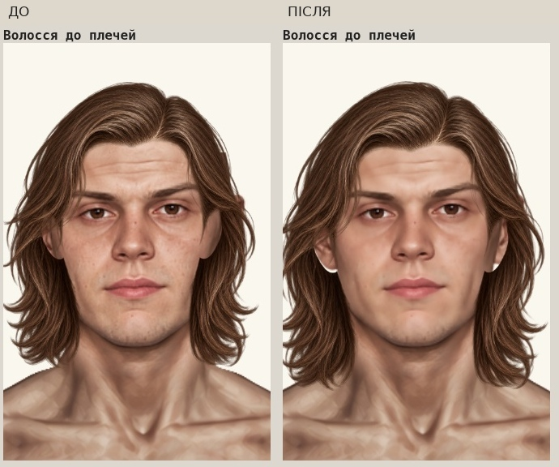
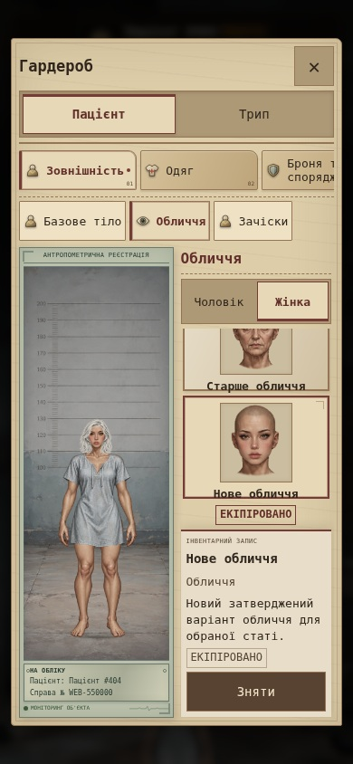

> **Історичний звіт етапу 082e83e / dbbcddf.** Наступний незалежний аудит, нові результати тестів, очищені PNG, задній шар волосся та мобільні виправлення: [актуальний звіт](../paper-doll-audit-2026-10/README.md). Наведені нижче старі результати збережено для історії; вони не є результатами нового запуску.

# Аватари, обличчя та зачіски — актуальне доведення в main

Робота виконувалась без нової feature-гілки, безпосередньо в `main`. Попередній результат `41bf1d1` включено один раз; старі зсуви зачісок повторно не застосовувались. Цей звіт замінює попередній звіт про експериментальну інтеграцію. Зображення в цій папці залишено як історичний матеріал; **актуальні контрольні знімки — у [сусідній галереї](../avatar-face-hair-final/README.md)**.

## Виявлені причини та виправлення

| Пункт | Причина | Що зроблено |
|---|---|---|
| 1. Нова жіноча голова | Темні RGB-плями біля кріплення вух, дрібні виступи альфи, занадто пізній перехід шиї в тіло | Локальна ретуш лише граничних плям, очищення однопіксельних виступів, зняття темного matte по шиї, коротший криволінійний neck join і перерахована індивідуальна маска тіла |
| 2. Чоловіче каре з чубчиком | Не було обмеження статі | `genders: ['female']`, тільки жіночий шлях і placement. Чоловічий каталог, equip і renderer не допускають його |
| 3. Чорний початковий колір | Наданий PNG справді чорний; режим `original` правильно показував його без змін | Тільки RGB нового каре переведено в каштановий пігмент `#704632` із збереженням освітлення пасом та **кожного байта альфи**. Палітра й загальна логіка фарбування не змінені |
| 4. Чоловіче волосся до плечей | Замалий розмір і застаріла геометрія crown clip | Пропорційне збільшення на 8% навколо маківки `(474,35)`; той самий перерахунок контуру перекриття. Перевірено всі шість чоловічих облич |
| 5. Нове чоловіче обличчя | Фотографічна мікротекстура виділялась серед ілюстрацій | Локальна edge-preserving ретуш RGB і м’яке укрупнення тонових переходів. Збережені особистість, форма, очі, вік, альфа й реєстрація. Це корекція наданого PNG, без генерації іншої голови |
| 6. Нове чоловіче обличчя + messy | Повніший контур нового черепа міг виступати під край пасом | Локальний додатковий запас crown clip **1.2 px** лише для цієї пари. Саму зачіску, її PNG, позицію та погоджене горизонтальне розтягування не змінено |
| 7. Контури тіл | Новий RGB був зібраний зі старою альфою | Обидві бази тепер мають **точну власну альфу джерельних PNG**. RGB не деформувався по рядках або частинах тіла; полотно, поза та суміщення одягу збережені |
| 8. Картки облич | Повнорозмірний прозорий PNG зменшував голову до кількох пікселів | Портретне CSS-кадрування того самого ресурсу у вікні 80×88 px, без дублювання PNG і зміни структури гардероба |
| 9. Мобільний гардероб | Попередні фото показували переважно сцену | Перевірено весь інтерфейс на 320×568, 390×844 і 768×1024: усі категорії/слоти, картки, кнопки, стать, обличчя, зачіски, кольори та обидва комплекти |
| 10. Документація | Кореневий README стверджував, що зачісок і одягу ще немає | Оновлено актуальний статус гардероба, каталог, розділення комплектів, збереження, міграцію та посилання на перевірки |

## Точна посадка й маски

- Голова в рендері: **x=0, y=0, width=941, height=1672**, без зміни загального масштабу.
- Реєстрація жіночого джерела: scale `1.02`, x `254.7`, y `17`; чоловічого: scale `0.275`, x `300.5`, y `8`. Ці реєстрації не змінені.
- Жіночий профіль neck join `(центр, радіус, початок, кінець, дуга)`: `(474,65,245,278,22)` → **`(474,65,242,270,14)`**. Нижче перехід повертає саме поточне тіло; стороння білизна з джерела не додається.
- Чоловіче волосся до плечей: x `341.320000325` → **`330.705600351`**; y `22.61025` → **`21.61907`**; width/height `256.7565` → **`277.29702`**. Для PNG 1254×1254: scale `0.20475` → **`0.22113`**. Пропорції однакові по обох осях.
- Жіноче каре з чубчиком: **x=365.9, y=-59.9, scale=0.23**, width=216.43, height=384.56. Посадка не змінена; чоловічий варіант вилучено з даних.
- Messy: затверджений placement і `stretchX` залишені. Додаткове відсікання голови працює тільки для `male + face-alternative + hair-messy`.
- Порядок не перевертався: тіло `0`, голова `1`, допоміжна анатомія горловини `2`, передня туніка `3`, волосся `9`, головний убір `10`. Одяг і аксесуари зберігають свої чинні порядки.

## Міграція та сумісність

При завантаженні старого чоловічого сейву з `hair-bob-bangs` зачіска нормалізується до `hair-none`. Так само вона скидається при переході з жіночого персонажа на чоловічого. Обличчя, колір волосся, характеристики, інвентар і обидва комплекти залишаються. Формат збереження **schemaVersion=2** не змінювався; виправлений вибір записується звичайним збереженням гри. Невідомі історичні ID не знищуються під час нормалізації.

Доступно 5 парних накладок облич та оригінальне обличчя. Зачісок разом із «Без зачіски»: 7 для чоловіків, 8 для жінок. Назва файлу `unisex_bob_bangs.png` лишилась історичною; **доступ до предмета тепер тільки жіночий**.

## Змінені файли

- Логіка/дані: `paper-doll-data.js`, `paper-doll.js`, `script.js`, `wardrobe.js`.
- Портретне кадрування: `style.css`.
- Версії завантаження: `index.html`; URL баз у `art/hospital-shirt.html`; кеш каталогу актуальної примірки `art/patient-tunic.html` (оновлений окремою заключною правкою).
- PNG: `base_male.png`, `base_female.png`; `assets/wardrobe/faces/{male,female}_alternative_head.png`; їхні `masks/{male,female}_alternative_body.png`; `assets/wardrobe/hair/unisex_bob_bangs.png`.
- Сумісність старих жіночих ший: `assets/wardrobe/faces/female_{young,exhausted,elder}_head.png` та відповідні `masks/female_{young,exhausted,elder}_body.png`; реєстрація й верхні обличчя не змінені. Маніфест: `tests/fixtures/face-neck-transitions.json`.
- Відтворювана обробка: `tools/prepare-avatar-update.py`, `tools/rebase-legacy-female-necks.py`; контрольна примірка: `tools/review-avatar-final.py`.
- Перевірки: `tests/game-logic.test.cjs`, `tests/test_game.py`, `tests/fixtures/avatar-face-hair-update.json`. У `.github/workflows/checks.yml` час job збільшено з 10 до 20 хвилин для розширеної браузерної матриці та встановлення Chromium; перевірки не вимикаються.
- Документація: кореневий `README.md`, цей звіт, [індекс галереї](../avatar-face-hair-final/README.md), контрольні зображення.

Повний перелік відносно попереднього `main`, включно з первинною інтеграцією та зображеннями: [changed-files.txt](../avatar-face-hair-final/changed-files.txt). SHA-256 джерел, результатів і масок: [fixture](../../tests/fixtures/avatar-face-hair-update.json). PNG раніше затверджених зачісок, усі PNG одягу, чоловічі старі голови, азійські голови й `hair-color.js` збережені байт у байт від `41bf1d1`. У старих жіночих young/exhausted/elder збережені точні байти всіх рядків **0–220**; змінені тільки нижні стики шиї та відповідні маски під нову власну альфу тіла. Це усунуло виявлені тестом стрибки контуру на 4–6 px та втрату 1/255 непрозорості без послаблення критеріїв плавності й альфи.

## Перевірки

- **JavaScript: 72/72 успішно.**
- **Python/Chromium: 76/76 унікальних перевірок успішно:** 65 браузерних у трьох ізольованих процесах (22+22+21) та 11 перевірок ресурсів. Після виправлення нижніх жіночих стиків усі 11 ресурсних і три пов’язані браузерні сценарії повторно пройшли; це повторні запуски, не додаткові унікальні тести.
- Новий сценарій каре/палітри також повторно пройшов після посилення перевірки каштанового початкового кольору. Сторінка актуальної примірки повторно перевірена після оновлення її кеш-версії каталогу.
- Синтаксис змінених JS/Python та `git diff --check` — успішно. У галереї та цільових браузерних перевірках **0 JS-помилок і 0 відсутніх ігрових PNG**.
- **40 актуальних контрольних зображень**, зокрема повний мобільний інтерфейс і однакові за масштабом ДО/ПІСЛЯ. [Машиночитаний підсумок](../avatar-face-hair-final/test-results.json).

Охоплено міграцію чоловічого сейву, відсутність жіночого предмета у чоловічому каталозі, відмову недопустимого equip, явні `original/black/white/red/blue`, збереження альфи після фарбування, перемикання статі й reload, наявність ресурсів, обидві сцени та комплекти, старі обличчя/зачіски, відповідність тунік, усі чоловічі обличчя з shoulder-length. Додаткова перевірка реального композиту обох нових голів на чотирьох фонах перевіряє непрозорість внутрішнього обличчя/шиї та чистий зовнішній фон.

```sh
node --test --test-isolation=none tests/game-logic.test.cjs
PLAYWRIGHT_BROWSERS_PATH=/workspace/.browsers python -m unittest discover -s tests -v
PLAYWRIGHT_BROWSERS_PATH=/workspace/.browsers python tools/review-avatar-final.py
```

Для повторної обробки потрібні незмінені п’ять PNG із `palata404_assets_fixedd.zip` і попередні тіла з `a85ccb4`; інструмент потребує Pillow, NumPy, SciPy. Пакет не завантажується грою. Контрольний маніфест містить контрольні суми вихідних файлів. Генерація нових зображень не застосовувалась.

## Контрольні зображення

Усі портрети — реальний Chromium-рендер PNG через `renderPaperDollAt`; інтерфейсні знімки — справжній гардероб. Колажі ДО/ПІСЛЯ складені лише зі знімків однакового масштабу. [Перевірка збереження затверджених ресурсів](../avatar-face-hair-final/protected-assets.json). ДО використовує графіку та посадку `41bf1d1`, зафіксовані перед редагуванням PNG.

### Жіноча голова



[Чотири фони](../avatar-face-hair-final/female-four-backgrounds.png) · [Усі зачіски, білий колір, чотири фони](../avatar-face-hair-final/female-all-hair-four-backgrounds-white.jpg)

### Чоловіче обличчя та messy





[Усі зачіски з новою головою](../avatar-face-hair-final/male-all-hair-new-face.jpg) · [Чотири фони](../avatar-face-hair-final/male-four-backgrounds.png) · [Світле волосся на чотирьох фонах](../avatar-face-hair-final/male-all-hair-four-backgrounds-white.jpg)

### Чоловіче волосся до плечей



[Усі чоловічі обличчя: оригінальний, чорний і білий кольори](../avatar-face-hair-final/male-shoulder-white-black.jpg)

### Жіноче каре і мобільний гардероб

[Каре на всіх жіночих обличчях: оригінальний / чорний / білий](../avatar-face-hair-final/female-bangs-original-black-white.jpg)



[Телефон 320 px — палітра і зачіски](../avatar-face-hair-final/mobile-320-patient-female-hair.jpg) · [Трип, чоловік — 390 px](../avatar-face-hair-final/mobile-390-combat-male-hair.jpg) · [Планшет 768 px](../avatar-face-hair-final/mobile-768-patient-female-faces.jpg)

## Перевірка опублікованої гри

Основна інтеграція опублікована в `main` комітом `082e83e3670aaa771760b80bf34fa03eeeeb356f`. GitHub Pages повернув HTTP 200; **45 робочих JS/CSS/PNG-файлів** побайтово збігаються з перевіреною локальною версією. Окремо підтверджено HTTP 200 та точні байти 45 публічних файлів звіту й галереї.

Chromium перевірив уже опубліковані HTTPS-ресурси: обидві статі, всі 5 парних накладок, 7 чоловічих / 8 жіночих варіантів волосся, порядок шарів і reload. **JS-помилок немає.** HTTPS-байти передавались браузеру через Python із перевіркою сертифіката; ресурси не підмінялись локальними файлами. [Результат перевірки публікації](../avatar-face-hair-final/publication-check.json).

Заключна правка кешу `art/patient-tunic.html` зберігає ту саму перевірену графіку й каталог. [Гра](https://neverl1ke.github.io/palata404/).

## Межі перевірки та залишкові моменти

- Мобільна перевірка виконана в Chromium з відповідними viewport; це не тестування на фізичних iOS/Android-пристроях.
- Ступінь painterly для нового чоловічого портрета залишається художньою оцінкою: виконано локальну ретуш, без зміни особистості або повного перемальовування обличчя.
- Природні відкриті ділянки між зовнішніми локонами та вухом у чоловічого shoulder-length є частиною прозорого контуру вихідного PNG. Їх не заливали плоским кольором і не підміняли новою графікою. Вони видимі в галереї; окремий задній шар волосся може бути наступним художнім уточненням. Лице більше не перекривається замалим внутрішнім отвором зачіски.
- Старі обличчя не перемальовувались. Три жіночі нижні стики шиї технічно перепід’єднані до нової бази з побайтовим захистом верхніх 221 рядків. Нових критичних подвійних контурів або поломок туніки під час перевірки не виявлено.
