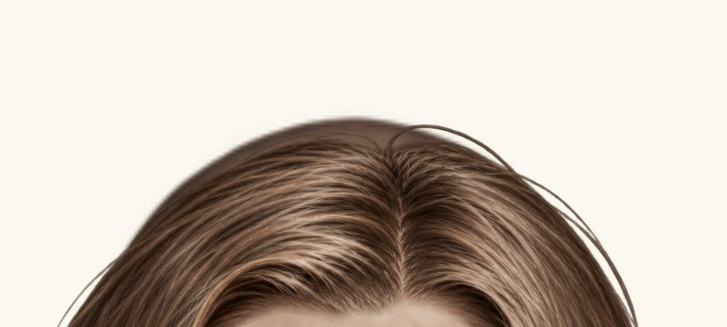
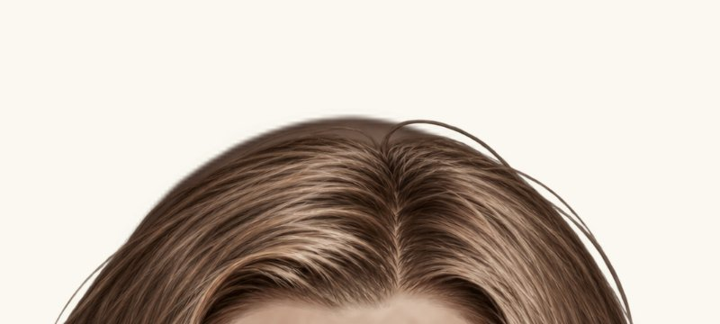
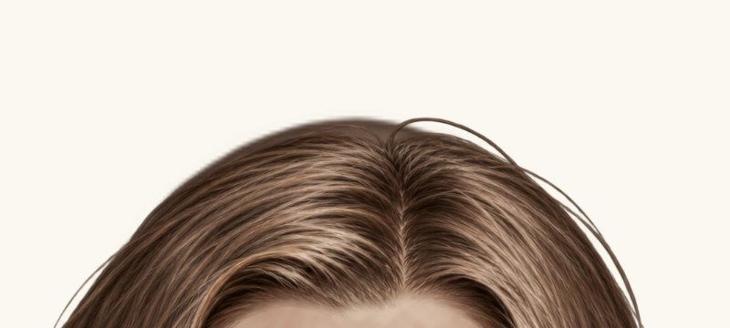
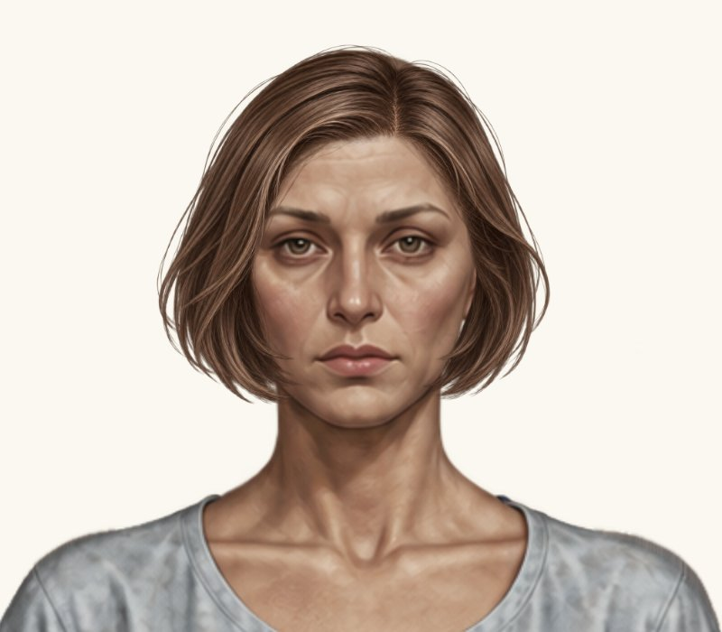
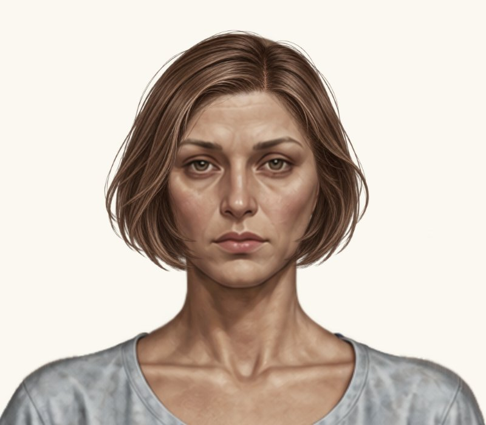
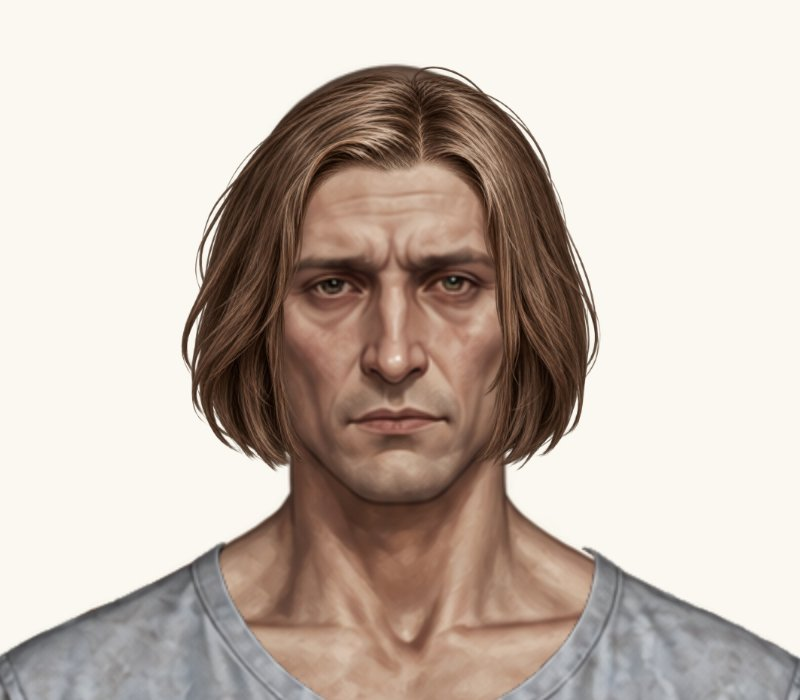

# Каре — перевірка маківки й країв

Пробна гілка: `preview/bob-cheek-direction`. Правки координат: `126c548f995a03f263ce236a3d0c3597008cc22a`. Main не змінено.

Збережені параметри: жіноче x = 345.3386675, y = 6.7274324; чоловіче x = 352.60516025, y = 16.4574795. Розміри, масштаб, PNG, аватари, туніки та інші зачіски незмінні. Підняття на 2 px показане лише як окрема проба, не застосоване до каталогу.

## Чоловіче каре — маківка 4×

Однакові кадри 800×360 px на світлому фоні #faf8f0. Це браузерні знімки справжнього ігрового рендерера, збільшеного цілком; арт не генерувався й не редагувався.

| До: y = 17.4574795 | Піднято на 1 px: y = 16.4574795 | Окрема проба на 2 px: y = 15.4574795 |
| --- | --- | --- |
|  |  |  |

На 1 px маківка перекрита не повністю. На 2 px результат кращий, але тонкий контур шкіри ще помітний. Повне усунення дефекту не підтверджене; додаткові довільні зміни не внесено. Погоджений чоловічий x залишився тим самим, нових помітних зазорів біля щік на цих кадрах не виявлено.

## Загальний вигляд голови 2×

Однакові кадри 800×700 px; натисніть на зображення, щоб відкрити його у повному розмірі.

| Варіант | До | Запитана правка |
| --- | --- | --- |
| Жіноче: x 346.3386675 → 345.3386675 |  |  |
| Чоловіче: піднято на 1 px |  |  |

[Окрема чоловіча проба з підняттям на 2 px — загальний вигляд](../bob-crown-fit/crown-male-up2-head-2x.jpg).

Перевірки: 65 Node + 62 Python (ресурси та Chromium) — усі 127 успішні. [Браузерний прогін](https://github.com/neverl1ke/palata404/actions/runs/38755960834).

Очікується погодження власника. У main жодного варіанта не перенесено.
