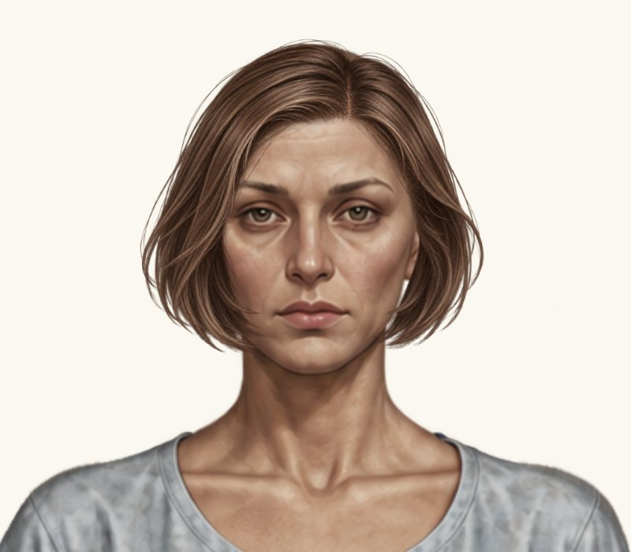
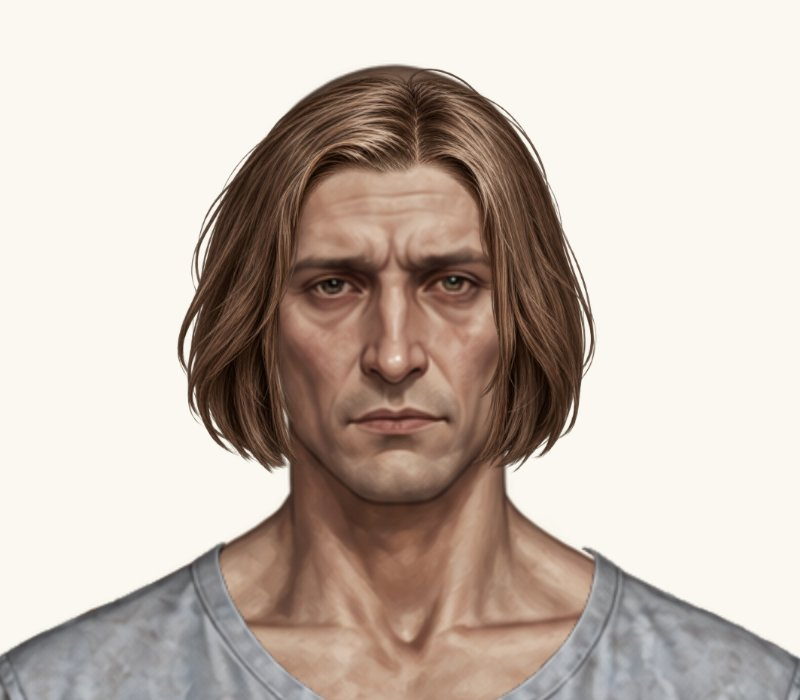
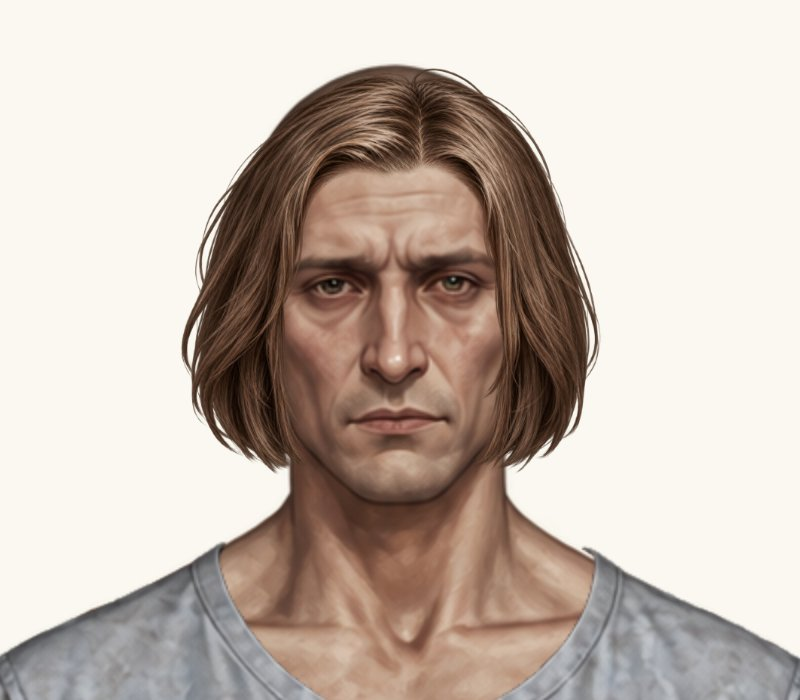

# Каре — порівняння напрямку зсуву

Поточний варіант: main `31f6c48`. Проба: гілка `preview/bob-cheek-direction`. У main пробу не перенесено.

Обидва кадри — реальні браузерні знімки ігрового компонента на однаковому світлому фоні, 800×700 px, збільшення 2×. PNG, y, масштаб і всі інші зачіски незмінні.

| Каре | Поточний варіант | Проба |
| --- | --- | --- |
| Жіноче |  |  |
| Чоловіче |  |  |

Жіноче x: 348.3386675 → 346.3386675. Чоловіче x: 350.60516025 → 352.60516025.

Просвіти біля проблемних щік зменшилися, але біля нижніх кінчиків пасом залишаються тонкі світлі ділянки. Подальших зсувів не внесено. Очікується погодження власника.
