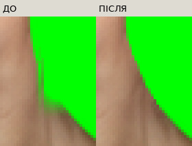
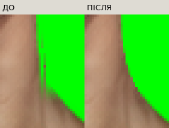

# Незалежна ревізія інтеграції восьми жіночих облич

Наступний погоджений етап: [заміна жіночої бази та адаптація нижніх стиків восьми голів](../female-base-replacement/README.md). Наведені нижче результати й зображення описують стан b00712b; їхні еталони збережено, а не підмінено новою базою.

Аудит діапазону `4046cac…6bac151`, робота безпосередньо в `main`. Перед правками: чисте дерево, `HEAD = origin/main = 6bac151e53e8723f69b21b1a62dd52d02b444cd5`; створено точку відновлення `backup/female-faces-independent-audit-20261019`. Історію не переписано. Це повторна перевірка іншим критерієм, а не посилання на попередній успішний звіт як на гарантію якості. Окремий сторонній художник у перевірці не брав участі.

[Відкрити нову галерею](https://neverl1ke.github.io/palata404/review/female-faces-independent-audit/gallery.html) · [Таблиця проблем JSON](issues.json) · [Початковий аналіз](before-analysis.json) · [Повторний аналіз](after-analysis.json) · [Маніфест правок і захищених ресурсів](repair-manifest.json) · [Точний список змінених файлів](changed-files.json)

## Підтверджені проблеми та рішення

| Файл / ділянка | Проблема | Доказ | Пріоритет | Рішення | Статус |
| --- | --- | --- | --- | --- | --- |
| `female_goth_septum_head.png` | Друга тонка смужка праворуч шиї | 28 повторних підйомів альфи; 9 точок x=518, y=239…247; крупний план нижче | P1 | Локальна монотонність зовнішнього альфа-спаду шиї до продовження контуру | Виправлено, перевірено |
| `female_ginger_soft_head.png` | Та сама смужка шиї | 27 повторних підйомів альфи; 5 точок x=515, y=240…244 | P1 | Те саме, без корекції художнього тону | Виправлено, перевірено |
| `tests/test_female_faces.py`, `tests/asset_history.py` | Перевірки відтворення/історичних ресурсів не знаходили ці поточні дефекти | Старі 82/106 проходять, нові тести на старих PNG падають | P1 | Незалежні критерії композитної альфи й плавності межі + негативні контролі на справжніх старих байтах | 5 нових тестів та чиста повна регресія пройдені |
| `female_ginger_soft_head.png` | Відмінність тону рожевого світлого обличчя від темнішої шиї/тіла | Знімки 100/200/400%, затверджене джерело | P2 | Не перефарбовувати без рішення власника | Підтверджена художня відмінність, не змінено |
| Вісім масок | Дві групи однакових масок могли приховати невідповідність окремій голові | Окремі результати кожної пари в `after-analysis.json` | P2 | Перевірка фактичного композиту кожної голови, а не вимога різних SHA заради різних SHA | Невідповідність масок не підтвердилася |
| `female_ginger_soft_head.png` | Вужчий силует: 158 px проти 166…177 px інших голів вище y=210 | Вихідний PNG уже має цей контур, runtime scale=1 | P2 | Художнє рішення власника, не автоматичне розширення голови | Потенційна відмінність пропорцій, збережено |
| `female_goth_black_lips_head.png` | Один малий альфа-реверс шиї | Аналіз та крупний план; довгої смужки немає | P3 | Коректна відстань до силуету також прибрала цей реверс | Усунуто технічним виправленням нижнього стику |
| Нижні стики восьми накладок | Різкий стрибок краю шиї у шести портретів; помилковий distance field для alpha253 всередині бази | Максимум за рядок: asian 9, young 9, exhausted 13, elder 10, alternative 15, ginger 5 px; у бази 3 | P1 | Коригувати дробовою альфою лише справжній край signed-distance field, а не всю напівпрозору внутрішню шкіру | Виправлено: максимум 3 px у кожного портрета, регресія пройдена |
| `tests/test_project_audit.py` | Один стрес-збій: тест почав порівняння до стабільного white | `test-logs/stress-shard-1.log.gz` | P2 | Вимагати саме white та перевіряти обидва шари в одному JS-такті; після reload чекати їхні зображення | Адресна перевірка й окремий чистий повний прогін пройдені; журнал збою збережено |
| `review/female-faces-integration/` | 75,8 МБ матеріалів, ризик небезпечного очищення | Повна інвентаризація 170 файлів, 0 побайтних дублікатів | P3 | Історію й URL зберегти; нові матриці відкривати окремими посиланнями, обирати менший формат без втрат за вимірюванням | Без видалення історичних файлів |
| `gear-helmet` | Відсутній малюнок головного убору (`image:null`) | Каталог і код рендерера | P3 | Перевірено контракт шару; художнє перекриття можливе лише після появи PNG | Обмеження перевірки |
| Незмінена `base_female.png` | Частина шиї від y=259 має власну alpha=253 | Наприклад (450,259), (474,259), (474,265), (499,269) | P3 | Верхня шия непрозора; нижче перевіряється відсутність *додаткової* прозорості проти бази | Давня властивість забороненої до редагування бази |
| WebKit / фізичний телефон | Немає системних бібліотек для запуску WebKit і фізичного пристрою | `browser-limitations.log` | P3 | Chromium і Firefox; окремо позначена емуляція viewport | Непроведена частина перевірки |

Статуси відповідають фактичному фінальному локальному прогону. Машинозчитувана таблиця містить стабільні ID F01…F14. Поточна технічна регресія не знімає художніх застережень і перелічених обмежень.

## Причина двох технічних артефактів

У двох коротких вихідних експортах є слабка паралельна альфа-лінія за справжнім краєм шиї. Попередній алгоритм `neck_pair()` переносив рядок y=235 униз, щоб не сприймати експортний зріз як анатомічний. Разом зі справжнім контуром продовжувалася й зайва лінія. Перевірка лише великих компонентів не знаходила її: вона залишається пов'язаною з основним зображенням.

Перше локальне виправлення застосоване тільки до `ginger_soft` і `goth_septum`: перед продовженням контуру альфа на звичайній шиї y=218…235 спадає назовні без повторного підйому. Воно зачіпало відповідно 78 і 62 RGBA-пікселі. Після нього також пройшов проміжний набір 84 JS / 110 Python та обидві матриці, але перегляд 400% виявив додаткові різкі стики, описані нижче. Цей проміжний зелений результат не видано за завершення; протоколи збережені в `intermediate/`.

## Додатковий підтверджений дефект: різкий стик шиї

У п'яти старих портретів і рудого край композиту змінювався на **5…15 px за один рядок** у місці переходу до трапеції. Це не форма затвердженого обличчя або природна асиметрія вуха: дефект розташований нижче щелепи, а в незміненої бази максимальний крок у тій самій зоні — 3 px.

Причина — `distance()` у підготовці PNG. Вона замінювала справжню відстань дробовою alpha-.5 для **кожного** пікселя з alpha<255. База має alpha253 далеко всередині шкіри, отже її відстань до зовнішнього краю хибно ставала близькою до нуля. Інтерполяція такого плаского поля створювала різкий поперечний зріз. Маски тут не винні: усі вісім залишилися побайтно незмінними.

Виправлено лише визначення дробового краю: поправка alpha-.5 застосовується біля реального силуету, де абсолютна початкова відстань ≤1 px. Усередині зберігається геометрична відстань. Результат — безперервний нижній контур восьми накладок; у всіх максимальний крок ≤3 px. Окремий новий тест спочатку впав на справжньому старому asian PNG (`9 > 3`), а на кандидатах проходить; його негативний контроль перевіряє всі шість проблемних старих голів.

Це не erosion/dilation, розмиття, перемальовування або зміна масштабу. Фінальні зміни від `6bac151`:

| Голова | Змінено RGBA-пікселів | Межі x / y включно |
| --- | ---: | --- |
| asian | 375 | 413…535 / 233…277 |
| young | 355 | 413…535 / 229…277 |
| exhausted | 463 | 413…535 / 230…277 |
| elder | 506 | 413…535 / 232…277 |
| alternative | 375 | 413…535 / 233…277 |
| ginger_soft | 309 | 420…528 / 218…259 |
| goth_septum | 278 | 420…528 / 218…259 |
| goth_black_lips | 219 | 420…528 / 222…259 |

**Усі пікселі вище y=218 побайтно незмінні у восьми головах.** RGB пікселів, видимих до й після правки, також тотожний; у нових крайових пікселях використані вже наявні кольори джерела/бази. Змінені лише технічна альфа та її нульове зовнішнє поле нижнього стику. Обличчя, вуха, прикраси, щелепа, масштаб і художній тон не змінені. Точні SHA — у `repair-manifest.json`.




## Розбір 11 та 8 попередніх кандидатів

Використано попередній `png-quality.json`; координати незалежно витягнуто тим самим визначенням *кандидата* (alpha≥128 мінус binary opening), але ним не визначається автоматичне художнє проходження.

- **Goth septum, 11:** 9 точок x=518, y=239…247 — підтверджена зайва смужка; (420,257), (527,257) — кінці порогу альфи на плавному переході накладки. Останні дві не є виступами силуету зібраного тіла, тому збережені.
- **Ginger soft, 8:** 5 точок x=515, y=240…244 — зайва смужка; (547,120) — верхній край вуха, присутній у затвердженому джерелі; (420,257), (527,257) — той самий плавний перехід. Вухо й природний перехід збережені.
- Після очищення залишаються відповідно 2 та 3 кандидати, а не штучно нуль. Критерій підтвердженої смужки — повторне зростання альфи на простій шиї у фактичному композиті — тепер дає **0 для обох**.

## Перевірка кожного портрета й маски

| Обличчя | Контроль верхнього силуету x/y при alpha≥128 | Окремий висновок |
| --- | --- | --- |
| Азійське | x389…554, маківка y29 | Вуха й щелепа не обрізані новим кодом; асиметрія джерела збережена; маска не залишає стару маківку |
| Молоде | x385…560, y33 | Джерельна форма підборіддя та вух збережена; нової геометричної правки не потрібно |
| Виснажене | x385…558, y31 | Виражена щелепа й фактура — художні; непідтвердженого масштабування не виконувалося |
| Старше | x390…558, y29 | Художні складки вух і шиї збережені; технічного обрізання не підтверджено |
| Альтернативне | x382…557, y28 | Веснянки, вуха й макіяж збережені; відмінність фактури від інших портретів не названа автоматично дефектом альфи |
| Світле руде | x392…549, y36 | Виправлена смужка; вузький силует і світлий тон залишені для художнього рішення |
| Септум | x382…558, y26 | Виправлена смужка; пірсинг не пошкоджений і не закритий звичайними зачісками |
| Чорні губи | x386…560, y22 | Пірсинг губи/носа та сережки збережені; малий альфа-реверс усунуто виправленням distance field |

Кожен портрет знятий на білому, сірому, чорному та зеленому фоні в реальному `index.html`. 100% означає один Paper Doll піксель на піксель браузерного контрольного кадру; 200%/400% — точне збільшення найближчим сусідом. Окремі `*-game.png` показують фактичний зменшений масштаб сцени гардероба. Це не тестова HTML-примірка і не згенеровані портрети; додаткова дошка всередині основної сторінки викликає чинний `renderPaperDollAt`.

Для **кожної з восьми пар** перевірено: приховування старої голови до y=210, зв'язність сильного силуету, непрозорість внутрішньої верхньої шиї, відсутність додаткової прозорості нижче відносно бази, побайтну тотожність нижнього тіла після y=286. Однакові маски в групах пояснюються спільним переходом на незмінену базу; сама однаковість не доводить ні придатності, ні непридатності. Доказом тут служать окремі композити. Тон не вирівнювався під надто зручний тест.

## Ревізія коду та незалежності тестів

Переглянуто весь diff PNG/масок, `paper-doll-data.js`, `paper-doll.js`, `script.js`, версій `index.html`, тестових адаптерів, інструментів, HTML-галереї й документації. У вихідній інтеграції перевірки статі у normalize/selection/gender-change локальні; формат збереження та ігрові дані не змінені. Нового дефекту цих механізмів аудит не підтвердив.

Невідомі/некоректні ID облич скидаються до базового обличчя без втрати прогресу. Невідомі старі ID волосся за наявним контрактом можуть залишатися інертними метаданими, але рендер використовує `hair-none`; цю сумісність не замінено довільною новою міграцією. Для v1 перевірено вибір обличчя активного комплекту та збереження обох комплектів.

У HTTPS-верифікаторі прибрано жорстко записаний номер версії JS із вихідного JSON: тепер він читається з фактичного `index.html` і перевіряється проти завантаженого script URL. Очікування кольорового волосся перевіряє також original із власним кольоровим reference, а готовність — усі видимі зображення. Це зміни інструмента перевірки, не рендерера гри. Фінальний запуск виконується після фактичного GitHub Pages deployment.

Попередні хеші й відтворення того самого ресемплера лишаються перевірками походження, не якості. Старі тести через `asset_history.py` чесно перевіряють попередні ресурси, але не активні нові PNG. Вони не видалялися й не послаблювалися. Новий модуль `tests/test_female_faces_independent.py` **не імпортує підготовку PNG**, аналізує фактичний композит, плавність його межі та має справжні негативні контролі зі збережених попередніх байтів. Додано також JS-перевірки некоректних/старих ID, v1, режимів і незмінності прогресу.

Новий тест спочатку впав на реальному старому PNG — [журнал](expected-regression-before.log). Перша версія іншої нової перевірки помилково вимагала alpha255 навіть від незміненої бази, де є alpha253. Цей невдалий запуск збережено в `test-definition-correction.log`; критерій уточнений за явним інваріантом: непрозорий верх накладки та відсутність додаткової прозорості проти бази нижче. Не було зміни PNG або підміни еталона для приховування цієї властивості бази.

Критерій монотонності не застосовується до волосся, пірсингу чи вух; він локальний для простого контуру шиї двох підтверджених дефектів. Автоматичні тести не можуть довести художню досконалість анатомії чи тону.

Початковий запуск нового capture-інструмента спіткнувся об помилку підготовки сценарію: кнопка вже одягненого останнього обличчя означала «Зняти», а сценарій очікував «Одягнути». Інструмент тепер явно скидає накладку перед контрольним кліком. Це не виправлення гри; перший невдалий і повторний журнали збережені в `test-logs/female-independent-before*.log.gz`.

У повторному Firefox-проході `networkidle` одного разу завершився до готовності відкладених скриптів, і інструмент звернувся до ще не оголошеного `paperDollState`. Журнал збережений у `test-logs/firefox-readiness-first-failure.log.gz`; інструмент тепер явно чекає `document.readyState=complete` і появи стану гри. Повторний прохід не замінює й не приховує цю невдалу спробу.

## Обсяг галереї та безпечна оптимізація

Повна початкова інвентаризація: **170 файлів, 75 786 522 байти**. Найбільша частина — `after/` (52 642 122 байти), далі затверджені `sources/` (7 353 649), історичний `before/` (3 967 172), первинні примірки `inputs/` (2 958 400), похідні крупні плани `details/` (2 519 559). Решта — опубліковані кадри, матриці, журнали, галерея й маніфести.

**0 точних дублікатів. Видалено 0, переміщено 0.** `before/assets` потрібні чинним історичним тестам; джерела — перевіркам і відтворюваності; after/details/matrix — галереї та історичним посиланням. Крупні плани є похідними від кадрів, але мають власну доказову роль. Схожі UI-знімки inputs/before/after не оголошені непотрібними лише за схожістю.

Пробне перекодування восьми великих original-матриць у lossless WebP з повною перевіркою тотожності пікселів не дає загальної економії — [вимірювання](compression-benchmark.json). Тому масове переписування історичних PNG не виконано. Нова галерея має lazy-зображення та посилання на великі матриці; для нових матриць інструмент порівнює оптимізований PNG і lossless WebP, перевіряє пікселі та зберігає менший. Це зменшує непотрібне завантаження без втрати історії чи якості.

Виносити історичні джерела/матриці в зовнішній архів можна лише зі стабільними URL, зміною залежних тестів і перевіркою всіх посилань; в цьому проході такого ризику не створено. Стару галерею чітко позначено історичною, з посиланням на цей аудит; старі докази не перегенеровано під новий результат.

## Фактичні результати запусків

Початковий повний запуск: **82/82 JS, 106/106 Python/Chromium**, без пропусків. Проміжна правка лише смужок: 84 JS / 110 Python та два браузери пройшли, але після неї підтверджено ще F13. Окремі очікувані негативні контролі двох нових критеріїв збережені у `expected-*-before.log`. П'ять незалежних asset-тестів після повного виправлення: **5/5**.

Перший повний запуск 111 тестів під одночасним навантаженням двох capture-процесів мав **110 успішних / 1 невдалий** — тест стабільності кольору з таблиці. Журнали та початковий JSON не підмінені. Поле `passed` старого runner-а рахує лише тести повністю успішних шардів (у цій спробі 86), тому індивідуальний підсумок 110/111 наведено окремо за чотирма unittest-журналами. Умова готовності тесту тепер вимагає обраного white, обох стабільних шарів і фактичних кольорових зображень після reload; пороги або вимоги рендерера не послаблювалися. Код гри з цього приводу не змінений. Повного onload/onerror-таймлайну саме першого транзиторного кадру немає, тож точний механізм цього одиничного стрес-збою не видається за доведений.

**Окремий чистий фінальний прогін: 84/84 JavaScript і 111/111 Python/Chromium, 0 пропусків, 0 невдалих.** Python: 37 asset + 74 browser тести; усі 111 ID перелічені в [підсумку](test-logs/final-python.json), повні журнали — `test-logs/final-shard-*.log.gz`. [JS-журнал](test-logs/final-javascript.log). Нові тести не видаляли старих і не виключали невдалі сценарії. [Загальний машинозчитуваний результат](test-results.json).

Фінальний **Chromium 151.0.7922.34** та **Firefox 153.0**: кожен завершив 64 унікальні пари face/hair × 3 кольори × 4 фони = **768 контрольних зразків**, разом **1536**. У кожному рушії збереження всіх восьми облич перевірено після reload, обидва комплекти збережені; desktop та вузькі viewport 320×568, 360×640, 390×844, 430×844, 768×1024, 1440×1000 пройдені з кліком останньої картки та без горизонтального переповнення. Обидва протоколи мають **0 page errors / 0 HTTP errors**: [Chromium](after-chromium/result.json), [Firefox](after-firefox/result.json). Це окремі реальні рушії, але емуляція розмірів, не фізичний телефон.

Перевірка самої галереї: **42 зображення завантажені, 128 посилань перевірено, 0 зламаних локальних шляхів / JS / HTTP-помилок** — [протокол](gallery-check.json). Аналізатор залежностей пройшов `--check`; усі 43 активні PNG зареєстровані з правильним регістром шляхів. [Повторний RGBA-аналіз](png-quality-after.json) містить актуальні SHA всіх восьми виправлених файлів.

Публікаційні GitHub Actions та HTTPS-перевірка виконуються для коміту з цими файлами; остаточні SHA й фактичні статуси deployment наведені у фінальній відповіді. Локальні докази не підміняють перевірку deployment. [Game checks у main](https://github.com/neverl1ke/palata404/actions/workflows/checks.yml?query=branch%3Amain) · [GitHub Pages](https://neverl1ke.github.io/palata404/).

## Змінені файли

- **Вісім жіночих head PNG:** лише описана альфа-правка нижнього стику; додаткове очищення смужки лише для ginger/septum. Точні SHA/межі — `repair-manifest.json`.
- `paper-doll-data.js` — тільки вісім версій URL PNG; `index.html` — версія цього JS. Runtime-координати, палітра, стать, шари й збереження не змінювалися.
- `tools/prepare-female-faces.py` — виправлене визначення signed-distance краю та локальне очищення смужки двох джерел.
- `tests/test_female_faces_independent.py`, `tests/game-logic.test.cjs` — незалежні регресійні критерії й сценарії старих/некоректних станів; `tests/test_project_audit.py` — посилена перевірка готовності та незмінності white на front/rear шарах до й після reload.
- `tools/audit-female-faces-independent.py`, `review-female-faces-independent.py`, `build-female-independent-gallery.py` — аналіз, реальні браузерні знімки, галерея.
- `tools/verify-paper-doll-pages.py` — актуальна версія кешу в результаті, очікування готовності застосунку/всіх зображень і той самий повний набір 114 × 3 × 5 у порядку, що повторно використовує чинний кеш.
- `README.md`, `review/README.md`, `docs/paper-doll.md`, історичні README/HTML і шаблон старої галереї — навігація та розмежування історії/поточного аудиту. В інтеграційному маніфесті оновлено лише актуальні SHA восьми накладок з явним посиланням на попередні байти.
- `review/female-faces-independent-audit/` — нові докази, інвентаризація, журнали, повний звіт; старі порівняння не перезаписані.

Чоловічі PNG, обидві бази, одяг, зачіски/placement, маски, палітра, CSS, прогрес і структура збережень **не змінені**. Незмінність інших ресурсів перевіряється 39 захищеними SHA та окремим чинним тестом каталогу зачісок; верхні портрети восьми накладок додатково порівнюються побайтно з baseline.

## Межі висновку

Не підтверджено нових критичних відсічень вух, щелепи або підборіддя в переглянутих кадрах. Це не рівнозначно твердженню «все ідеально»: руде обличчя має інший тон і вужчий художній силует, готичні — інший макіяж/фактуру. Художні пункти не виправлялися самовільно. Крайові dark/light-кандидати з `png-quality-after.json` переглядаються на окремих чотирифонових крупних планах вух; темна складка або антиаліасинг не оголошуються автоматично ореолом. Художній аналіз контрасту не підмінено одним середнім RGB.

Фізичний телефон, Safari/iOS та справжній PNG головного убору не перевірені. Емуляція розмірів не названа тестуванням фізичного пристрою. Ні геометричний тест, ні проходження матриці не є гарантією відсутності будь-якого суб'єктивного художнього недоліку.

## Повторний запуск

Потрібні `requirements-dev.txt`, встановлені Playwright Chromium/Firefox, для підписів галереї — DejaVu Sans. У цьому середовищі браузери лежать у `/workspace/.browsers`; в іншому середовищі використовуйте власний Playwright cache.

```sh
node --test tests/game-logic.test.cjs
python tools/run-python-tests.py --jobs 3 --output test-results/female-independent
python tools/audit-paper-doll-png.py --output test-results/female-independent/png-quality.json
python tools/review-female-faces-independent.py --phase after --matrix --engine chromium --output test-results/female-independent-captures
python tools/review-female-faces-independent.py --phase after --matrix --engine firefox --output test-results/female-independent-captures
```

Інструменти знімків відмовляються перезаписувати завершений протокол; новий прогін слід зберігати в новий каталог. Не запускайте підготовку PNG в активні `assets/` для самої перевірки: аналіз і capture їх не редагують.
