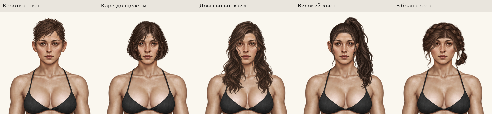
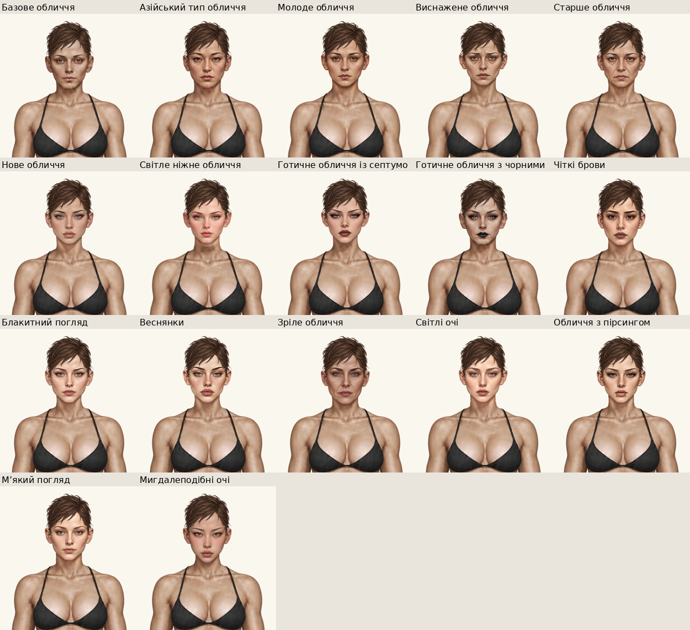
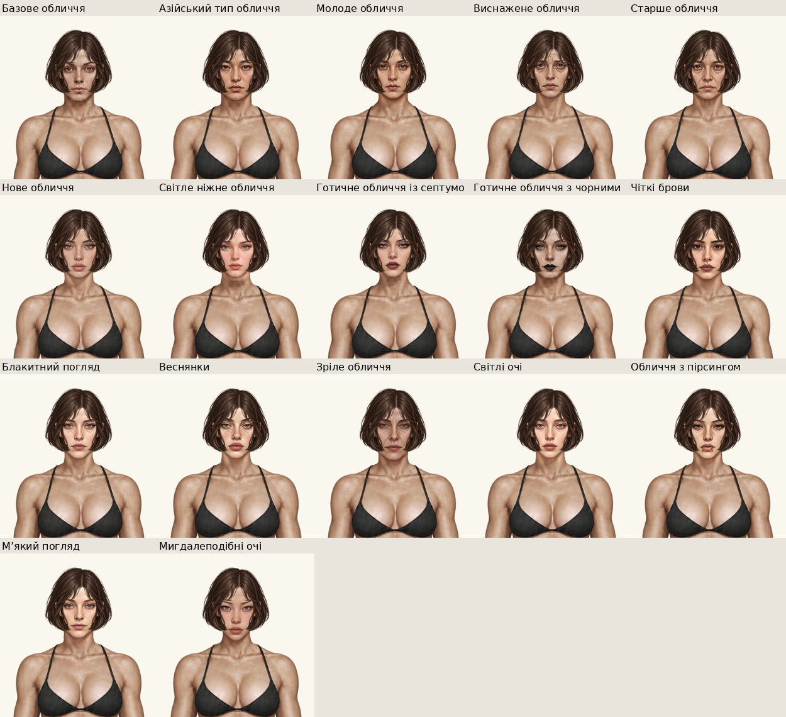
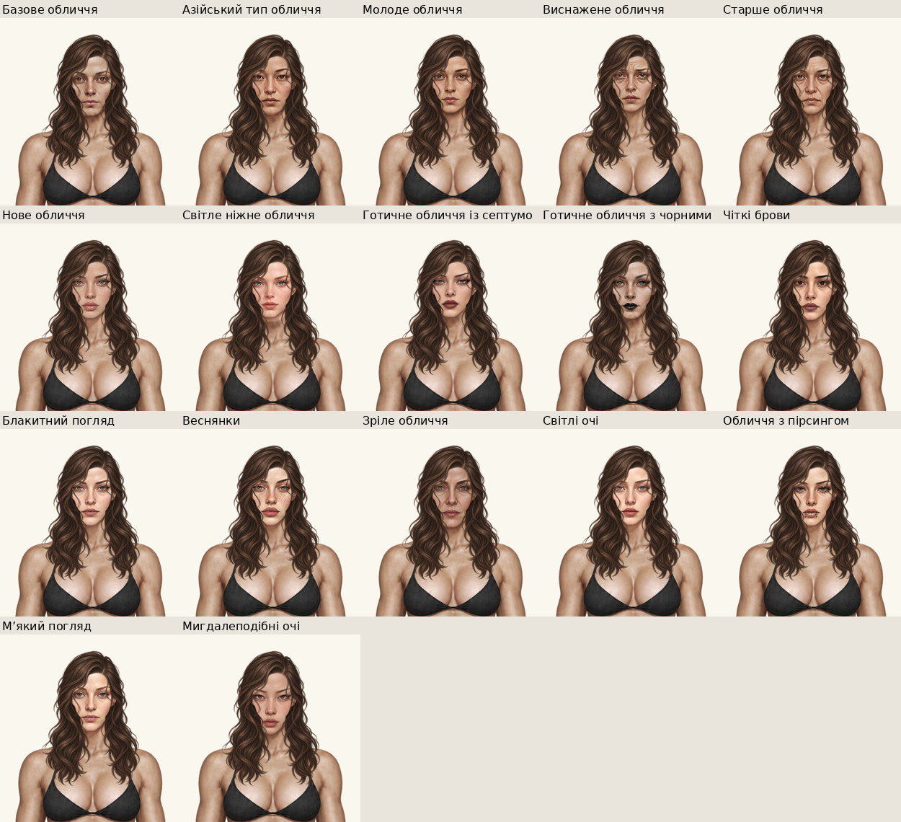
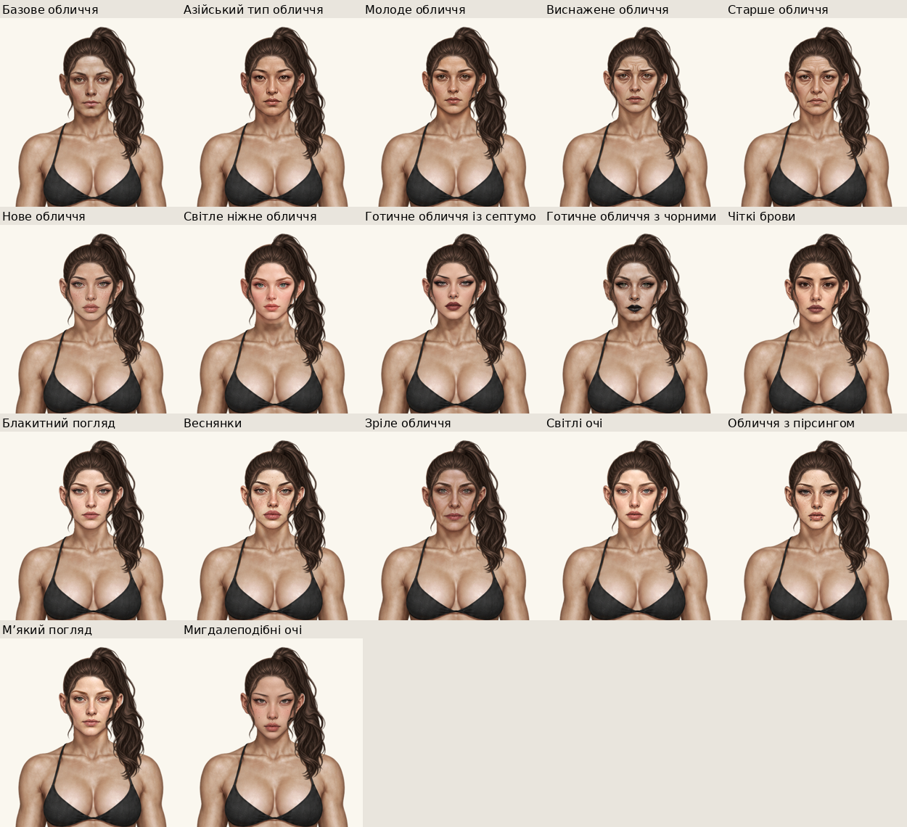
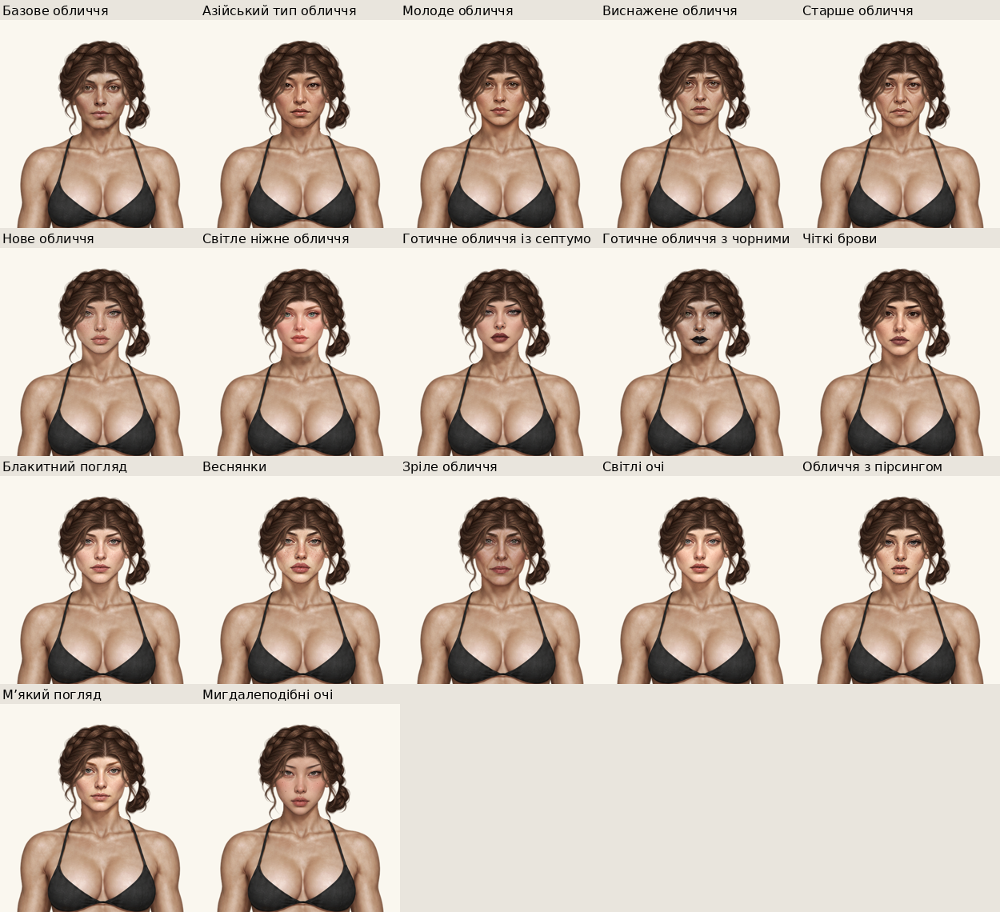

# П’ять нових жіночих зачісок

> Це звіт первинного додавання. Подальшу програмну корекцію, остаточні PNG,2125кольорових комбінацій і відомий дефект чоловічої бази описано в [актуальному аудиті](../female-five-fit-audit/README.md). Галерея тут оновлена під фінальні ресурси.

Локальна робота безпосередньо в **main**, базовий HEAD `6803d21`. Попередні незакомічені правки пробної зачіски збережені; нові варіанти не підміняють її. На цьому первинному етапі commit/push не виконувалися; подальшу інтеграцію вmain описано в актуальному аудиті.

Вибір: **Гардероб → Жінка → Зовнішність → Зачіски → назва → Обрати**. У кожної зачіски свій ID і PNG, тому її можна окремо прибрати. Палітра та стандартний колір «Оригінальний» працюють через чинний механізм.

[Крупні плани2×](five-details.png) · [HTML-галерея](index.html) · [Браузерні результати](browser-check.json) · [Параметри й SHA-256](registration.json).

## Різні форми

| Зачіска | ID | Форма |
|---|---|---|
| Коротка піксі | `hair-f5-pixie` | Коротка текстурована верхівка, відкриті вуха, коротка потилиця |
| Каре до щелепи | `hair-f5-jaw-bob` | Округлий силует, кінчики біля щелепи, легкий чубчик |
| Довгі вільні хвилі | `hair-f5-long-waves` | Великі вільні хвилі до грудей, бічний проділ |
| Високий хвіст | `hair-f5-high-ponytail` | Зібрана верхівка, асиметричний хвіст праворуч до плеча/грудей |
| Зібрана коса | `hair-f5-braided-updo` | Коса навколо голови, бічний низький вузол, короткі передні пасма |

Це п’ять окремих силуетів і укладань, а не перефарбування еталонної зачіски. Нові ресурси створено через `image_gen` за фактичним аватаром і якістю затвердженого волосся. Збережені вихідні PNG в `sources/`. Художній вигляд передається користувачу для оцінки; автоматичні перевірки не оголошуються доказом ідеальної художньої якості.

## Геометрія і підготовка

Виміряно **всі17 активних жіночих варіантів**, включно з render-only базовою головою. Верх alpha≥128 — y33, максимальна ширина рядка в зоні вух176, x385…560, вісь472.5. Результати для кожного ресурсу — [head-geometry.json](head-geometry.json). Нормалізація жіночої базової голови вже реалізована через `PAPER_DOLL_NATIVE_HEADS`; оригінальний PNG тіла не змінювався.

Генератор повернув власні розміри джерел, тому PNG спочатку рівномірно зареєстровані на941×1672. Координати нижче — **лише підготовка джерела**, не runtime-зсув голови чи готового волосся. Кінцевий runtime для всіх п’яти: **x0, y0, width941, height1672, scale1**, слой9 над головою1 і тілом0. Рендерер, crown contours, маски та старі посадки не змінені.

| Джерело | Розмір | Рівномірний scale | tx | ty | Верх фінальної альфи |
|---|---|---:|---:|---:|---:|
| `pixie.png` | 1006×1564 | 0.3 | 322.5 | 0 | 4 |
| `jaw-bob.png` | 979×1606 | 0.3 | 325.5 | -6 | 23 |
| `long-waves.png` | 979×1606 | 0.3 | 325.5 | -6 | 23 |
| `high-ponytail.png` | 1005×1565 | 0.3 | 325.5 | -14 | 2 |
| `braided-updo.png` | 979×1606 | 0.3 | 325.5 | -12 | 29 |

Для хвоста перевірено верхній край і додано запас під час підготовки: навіть слабка альфа не торкається краю. У джерелі зібраної коси знайдено відокремлену сторонню позначку у верхньому лівому куті; тільки порожню щодо волосся область `(0,0)–(80,80)` виключено з альфи під час підготовки. Оригінал збережено. Загального erosion/dilation, заливання природних отворів чи розмиття волосся немає. Технічна очистка віддалених слабких пікселів виконується до інтеграції; напрямки пасом і природні прозорі отвори зберігаються.

Підготовку відтворює `python tools/prepare-female-five-hairstyles.py`. Віддалених слабких пікселів і відокремлених компонентів у фінальних PNG **0** для кожного; діагностичні кандидати темного/світлого краю не вважаються автоматично дефектами. [Повна діагностика](png-quality.json) · [Маніфест файлів і SHA-256](manifest.json).

## Фактична перевірка

- Основний **index.html**, production `renderPaperDollAt`, справжній Chromium; без генерованих замінників аватарів.
- **85/85 нових комбінацій**: 5зачісок ×17жіночих голів, окремі знімки в `captures/` та матриці нижче.
- Для кожної зачіски еталон `face-young` додатково перевірено в original/black/white на світлому, сірому, чорному та зеленому фоні —60контрольних кадрів. Це не означає всі25кольорів на кожній голові.
- Перевірено вибір справжньої картки, збереження кожної зачіски/обличчя/кольору після reload, окремі комплекти «Пацієнт / Трип» і туніку; нових варіантів немає в чоловічому каталозі. Зняття прибирає шар; ігровий прогрес, характеристики, інвентар та спорядження не змінюються.
- Порядок тіло0 → голова1 → волосся9 перевірено в кожній із85комбінацій. Новий rear-layer не знадобився: у хвоста видима маса розташована збоку від обличчя й шиї. Наявні задні пасма чоловічих зачісок не редагувались.
- Справжній гардероб і центральна сцена зняті окремо. Мобільні320/390px — **емуляція Chromium**, не фізичний телефон. JS errors0, HTTP errors/4040.
- Візуально переглянуто всі п’ять матриць на17голів, індивідуальні великі примірки та білий колір хвоста. Короткі й зібрані зачіски природно відкривають вуха; довгі стилі мають передні пасма, які можуть закривати зовнішній край брови/щоки за дизайном, але не перекривають центральну частину обличчя.

## Тести поточного запуску

- JavaScript: **95/95**, з них5нових сценаріїв доступності, reload, кольору, спільної зовнішності й окремого видалення.
- Новий `tests/test_female_five_hairstyles.py`: **5/5** — незмінність попереднього каталогу й125захищених ресурсів і fixtures, п’ять точних ID, RGBA/поля/центральний виріз обличчя/слабка альфа, фактична геометрія17голів та актуальна браузерна матриця з SHA ресурсів.
- `tests/test_trial_braided_curls.py`: **6/6** регресій затвердженої зачіски.
- `tests/test_female_faces.py`: **9/9**, включно з8історичними жіночими обличчями ×14зачісками ×3кольорами, reload та мобільним вибором. Лог: `test-logs/female-regression.log`.
- Розширена наявна браузерна матриця **126комбінацій** (6історичних типів облич кожної статі, дозволені зачіски, original/white та4фони) і перевірка зареєстрованих шляхів: **2/2**. Лог: `test-logs/additional-regression.log`.
- Разом **95 JavaScript +22 Python/Chromium =117 успішних тестів**. Окремий інструмент знімків також фактично пройшов85нових комбінацій; ці85сценаріїв не додаються до лічильника unit-тестів.

Історичні тести точного каталогу відокремлюють лише п’ять явних нових ID; усі старі дані продовжують порівнюватися точно. Розміри матриць оновлені відповідно до14жіночих варіантів волосся разом із «Без зачіски»; кількість чоловічих варіантів лишилася7. Новий тест вимагає саме п’ять названих нових ID та незмінність усіх інших елементів. Невдалий перший запуск додаткових тестів із неправильної робочої директорії збережено в `loader-invocation-error.log`; це помилка імпорту, а не замовчаний результат тесту. Повний загальний Python-набір цього проходу не запускався.

## Матриці всіх жіночих голів

### Коротка піксі

### Каре до щелепи

### Довгі вільні хвилі

### Високий хвіст

### Зібрана коса

## Змінені файли та окреме видалення

Ігрові файли: п’ять PNG у `assets/wardrobe/hair/female-five/`, окремий `preview.css` тільки для мініатюр нових ID, п’ять записів у `paper-doll-data.js` та версія підключення даних/нового CSS в `index.html`. Карткове збільшення не застосовується до екіпірованого волосся.

Допоміжні: `tools/prepare-female-five-hairstyles.py`, `tools/review-female-five-hairstyles.py`, новий тест і актуалізація точних каталожних лічильників у наявних тестах; поточний звіт, джерела, SHA, знімки й галерея. У README та `docs/paper-doll.md` додано локальний статус без заяви про публікацію.

Щоб прибрати один варіант, прибрати лише його запис ID й PNG та відповідний рядок у списку інструмента підготовки. Інші чотири не залежать від нього. Поточний рендер уже відображає невідомий/відсутній ID волосся як `hair-none`; окремий регресійний тест перевіряє цей сценарій для кожного нового варіанта. Структура збережень і ключі localStorage не змінювались.
