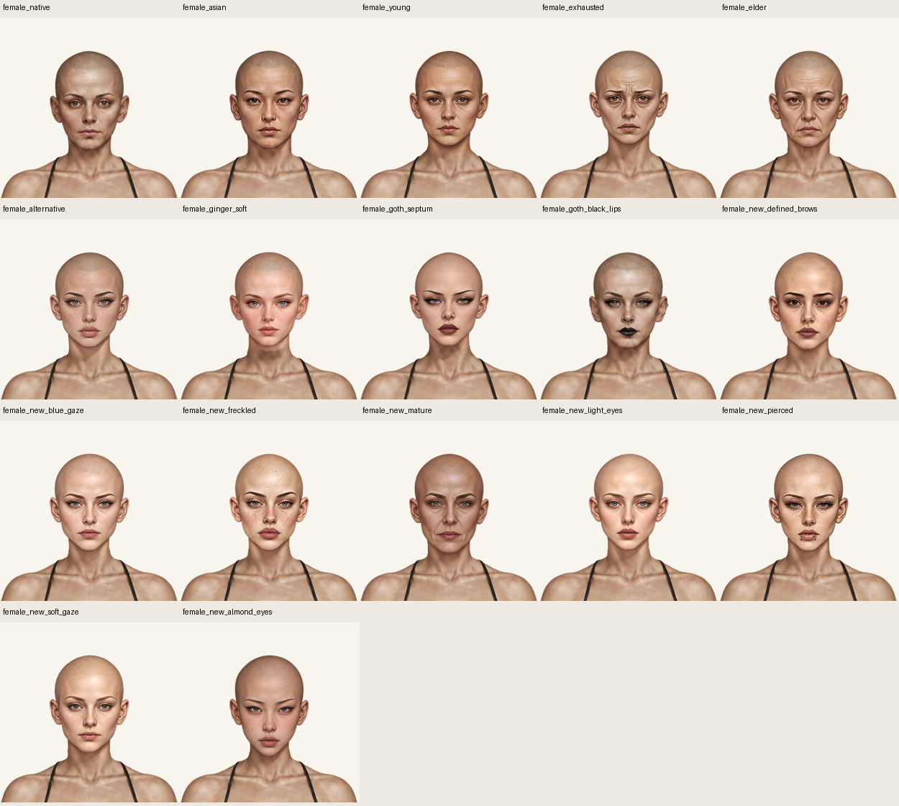
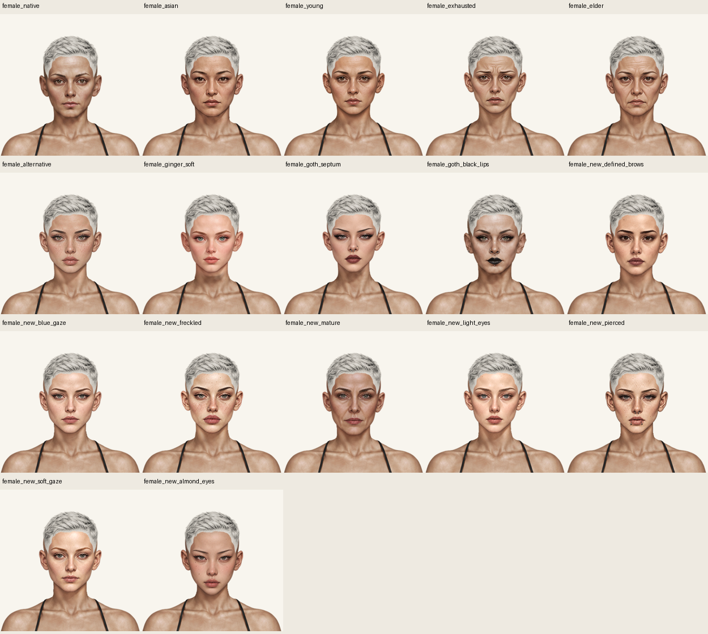

# Єдина жіноча рамка для зачісок

Еталон — **«Молоде обличчя» / `face-young`**. Робота виконана в `main` від `fd20bc3`; точка відновлення — `backup/before-female-head-standard-20261019`. Вирівняно 17 жіночих варіантів, включно з оригінальним. Чоловічі голови, тіла, зачіски, одяг і палітра не змінені.

[Відкрити галерею](index.html) · [ZIP для генерації зачісок](hair-generation-template.zip) · [Чистий PNG голови](template/reference-head.png) · [Голова з тілом](template/reference-body.png) · [Розмітка](template/geometry-guide.png) · [Точні параметри JSON](template/hair-template.json) · [Готовий промпт](template/HAIR_GENERATION_PROMPT_UK.txt).

## Спільні параметри

| Параметр | Значення у натуральних пікселях Paper Doll |
| --- | --- |
| Полотно / формат | 941 × 1672, RGBA PNG, прозорий фон |
| Початок координат | верхній лівий кут |
| Межі голови з вухами | x=385…560 включно, ширина 176 |
| Вісь | x=472.5 |
| Верх шкіри маківки | y=33; волосся може бути вище |
| Верхній контур усіх голів до y=124 | x=394…549, загальна область 156 × 92 |
| Готова повнорозмірна зачіска | x=0, y=0, width=941, height=1672, scale=1 |
| Шари | заднє волосся −1 (за потреби), тіло 0, голова 1, переднє волосся 9 |

Геометрію виміряно за alpha≥128. Це **спільна монтажна рамка**, а не однакова анатомія: форма вух, довжина щелепи й підборіддя залишилися індивідуальними. Ряд максимальної ширини вух — y=133…148. Однакова рамка полегшує створення волосся, але не замінює примірку коротких пасом біля вух на всіх варіантах.

Орієнтири очей/скронь у JSON приблизні, визначені візуально. Чистий PNG — основний еталон. Не обрізайте прозорі поля. Для крупного генеративного редагування є crop 270×420 від (340,0), збільшений у 4 рази до 1080×1680; повернення — scale=0.25 і позиція (340,0). Сам текстовий промпт не гарантує точного суміщення.

## Реалізація

- Для 16 змінених варіантів створено окремі похідні PNG у `assets/wardrobe/faces/standardized/` та парні маски в `assets/wardrobe/faces/masks/standardized/`. Застосовано тільки рівномірний масштаб і перенесення; портретний RGB не перемальовувався й не перефарбовувався.
- Оригінальний `female_young_head.png` та його маска залишилися байт у байт незмінними. Збережено всі джерела й контрольні суми. Дані реєстрації — [registration.json](registration.json), кінцеві точні перетворення й хеші — [manifest.json](manifest.json).
- Нижню частину нових накладок зведено з незмінним тілом через взаємодоповнювальну пару голова/маска. Центр переходу x=472.5, радіус65; початок y=265 у центрі /245 збоку, завершення y=290/275; від y=300 тіло точно оригінальне. Непрозорість внутрішньої шкіри збережена; округлення альфи маски вгору усуває втрату непрозорості на стику.
- Базове жіноче обличчя вирівняно окремою внутрішньою накладкою `PAPER_DOLL_NATIVE_HEADS.female`; `base_female.png` не змінений. У сейві базовий вибір досі `null`, нового каталожного ID немає, формат збереження не змінений. Чоловічий native-рендер працює як раніше.
- Runtime placement усіх готових накладок: x=0, y=0, width=941, height=1672. У таблиці нижче — **перетворення підготовки вихідного PNG**, а не нові координати runtime.
- Версії PNG у каталозі — за SHA-256; `index.html` оновлює версії data/renderer.

## Реєстрація всіх жіночих варіантів

| Обличчя | uniform scale | tx | ty | Ряд ширини вух |
| --- | ---: | ---: | ---: | ---: |
| Оригінальне обличчя (`native/null`) | 1.03529411765 | -15.6411764706 | 9.18823529412 | 140 |
| Азійський тип обличчя (`face-asian`) | 1.06024096386 | -27.4036144578 | 2.25301204819 | 135 |
| Молоде обличчя (`face-young`) | 1 | 0 | 0 | 140 |
| Виснажене обличчя (`face-exhausted`) | 1.01149425287 | -4.41954022989 | 1.64367816092 | 135 |
| Старше обличчя (`face-elder`) | 1.04142011834 | -21.1331360947 | 3.79881656805 | 133 |
| Нове обличчя (`face-alternative`) | 1 | 3 | 5 | 134 |
| Світле ніжне обличчя (`face-ginger-soft`) | 1.11392405063 | -51.6012658228 | -7.10126582278 | 133 |
| Готичне обличчя із септумом (`face-goth-septum`) | 0.994350282486 | 5.15536723164 | 7.14689265537 | 134 |
| Готичне обличчя з чорними губами (`face-goth-black-lips`) | 1.00571428571 | -3.20285714286 | 10.8742857143 | 148 |
| Чіткі брови (`face-female-new-defined-brows`) | 1.03529411765 | -15.6411764706 | 9.18823529412 | 140 |
| Блакитний погляд (`face-female-new-blue-gaze`) | 1.03529411765 | -15.6411764706 | 9.18823529412 | 140 |
| Веснянки (`face-female-new-freckled`) | 1.03529411765 | -15.6411764706 | 9.18823529412 | 138 |
| Зріле обличчя (`face-female-new-mature`) | 1.03933727811 | -17.0278579882 | 9.09524260355 | 137 |
| Світлі очі (`face-female-new-light-eyes`) | 1.03529411765 | -15.6411764706 | 9.18823529412 | 136 |
| Обличчя з пірсингом (`face-female-new-pierced`) | 1.03529411765 | -15.6411764706 | 9.18823529412 | 140 |
| М’який погляд (`face-female-new-soft-gaze`) | 1.03529411765 | -15.6411764706 | 9.18823529412 | 137 |
| Мигдалеподібні очі (`face-female-new-almond-eyes`) | 1.03529411765 | -15.6411764706 | 9.18823529412 | 143 |

## Реальні контрольні зображення

Повні контактні таблиці всіх зачісок: [варіанти1–6](hair-matrix-1.webp), [7–12](hair-matrix-2.webp), [13–17](hair-matrix-3.webp).

У галереї для кожного варіанта є ДО/ПІСЛЯ, чотири фони та всі вісім жіночих варіантів волосся. Зображення отримано з фактичного `index.html` через `renderPaperDollAt`, не з окремого імітатора. ДО використовує джерела й маски `fd20bc3`; ПІСЛЯ — поточні ресурси, з тим самим масштабом. Порівняння еталонного young ідентичне піксельно.

- [Результат матриці](geometry/result.json): 199 станів у Chromium, 136 жіночих і 63 чоловічих, оригінальний колір; 26 повноростових знімків і перевірок reload.
- [Окремі перевірки](captures/result.json): усі 17 жіночих голів на білому, сірому, чорному й зеленому фоні; classic/textured у black/white; туніка; desktop і емуляція ширин320/390/768. JS errors та HTTP errors — 0.
- Чоловічі 63 знімки ідентичні піксельно попередній опублікованій бібліотеці. Окремі тести перевіряють незмінні вихідні PNG, ресурси, маски, геометрію, RGB після рівномірного перетворення, непрозорість шиї, native/null і збереження всіх 17 виборів.
- [Аудит PNG](png-quality.json): 34 активні жіночі голови/маски. Кандидати на особливості контуру — діагностика, не автоматичний висновок про художній дефект.

### Межі перевірки

Спеціального повного прогону 17×8×25 кольорів не було: матриця знята в original, проблемні короткі зачіски додатково в black/white. Палітра й PNG волосся не змінювалися. Перевірено Chromium та емуляцію екранів, не фізичний телефон. Індивідуальна анатомія вух/щелеп збережена; майбутні дуже короткі зачіски потребують примірки на всій бібліотеці.

Початковий строгий тест альфа-шуму `base_male.png` фіксує 4234 віддалені слабкі пікселі в незмінному чоловічому джерелі. Це успадкована від `fd20bc3` відома проблема; заради поточного жіночого завдання чоловічий PNG не змінювався, поріг тесту не послаблений.

Діагностика незмінного еталона також бачить 4 слабкі пікселі в зоні згасання шиї y263…264, не на контурі черепа; відокремлених компонентів там немає. Похідні голови мають 0 віддалених слабких пікселів.

Поточні результати тестів і публікації наведено в [verification.json](verification.json); історичні звіти не замінено.

## Змінені файли

Каталог/рендер/кеш: `paper-doll-data.js`, `paper-doll.js`, `index.html`. Нові 16 голів +16 масок у підкаталогах `standardized/`. Інструменти: `tools/standardize-female-heads.py`, `tools/build-female-hair-template.py`, `tools/review-female-head-standard.py`, `tools/build-female-head-standard-report.py`; два аудитори враховують внутрішню native-накладку. Регресійні тести й runner доповнено; історичні перевірки незмінних оригіналів збережено, старі URL-контракти прив'язані до історичного `fd20bc3`, поточні похідні перевіряються окремо точними хешами. Навігацію README й документацію актуалізовано.

Фінальний запуск: **89/89 JavaScript; 141/142 Python/Chromium**. Єдиний збій — описаний вище незмінний чоловічий PNG. Сирі журнали збережено у `verification/final/`, початкові невдалі очікування — у `verification/initial/`; повторні запуски не підміняють початкових результатів.

## Підтверджена HTTPS-публікація

Функціональний коміт `bb065a7` у main: [GitHub Pages](https://github.com/neverl1ke/palata404/actions/runs/39420728654) — success. У [реальній опублікованій грі](https://neverl1ke.github.io/palata404/) перевірено 133 файли за SHA-256, 95 станів і 26 перезавантажень, 0 JS errors / HTTP errors. Перевірено також URL галереї, ZIP, еталонного PNG та JSON. [Машинний результат](verification/published-https.json) · [Мобільний знімок опублікованої гри](captures/published-mobile-390.png). Повний Game checks на момент запису ще триває; успіх CI не заявляється. Наступний коміт додає тільки цю документацію й докази, без змін runtime.
