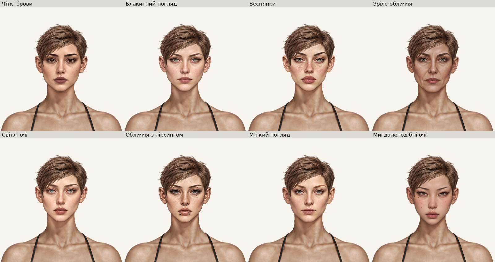

# Нові жіночі голови — інтеграція на чоловічій основі

Робота виконується в локальному `main` за уточненням власника. `origin/main` на початку — `03a4b98`; чоловічу роботу перенесено fast-forward до `cbe74df` (включає `819c0a3`). Віддалений main і GitHub Pages на цьому етапі не оновлювалися: публікація потребує окремої команди.

Точки відновлення: `backup/main-before-male-female-20261019` → `03a4b98`; `backup/before-female-heads-20261019` → `cbe74df`.

## Перегляд

- [Відкрити галерею у браузері](index.html).
- [Галерея у Markdown](GALLERY.md).
- [Оригінальні файли → робочі ресурси → ID](SOURCE_MAPPING.md).
- [Вуха ×4 та шийні стики ×2](ear-neck-details.webp).

HTML треба відкривати як вебсторінку, а не переглядати її вихідний код. Усі зображення локальні; зовнішні бібліотеки й fetch не потрібні.

## Що додано та збережено

Архів «Голова 2.rar» містить 8 жіночих портретів із шиями. Усі оригінали збережені побайтно в `sources/`. Додано 8 окремих жіночих ID з префіксом `face-female-new-`; жодне старе обличчя не замінено. Чоловік має 8 накладок плюс базову голову, жінка — 16 плюс базову голову. Відповідно, поточна матриця в оригінальному кольорі — 9×7 + 17×8 = 199 станів.

Чоловічі ресурси з review-гілки, бази обох статей, усі попередні жіночі PNG/маски, зачіски, одяг, палітра, `paper-doll.js`, `wardrobe.js`, `style.css` незмінні щодо `cbe74df`. Це перевіряється хешами в `integration-manifest.json` та окремим тестом. Порівняння з попереднім origin/main також містить раніше погоджену чоловічу інтеграцію; вона навмисно перенесена, а не виконана повторно.

## Реєстрація та тон

Масштабування тільки рівномірне. За поточною жіночою базою виміряно зовнішній розмах вух близько 170 px; верх сильного альфа-контуру — близько y=23, центр між вухами x=471.5. Для кожного джерела окремо визначено початкові орієнтири, масштаб та перенесення. Збережено відмінності форми облич, вік, пірсинг, родимки й веснянки. Чоловічі коефіцієнти не копіювалися.

Нижче наведено **перетворення вихідного портрета**, а не runtime-placement:

| Назва | Рівномірний scale | x | y | RGB gain шкіри |
|---|---:|---:|---:|---|
| Чіткі брови | 0.278232405892 | 317.915711947627 | 6.027823240589 | 1.150000 / 1.150000 / 1.150000 |
| Блакитний погляд | 0.257966616085 | 338.905159332322 | -3.570561456753 | 1.127389 / 1.150000 / 1.150000 |
| Веснянки | 0.266040688576 | 346.460876369327 | -40.583724569640 | 1.085890 / 1.150000 / 1.150000 |
| Зріле обличчя | 0.281923714760 | 338.995854063018 | -53.119402985075 | 0.921875 / 0.936620 / 0.972727 |
| Світлі очі | 0.259541984733 | 338.354961832061 | -19.564885496183 | 1.149351 / 1.150000 / 1.150000 |
| Обличчя з пірсингом | 0.274193548387 | 342.766129032258 | -59.806451612903 | 1.149351 / 1.150000 / 1.150000 |
| М’який погляд | 0.255255255255 | 327.153153153153 | 6.153153153153 | 1.134615 / 1.150000 / 1.150000 |
| Мигдалеподібні очі | 0.272873194222 | 325.239967897271 | -8.107544141252 | 1.035088 / 0.977941 / 0.955357 |

Точні неокруглені значення й джерельні SHA-256: [registration.json](registration.json). Runtime-placement усіх восьми готових PNG: **x=0, y=0, width=941, height=1672**.

Корекцію тону дозволено власником. Коефіцієнти виміряно за непрозорою центральною зоною шиї щодо тіла, обмежено 0.85–1.15 і застосовано зі згладженою селекцією шкіри. Темні прикраси, брови, очі й макіяж не перефарбовуються суцільною заливкою. Текстура не розмивається. Порівняння ДО означає первинну реєстрацію **того самого нового портрета** до тонового узгодження та RGB-переходу нижньої шиї; це не підміна попередньої версії гри.

## Маски та шийний стик

Використано принцип парних масок чоловічого механізму, але жіночий профіль визначено заново. Початок переходу y=222 у центрі /207 збоку, кінець y=271/250; центральна вісь x=472, радіус 62. Профіль плавний, за квадратичною дугою; RGB нижнього стику узгоджується з фактичним тілом. Із y=277 результат побайтно збігається з поточною базою.

Для кожної голови збережено власний файл маски. У нормалізованому нижньому переході вони мають однакові байти — це допустимий результат, перевірений на кожній фактичній композиції, а не вимога штучно робити хеші різними. Власні контури голів зберігаються у відповідних накладках. Перевірено відсутність центральних альфа-отворів, старої голови та від’єднаного сильного силуету.

Після фінального стику повторно прибрано лише від’єднані компоненти alpha≤16. У нових головах немає віддалених слабких пікселів або відокремлених компонентів. `png-quality.json` також містить кандидати на темні краї та однопіксельні виступи: вони не є автоматично доведеними помилками. Візуальні крупні плани показують природну темну обводку вух та звичайне згладжування у фактичному ігровому масштабі; довільне стирання таких пікселів не виконувалося.

## Каталог, шари та збереження

Нові записи мають `genders: ['female']`, `fittedToGender: true`, жіночі `genderVariants`, `bodyMaskByGender`, `renderOrder: 1` і повнорозмірний placement. Кожен PNG підключений з версією власного SHA-256; версію `paper-doll-data.js` у `index.html` оновлено.

Збережено тіло → голова → переднє волосся, існуючий чоловічий rear hair та порядок одягу. Crown contours і координати зачісок не змінено. Ключ localStorage, schemaVersion=2, старі ID й окремі комплекти «Пацієнт / Трип» незмінні. Нові обличчя відхиляються для чоловічої статі; некоректний вибір нормалізується штатним механізмом. Статистика й інвентар перевіряються на незмінність у браузерних тестах.

## Перевірки

Фактичні підсумки поточного запуску наведені в `test-results.json`, результати браузерних проходів — `geometry/result.json`, `captures/result.json`, `review-captures/result.json`. Історичні тести й чоловіча галерея не перезаписуються.

Сценарії перевірки: справжній `index.html`, обидві сцени, усі допустимі зачіски, чинна палітра, світлий/сірий/чорний/зелений фони, туніка, окремі комплекти, перемикання статі, reload, JS та HTTP-помилки. Повну палітру нових голів перевіряємо як 8×8×25=1600 станів; окремі знімки зберігаються для original/black/white (192), для решти кольорів — результати завантаження й стану. Це не означає ручного огляду всіх 1600 станів.

## Межі перевірки та відомі обмеження

- У чоловічій базі, перенесеній без змін, зберігається відомий alpha-шум: суворий тест знаходить 4234 віддалені слабкі пікселі. Його не послаблено й ресурс не змінено в межах жіночої інтеграції.
- Відомі історичні слабкі сліди чоловічих шийних масок не виправлялися; див. попередній `issues.json`.
- Активний предмет головного убору `gear-helmet` не має PNG (`image:null`). Візуальну сумісність із неіснуючим ресурсом перевірити неможливо; шарувальний механізм не змінювався.
- Мобільні перевірки — емуляція Chromium, не фізичний телефон. Перевірка інших рушіїв не заявляється.
- Художня відповідність остаточно оцінюється власником. Оригінальні особливості портретів, включно з різницею макіяжу та природного підтону, не перероблялися.
- Push, Actions, GitHub Pages і онлайнова гра цим локальним етапом не оновлювалися.

## Відтворення

```sh
python tools/prepare-new-female-heads.py
python -m unittest tests.test_new_female_heads -v
node --test tests/game-logic.test.cjs
python tools/build-new-female-gallery.py
```

Для нових знімків використовуйте нову вихідну папку, не перезаписуйте завершені докази. Повний набір початкових трансформацій, захищених хешів та параметрів переходу збережений у маніфестах.

## Таблиця виявлених проблем

| Файл / група | Причина | Виправлення / статус |
|---|---|---|
| `download.png` | Різні вихідні розміри й реєстрація; тон шиї | Зареєстровано окремо; тон і стик узгоджено, контроль ДО/ПІСЛЯ доступний. |
| `ввв.png` | Різні вихідні розміри й реєстрація; тон шиї | Зареєстровано окремо; тон і стик узгоджено, контроль ДО/ПІСЛЯ доступний. |
| `Зображення ChatGPT 19 жовт. 2026 р., 19_04_35.png` | Різні вихідні розміри й реєстрація; тон шиї | Зареєстровано окремо; тон і стик узгоджено, контроль ДО/ПІСЛЯ доступний. |
| `Зображення ChatGPT 19 жовт. 2026 р., 19_04_41.png` | Різні вихідні розміри й реєстрація; тон шиї | Зареєстровано окремо; тон і стик узгоджено, контроль ДО/ПІСЛЯ доступний. |
| `Лисий портрет воїтельки.png` | Різні вихідні розміри й реєстрація; тон шиї | Зареєстровано окремо; тон і стик узгоджено, контроль ДО/ПІСЛЯ доступний. |
| `Лисий портрет із пірсингом taamatut.png` | Різні вихідні розміри й реєстрація; тон шиї | Зареєстровано окремо; тон і стик узгоджено, контроль ДО/ПІСЛЯ доступний. |
| `Реалістичний портрет лисої героїні.png` | Різні вихідні розміри й реєстрація; тон шиї | Зареєстровано окремо; тон і стик узгоджено, контроль ДО/ПІСЛЯ доступний. |
| `Реалістичний портрет лисої дівчини.png` | Різні вихідні розміри й реєстрація; тон шиї | Зареєстровано окремо; тон і стик узгоджено, контроль ДО/ПІСЛЯ доступний. |
| `base_male.png` | Історичний alpha-шум джерела | Збережено без змін, суворий тест залишається невдалим. |
| `gear-helmet` | Немає PNG | Візуальна перевірка неможлива. |

Машинозчитуваний перелік: [issues.json](issues.json).

## Фактичний підсумок завершеного запуску

| Перевірка | Результат |
|---|---|
| JavaScript до змін | 86/86 |
| JavaScript після додавання | **88/88** |
| Python/Chromium, 132 унікальні тести | **131 успішний, 1 відомий невдалий** |
| Нові тести жіночої інтеграції | 6/6 (4 ресурси, 2 браузерні) |
| Усі поточні обличчя × зачіски, original | **199 реальних примірок**, 26 перевірок reload |
| 8 нових голів × 8 зачісок × 25 кольорів | **1600 станів**, 192 знімки original/black/white |
| Додаткові знімки фону, стиків, туніки та UI | **187** |
| Мобільна емуляція | 320, 360, 390, 430, 768 px; усі 8 нових карток вибираються |
| Галерея через file:// | 9 HTML-сторінок; усі зображення завантажилися |
| Реєстрація ресурсів | 65 активних PNG; відсутніх посилань немає |

Повний перший Python-прогін мав 125 успішних тестів і 7 невдалих. Шість невдач були старими точними очікуваннями кількості карток/накладок/ресурсів: 8→16 жіночих карток, 16→24 накладки обох статей, 49→65 PNG. Їх виправлено відповідно до реально доданих ресурсів і повторно виконано всі шість сценаріїв; вони пройшли. Перевірки самих збережень, геометрії та ресурсів не прибиралися. Залишилася одна попередня невдача — 4234 слабкі віддалені пікселі `base_male.png`.

Точні ID, початкові невдачі та повторні запуски: [test-results.json](test-results.json), сирі журнали — `test-logs/`. Поле `passed` історичного shard-runner рахує лише повністю зелені групи; тут підсумок обчислено за фактичними результатами кожного унікального тесту, а не цим полем.

У первинному інструментальному проході Chromium спочатку бракувало встановленого браузера, потім мобільний сценарій звернувся до ще згорнутої палітри. Браузер встановлено, сценарій виправлено для натискання видимого перемикача палітри; повторний UI-прохід успішний. Початкові невдалі спроби збережені в `attempts/`. Це не приховані дефекти інтерфейсу.



[Джерельний контактний аркуш](source-contact.webp).

## Змінені файли

- `paper-doll-data.js` — 8 нових жіночих записів; `index.html` — версія кешу даних.
- `assets/wardrobe/faces/female_new_*_head.png` — 8 робочих накладок; `assets/wardrobe/faces/masks/female_new_*_body.png` — 8 відповідних масок.
- `tools/prepare-new-female-heads.py`, `capture-new-female-review.py`, `build-new-female-gallery.py`, `verify-new-female-gallery.py` — відтворення та контроль. Загальний capture-інструмент отримав фільтр статі/ID і вибір кольорів для знімків без скорочення перевірених станів.
- `tests/test_new_female_heads.py`, доповнення JavaScript-тестів та оновлення точних лічильників у старих перевірках; `tools/run-python-tests.py` реєструє новий браузерний клас.
- Кореневий README, `docs/paper-doll.md`, цей звіт, оригінали, маніфести та реальні знімки.

Повний перелік щодо чоловічої основи з хешами: [changed-files.json](changed-files.json). Ресурси чоловічого перенесення описані в попередньому маніфесті `review/male-heads-full-library/integration-manifest.json` і коміті `819c0a3`.

Після повторного запуску підготовки всі 4 ресурсні тести пройшли знову; SHA всіх ігрових ресурсів збігаються зі знімками початку завершених браузерних проходів.
