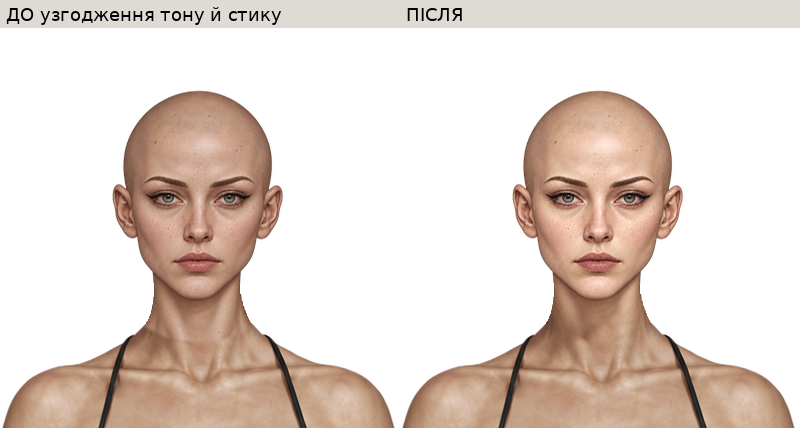
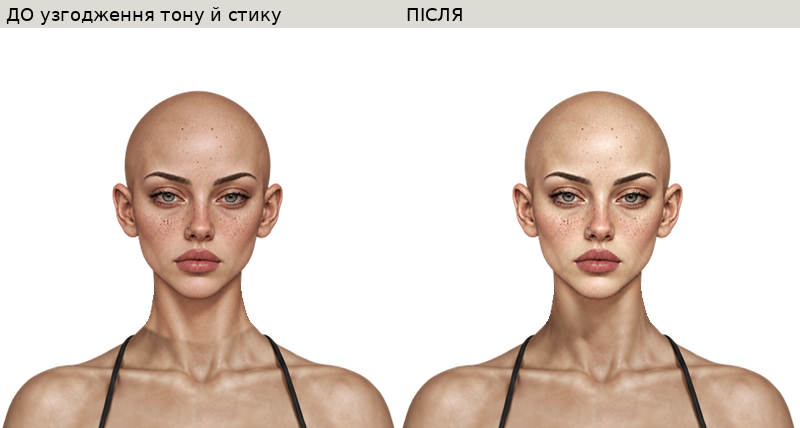
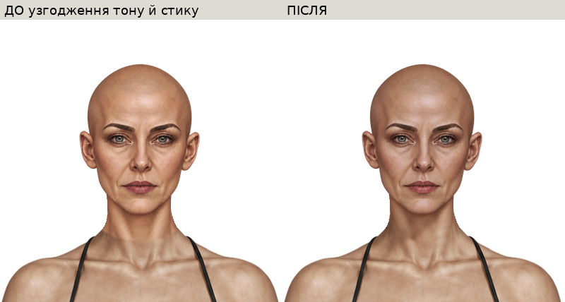
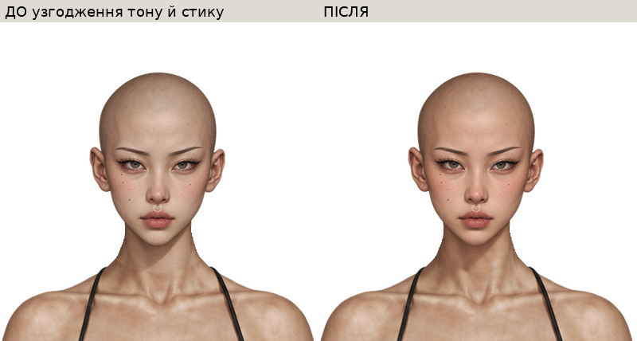
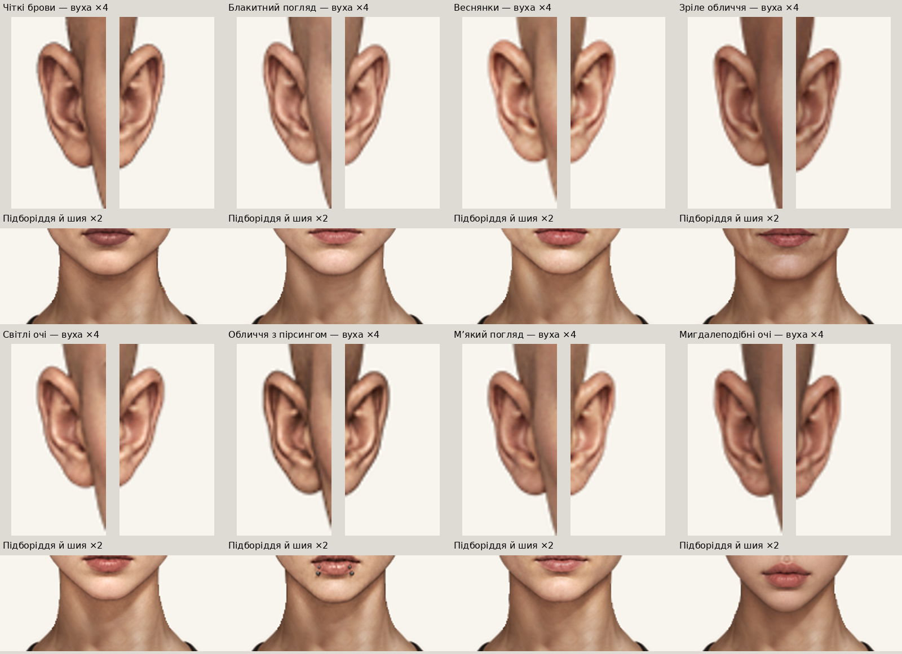
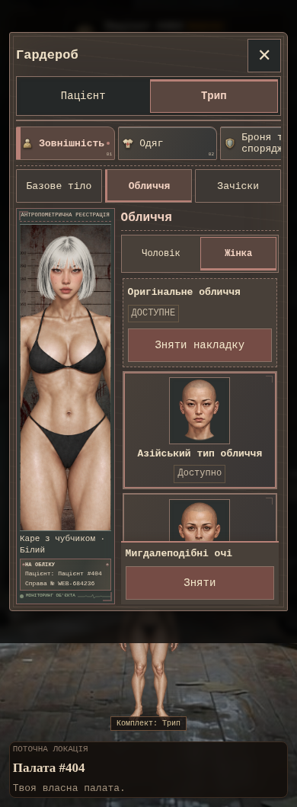

# Палата 404 — перегляд нових жіночих облич

Зображення відкриваються прямо на цій сторінці. Натисніть назву обличчя, щоб побачити ДО/ПІСЛЯ, всі зачіски, світле й темне волосся та перевірку на чотирьох фонах.

**Це контрольні знімки локальної інтеграції. Онлайн-гру ще не оновлено.**

[Повний звіт](../README.md) · [Відповідність джерел і назв](../SOURCE_MAPPING.md)

## [Чіткі брови](defined_brows.md)

## [Блакитний погляд](blue_gaze.md)

## [Веснянки](freckled.md)

## [Зріле обличчя](mature.md)

## [Світлі очі](light_eyes.md)

## [Обличчя з пірсингом](pierced.md)

## [М’який погляд](soft_gaze.md)

## [Мигдалеподібні очі](almond_eyes.md)

## Вуха та шийні стики крупним планом

## Гардероб на телефоні — емуляція Chromium

