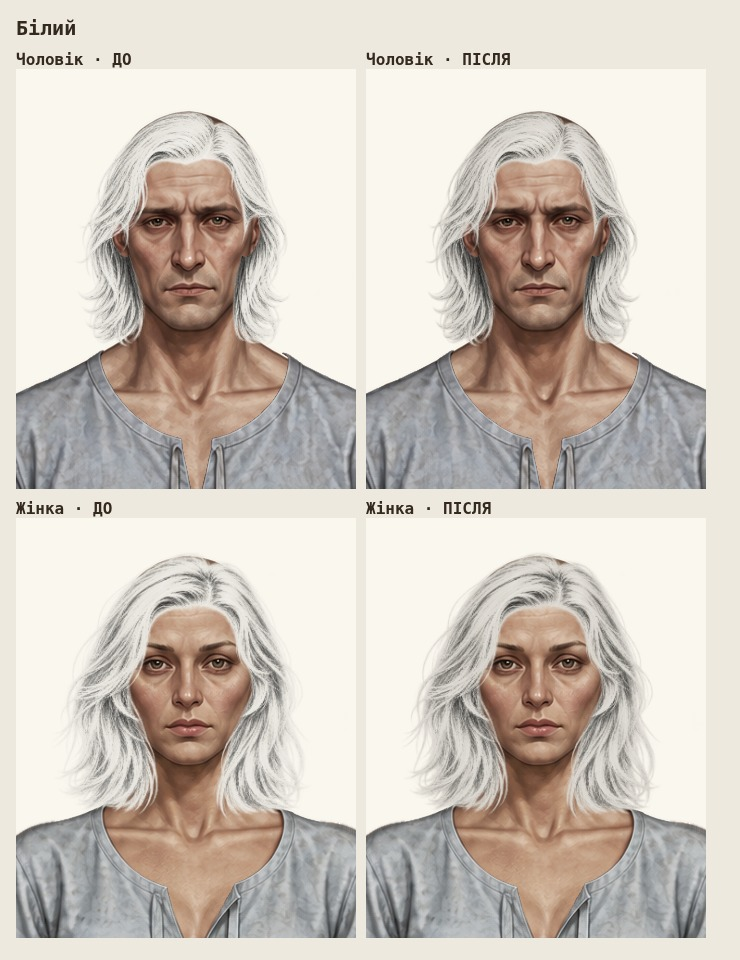
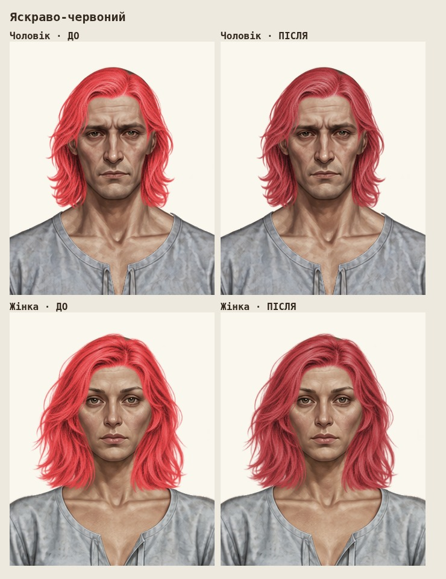
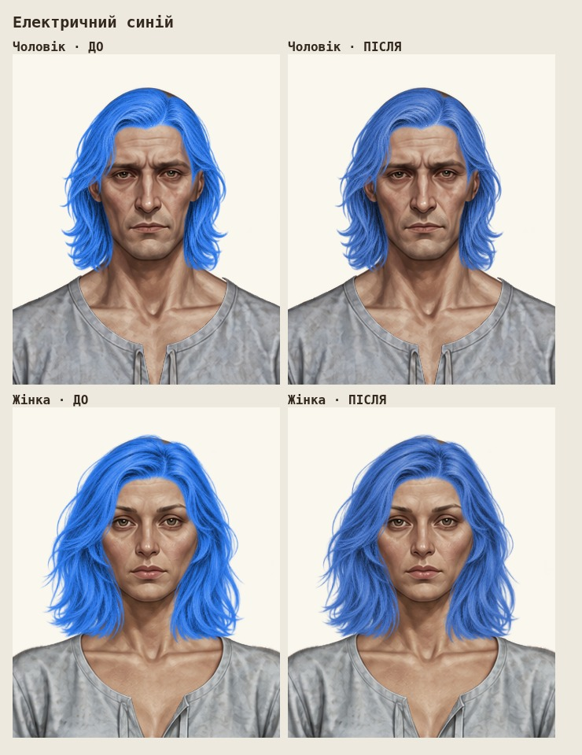
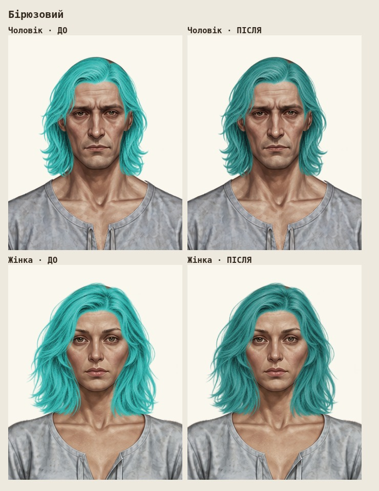
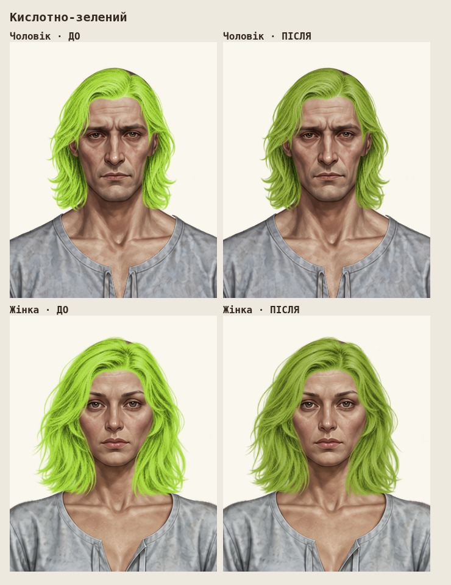

# Приглушення п'яти кольорів волосся

Вихідна версія: `f638cc70bd936a169d9cbfbea6b3f5a2e762385f`. Робоча гілка: `main`.

| Колір | До | Після |
| --- | --- | --- |
| Білий | `#E7E4DD` | `#D8D4CC` |
| Яскраво-червоний | `#E33F42` | `#B43A3F` |
| Електричний синій | `#2876EC` | `#3C6CC4` |
| Бірюзовий | `#2FB4AE` | `#2E8B87` |
| Кислотно-зелений | `#A5D834` | `#8AA62F` |

У грі змінені тільки п'ять HEX у `hair-color.js` та кеш-версія посилання на нього в `index.html`. Алгоритм перефарбування, решта 20 варіантів, PNG, реєстрація шарів, аватари, одяг, UI та структура гардероба незмінні. Додані лише цей звіт і п'ять JPEG-скриншотів перевірки.

## Порівняння до / після

Справжній ігровий `renderPaperDollAt`, затверджені PNG та поточні координати. Зліва — до, справа — після; верхній ряд — чоловік, нижній — жінка. Масштаб і світлий фон однакові. Для «до» завантажено незмінний модуль палітри з вихідного коміту; для «після» — оновлений модуль. Зображення не генерувалися й не перемальовувалися.

### Білий

### Яскраво-червоний

### Електричний синій

### Бірюзовий

### Кислотно-зелений

## Перевірки

- 66 тестів Node — успішно.
- Існуючий браузерний тест палітри — успішно: всі 25 варіантів, обидві статі, прозорість, збереження, перемикання, геометрія та адаптивність.
- Додаткова фактична примірка всіх п'яти змінених кольорів на чоловічому та жіночому аватарі: 10 поєднань. Альфа-канал збігається піксель у піксель з оригінальним PNG, тональна різноманітність пасом збережена. Помилок JavaScript немає.
- Перевірка різниці з вихідним кодом: поза п'ятьма HEX логіка `hair-color.js` ідентична.
