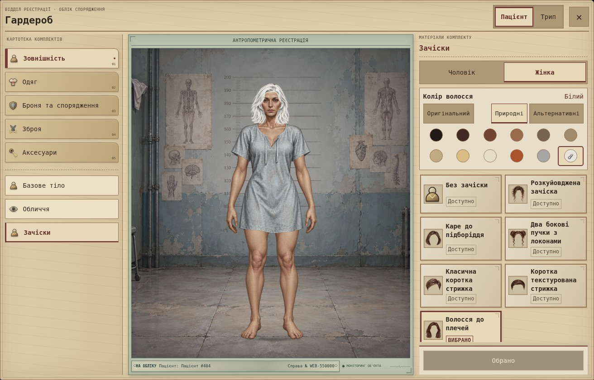
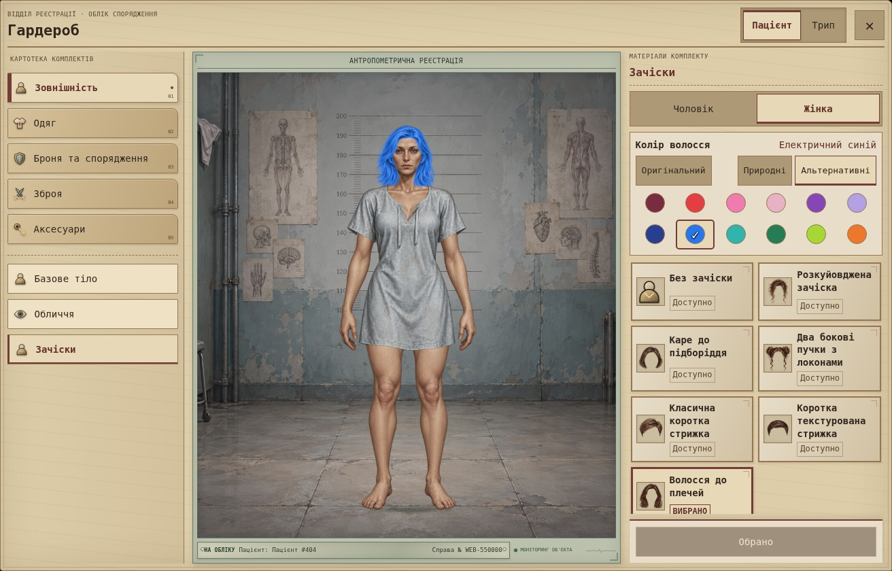
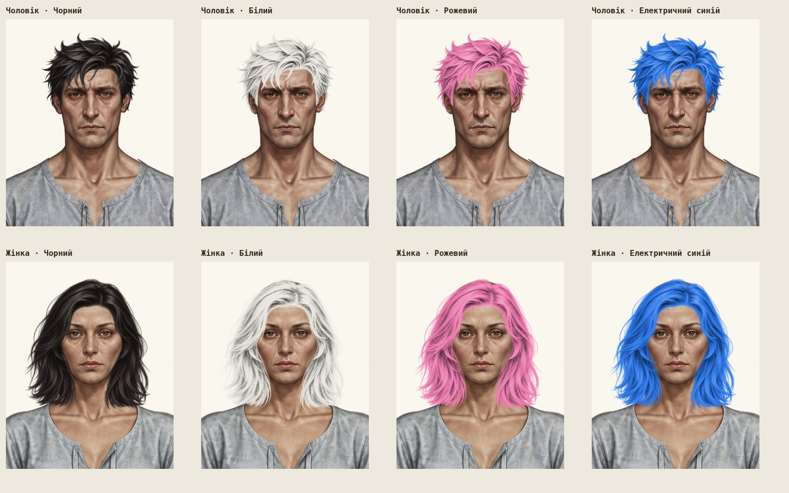
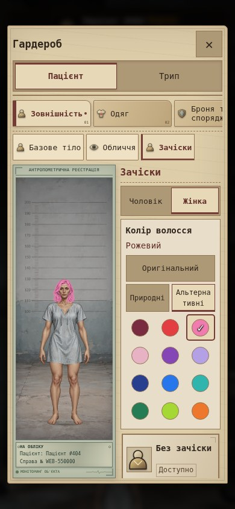

# Гардероб: зовнішність і колір волосся

Робоча гілка: `main`. Точка повернення перед змінами: `4252687737f6ac49211aa6fa20dce7cc07e64d95`.

У головній картотеці п'ять категорій. «Зовнішність» містить «Базове тіло», «Обличчя», «Зачіски». Картки показують назву один раз; службові описи залишені в даних, але не виводяться для зачісок.

Палітра: 12 природних, 12 альтернативних кольорів та «Оригінальний». Усі HEX відповідають завданню. Колір спільний для двох комплектів і зберігається як `appearance.hairColor` у чинному збереженні Paper Doll, без зміни версії схеми. Старі або невідомі значення означають «Оригінальний».

Canvas перетворює лише RGB шару волосся, переносить освітлення пасом на вибраний пігмент і не змінює альфа-канал. Оригінальний режим використовує вихідний URL PNG. Кеш містить до 24 результатів за ключем «URL ресурсу з версією + колір»; спільні запити HUD та гардероба об'єднуються. Захист від застарілих асинхронних результатів не дозволяє старому кольору або статі підмінити новий вибір. Якщо перефарбування не вдалося, показується оригінал та повідомлення з можливістю повторного вибору.

**PNG, бази, туніки, всі визначення предметів і `placementByGender` залишилися незмінними.** Зміна в `paper-doll-data.js` стосується тільки категорій. Бойова логіка та інвентар не змінені.

## Реальні скриншоти

Скриншоти Chromium із локально запущеної гри. Збільшені голови зібрано тим самим `renderPaperDollAt`, тими самими PNG та незміненими координатами; це не генерація зображень.

### Гардероб і природні кольори

### Альтернативні кольори

### Чорний, білий, рожевий та електричний синій

### Телефон — емуляція viewport 390×844

На вузьких екранах категорії прокручуються горизонтально, права колонка доступна через прокручування. Усі елементи палітри мають область натискання щонайменше 44 px. Перевірка виконана браузерною емуляцією, не на фізичному телефоні.

## Перевірки

- Node: `node --test --test-isolation=none tests/game-logic.test.cjs` — 66 тестів.
- Chromium/Python: `python -m unittest discover -s tests -v` — 64 тести.
- 25 кольорів: розміри і точна альфа-прозорість, різноманітність тонів замість пласкої заливки; особливо чорний, білий, платиновий, рожевий та синій.
- Усі шість зачісок для обох статей: оригінальний і перефарбований рендер, незмінні PNG та геометрія, коректний «Без зачіски».
- Старі збереження, збереження кольору, перезавантаження, кеш та швидке перемикання кольору/статі/зачіски.
- Незмінні шари тіла й одягу; обидва комплекти; розміри 1920×1080, 1280×800, 390×844 та 320×568.
- Жодних помилок JavaScript або HTTP-помилок ресурсів у новому сценарії.

Змінені файли: `hair-color.js`, `paper-doll.js`, `paper-doll-data.js`, `wardrobe.js`, `index.html`, `style.css`, два тестові файли, перевірка синтаксису нового модуля в `.github/workflows/checks.yml`, цей звіт і чотири JPEG-скриншоти.
