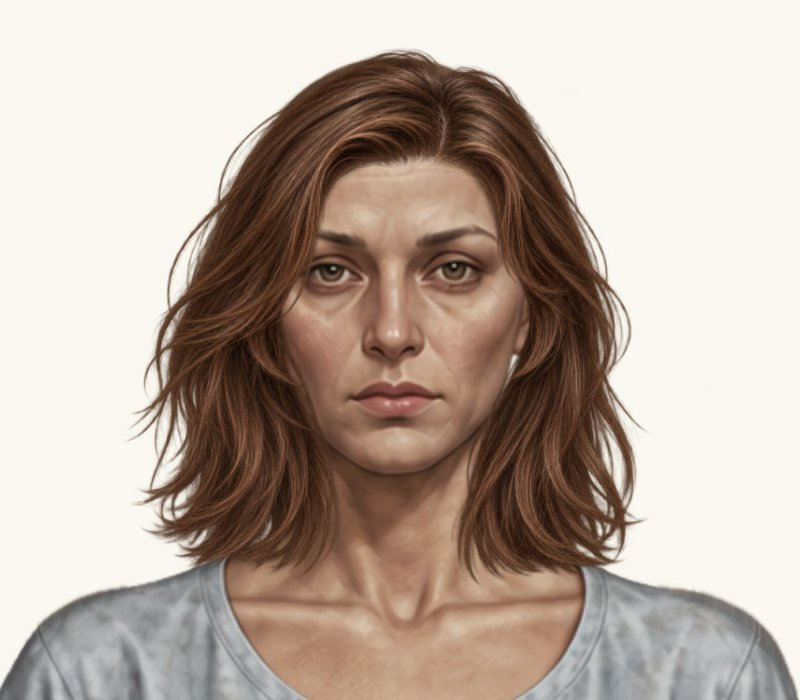
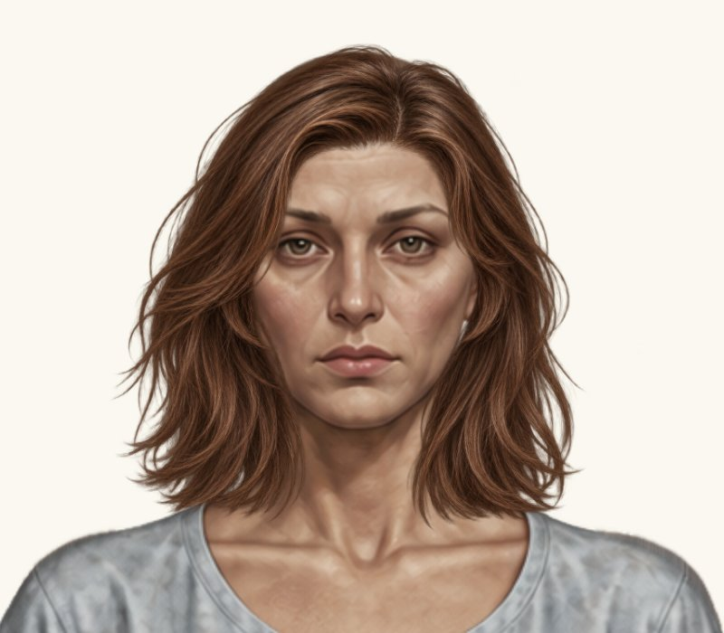
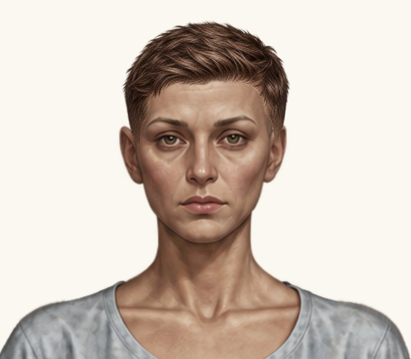
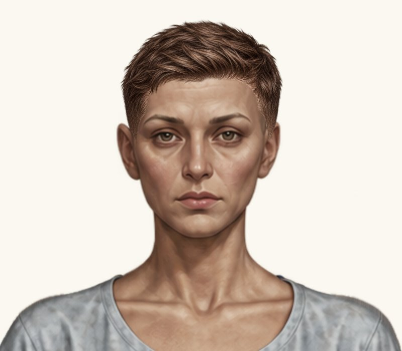

# Дві жіночі зачіски — нові дрібні правки

Гілка `feature/new-hairstyles-pack-02`. Main не змінено. До: `7fb6403fbf433f9da81fb6ccfdfd9e31640bd8fc`; новий код: `da93820c41641e6101654843788a5ab0c9b2f86e`.

Реальні браузерні скриншоти з чинним рендерером та незміненими PNG. До — кадри попереднього стану, після — новий прогін. Однакові світлий фон #faf8f0, ракурс, кадр 800×700 px та масштаб 2× цілого ігрового компонента. Жодної генерації або редагування графіки. Натисніть на кадр для повного розміру.

## 1. Жіноче волосся до плечей

| До | Після |
| --- | --- |
|  |  |

| Параметр | До | Після |
| --- | ---: | ---: |
| x | 320.618976 | **319.618976** |
| y | 12.903985568 | **12.903985568** |
| scale | 0.234075744 | **0.234075744** |
| width | 293.530982976 | **293.530982976** |
| height | 293.530982976 | **293.530982976** |

Новий додатковий зсув x −1 px у координатах Paper Doll; y, scale й розміри незмінні. Старі зсуви не повторювалися.

Після додаткового зсуву вліво вертикальна посадка маківки збережена. Явних нових просвітів біля щік, скронь та вух на світлому крупному плані не виявлено. Природну асиметрію вихідних пасом не змінювали. Остаточне центрування належить погодити власнику.

[Повний гардероб](female-hair-shoulder-length-wardrobe.jpg), [крупний план на темному фоні](female-hair-shoulder-length-head-dark.jpg).

## 2. Жіноча коротка текстурована

| До | Після |
| --- | --- |
|  |  |

| Параметр | До | Після |
| --- | ---: | ---: |
| x | 370.9300417 | **371.970741283** |
| y | -14.95278787675 | **-14.5935099979825** |
| scale | 0.16556584275 | **0.1639101843225** |
| width | 207.6195668085 | **205.543371140415** |
| height | 207.6195668085 | **205.543371140415** |

Рівномірне зменшення на 1% від поточного розміру (width і height ×0.99). Центрування відносно голови x = 475; видиму верхню опорну точку збережено: y + 217 × scale = 20.975. Зміна y компенсує масштабування PNG разом із прозорими полями. Чоловічий варіант незмінний.

Верхній об’єм трохи компактніший після пропорційного зменшення. Верхню опорну точку збережено; явних нових просвітів біля скронь, вух і лінії росту на крупному плані не виявлено. Вихідні крайові пасма не редагувалися.

[Повний гардероб](female-hair-textured-short-wardrobe.jpg), [крупний план на темному фоні](female-hair-textured-short-head-dark.jpg).

## Перевірки та межі змін

[Прогін коду da93820](https://github.com/neverl1ke/palata404/actions/runs/38853988923): **128 успішних перевірок** (65 Node + 63 Python). Перевірено реальне накладання в гардеробі / HUD, обидві статі й режими, перемикання, «Без зачіски», перезавантаження, незмінність ресурсів і viewport 1280×800, 390×844, 320×568 у Chromium. Фізичний телефон не використовувався. Окремо звірено тільки x −1 px першої зачіски, рівномірні 99% розміру другої та незмінність її верхньої опорної точки.

Повну різницю каталогу звірено з попереднім комітом: змінені тільки два жіночі placementByGender; усі інші поля / варіанти побайтово незмінні. PNG, чоловічі зачіски, інші жіночі зачіски, базові аватари, одяг, фони, UI, рендерер, stretchX, інвентар і збереження не змінювалися. Наявні тести не змінювалися.

Файли: `paper-doll-data.js`; лише кеш-версія каталогу в `index.html` (hairstyles-pack-02-12); документація та ці JPEG-скриншоти / звіт. Візуальних змін інтерфейсу немає.

Роботу після цієї проби зупинено для рішення власника. Злиття у main не виконано.
