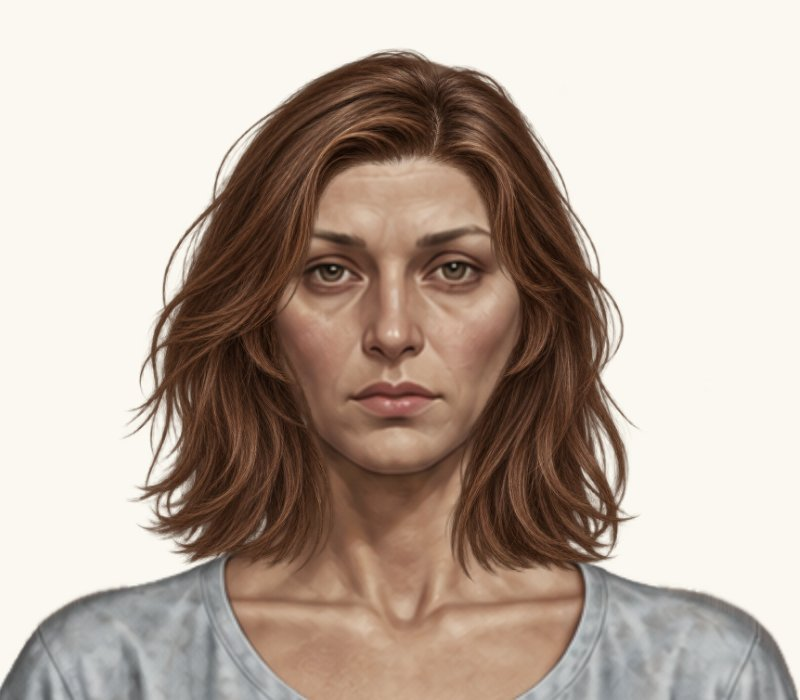
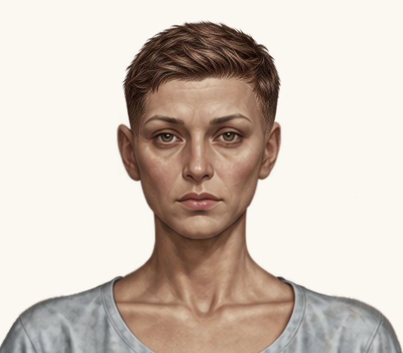

# Дві жіночі зачіски — наступна мінімальна проба

Гілка `feature/new-hairstyles-pack-02`. Main не змінено. До: `fd2c892963095157a28e4db5b4ccaff0a9388d52`; новий код: `32dea002c51cb8c482e4897317dde8630f72f741`.

Реальні браузерні скриншоти з чинним рендерером та незміненими PNG. До — кадри попереднього стану, після — новий прогін. Однакові світлий фон #faf8f0, ракурс, кадри 800×700 px та масштаб 2× цілого ігрового компонента. Жодної генерації або редагування графіки. Натисніть на кадр для повного розміру.

## 1. Жіноче волосся до плечей

| До | Після |
| --- | --- |
|  |  |

| Параметр | До | Після |
| --- | ---: | ---: |
| x | 317.618976 | **319.19278624** |
| y | 12.903985568 | **13.02804571232** |
| scale | 0.234075744 | **0.23173498656** |
| width | 293.530982976 | **290.59567314624** |
| height | 293.530982976 | **290.59567314624** |

Рівномірне зменшення на 1% від поточного розміру (width і height ×0.99). Центрування відносно голови x = 475. Видиму верхню опорну точку збережено: y + 53 × scale = 25.31. Зміна y компенсує масштабування PNG разом із прозорими полями. Чоловічий варіант незмінний.

Після пропорційного зменшення об’єм трохи компактніший. Верхню опорну точку збережено; явних нових просвітів біля щік, скронь та вух на світлому крупному плані не виявлено. Вихідні крайові пасма й природну асиметрію не редагували. Остаточна оцінка посадки належить власнику.

[Повний гардероб](female-hair-shoulder-length-wardrobe.jpg), [крупний план на темному фоні](female-hair-shoulder-length-head-dark.jpg).

## 2. Жіноча коротка текстурована

| До | Після |
| --- | --- |
|  |  |

| Параметр | До | Після |
| --- | ---: | ---: |
| x | 374.0210235314683 | **373.0210235314683** |
| y | -13.885696649022648 | **-13.885696649022648** |
| scale | 0.16064837165448225 | **0.16064837165448225** |
| width | 201.45305805472074 | **201.45305805472074** |
| height | 201.45305805472074 | **201.45305805472074** |

Зсув тільки x на -1 px у координатах Paper Doll. Y, scale, width і height незмінні; старі коригування не повторювалися.

Зачіска зсунута на 1 px вліво без зміни розміру й вертикального положення. Явних нових просвітів біля скронь, вух і лінії росту на крупному плані не виявлено. Вихідний контур не редагувався.

[Повний гардероб](female-hair-textured-short-wardrobe.jpg), [крупний план на темному фоні](female-hair-textured-short-head-dark.jpg).

## Перевірки та межі змін

[Прогін коду 32dea00](https://github.com/neverl1ke/palata404/actions/runs/38857570683): **128 успішних перевірок** (65 Node + 63 Python). Перевірено реальне накладання в гардеробі / HUD, обидві статі й режими, перемикання, «Без зачіски», перезавантаження, незмінність ресурсів і viewport 1280×800, 390×844, 320×568 у Chromium. Фізичний телефон не використовувався. Окремо звірено тільки x −1 px текстурованої зачіски та рівномірні 99% розміру волосся до плечей зі збереженням верхньої опорної точки.

Повну різницю каталогу звірено з попереднім комітом: змінені тільки два жіночі placementByGender; усі інші поля / варіанти побайтово незмінні. PNG, чоловічі зачіски, інші жіночі зачіски, базові аватари, одяг, фони, UI, рендерер, stretchX, інвентар і збереження не змінювалися. Наявні тести не змінювалися.

Файли: `paper-doll-data.js`; лише кеш-версія каталогу в `index.html` (hairstyles-pack-02-15); документація та ці JPEG-скриншоти / звіт. Візуальних змін інтерфейсу немає.

Роботу після цієї проби зупинено для рішення власника. Злиття у main не виконано.
