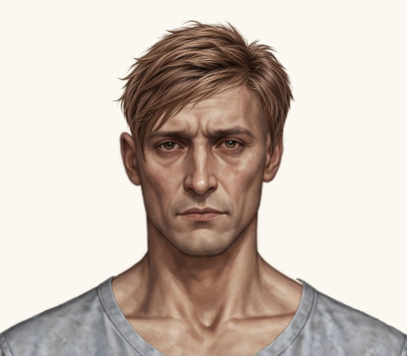
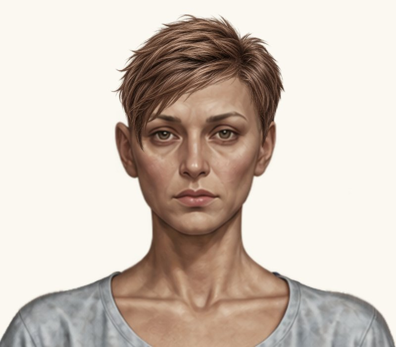
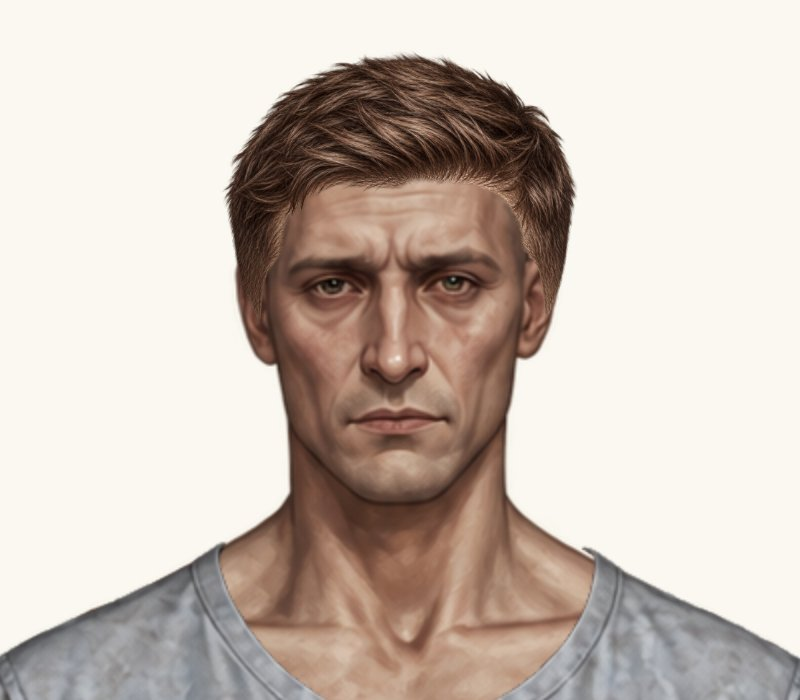
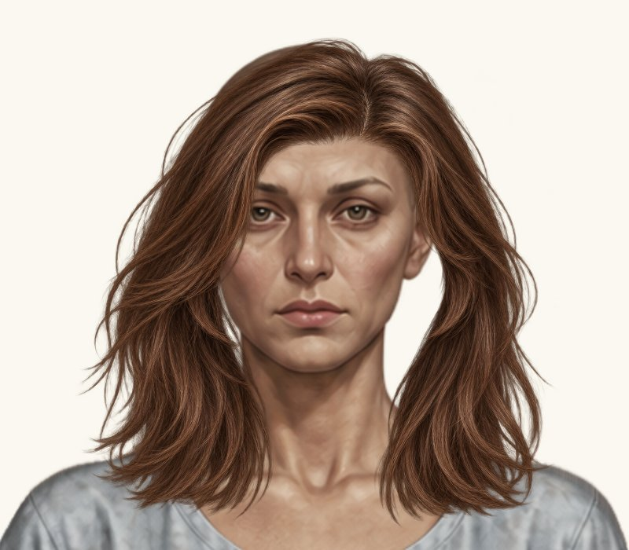
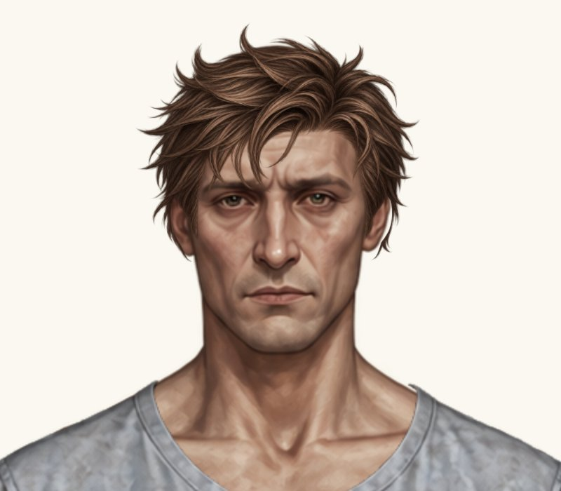
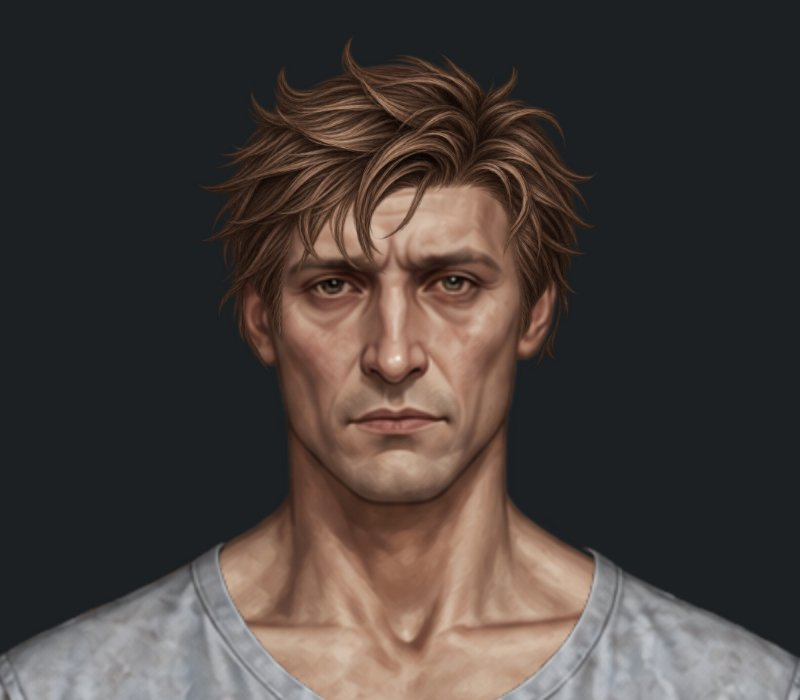
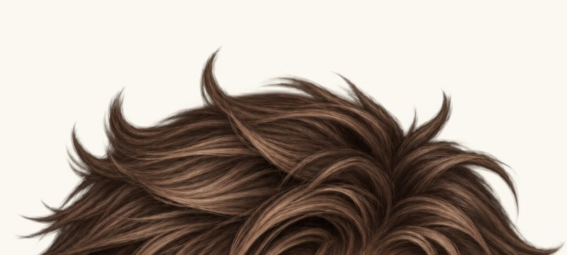

# Точкові правки посадки — комплект 02

Гілка `feature/new-hairstyles-pack-02`. Код правки: `501556f0d9ba1c196b5219785b827aa6918c8947`. Main і гілка каре не змінені. PNG не перегенеровано й не відредаговано.

## Що змінено

- Класичні короткі стрижки обох статей: на 2 px вліво в координатах Paper Doll, без зміни y та масштабу.
- Чоловіча текстурована: рівномірне зменшення на 3%, перецентрування та додатковий зсув на 2 px вліво. x усього PNG враховує перецентрування після зменшення. Верх видимого волосся збережено на попередній висоті.
- Жіноче волосся до плечей: рівномірне зменшення на 5%, зі збереженням центрування й висоти верхнього видимого краю.

| Варіант | x | y | width = height | scale |
| --- | ---: | ---: | ---: | ---: |
| Чоловіча класична | 373 | 0 | 200.64 | 0.16 |
| Жіноча класична | 375 | -5 | 196.878 | 0.157 |
| Чоловіча текстурована | 363.1766 | -10.8282 | 218.9484 | 0.1746 |
| Жіноче до плечей | 313.5 | 11.7155 | 321.651 | 0.2565 |

Координати — полотно 941×1672; scale — відносно вихідного PNG. Чоловіче волосся до плечей (x 336.866667, y 22.5, scale 0.21) та жіноча текстурована (x 365, y -17, scale 0.175) без змін. Всі попередні зачіски, аватари, туніки, інші предмети та збереження незмінні.

## Порівняння до / після

Усі кадри — справжній браузерний рендерер, однакові 800×700 px на світлому фоні, збільшення всього компонента 2×. Форма PNG не змінювалася. Натисніть на картинку, щоб відкрити її повністю.

| Примірка | До | Після |
| --- | --- | --- |
| Класична — чоловік |  |  |
| Класична — жінка |  |  |
| Текстурована — чоловік |  |  |
| До плечей — жінка |  |  |

[Усі шість актуальних загальних примірок і крупних планів](../hairstyles-pack-02/README.md).

## Чоловіча розкуйовджена — огляд без зміни посадки

Залишено x = 365.06, y = -30.32, width = 210.936, height = 263.576, scale = 0.188. Перевірено обидві ділянки біля вух, маківку й край на світлому / темному фонах.

- Просвіту на маківці, непрозорого фону та помітного кольорового альфа-ореолу на цих кадрах не виявлено.
- Гострі бокові кінчики присутні в самому [вихідному PNG](../../assets/wardrobe/hair/male_messy_hair.png). Вони не створені CSS-масштабуванням.
- Достатніх підстав міняти placement не виявлено, тому мінімальну правку масштабу / позиції не пропонуємо. Якщо потрібно прибрати саме ці кінчики, це окрема локальна правка силуету PNG, яка тут не виконувалася й потребує погодження.

| Світлий фон 2× | Темний фон 2× |
| --- | --- |
|  |  |

Маківка 4×:

## Перевірки

[GitHub Actions](https://github.com/neverl1ke/palata404/actions/runs/38788548344): 65 Node + 63 Python — всі 128 успішні. Перевірено точні байти PNG, перемикання всіх зачісок, обидві статі, режими, туніки, головне прев’ю й гардероб, reload / старі збереження, ширини 1280 / 390 / 320 px у Chromium.

Чоловіче волосся до плечей не коригувалося: раніше зафіксований просвіт біля вуха залишається відомим обмеженням цього ресурсу. Інші зачіски не змінювалися. Остаточне погодження посадки — за власником, злиття в main не виконано.
