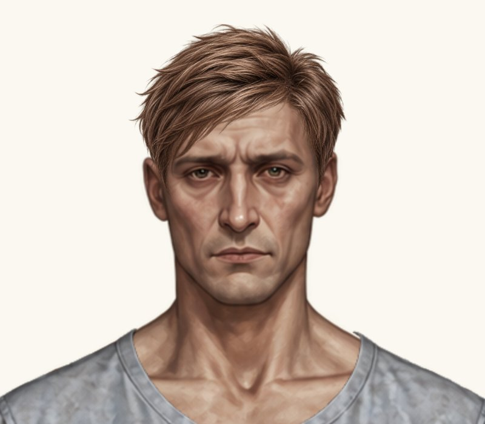
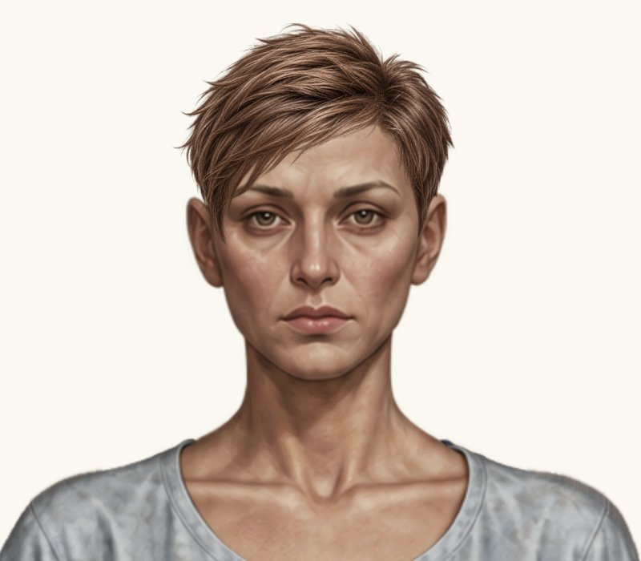
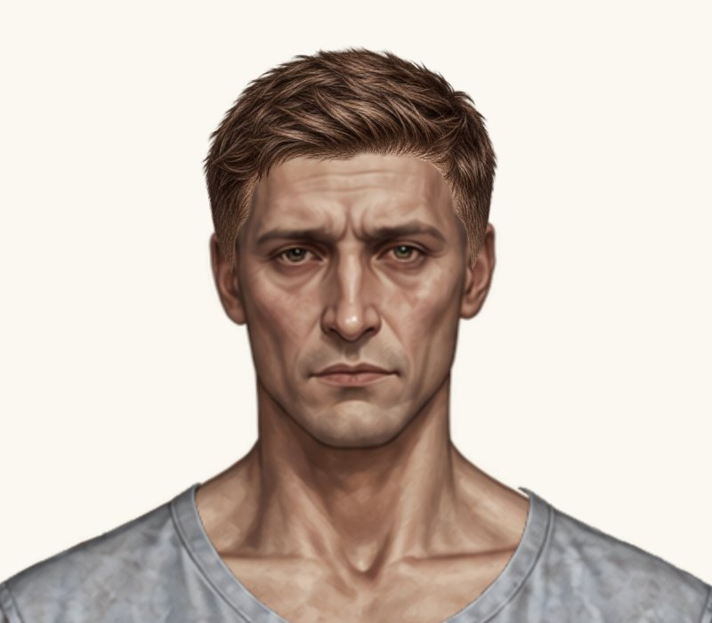
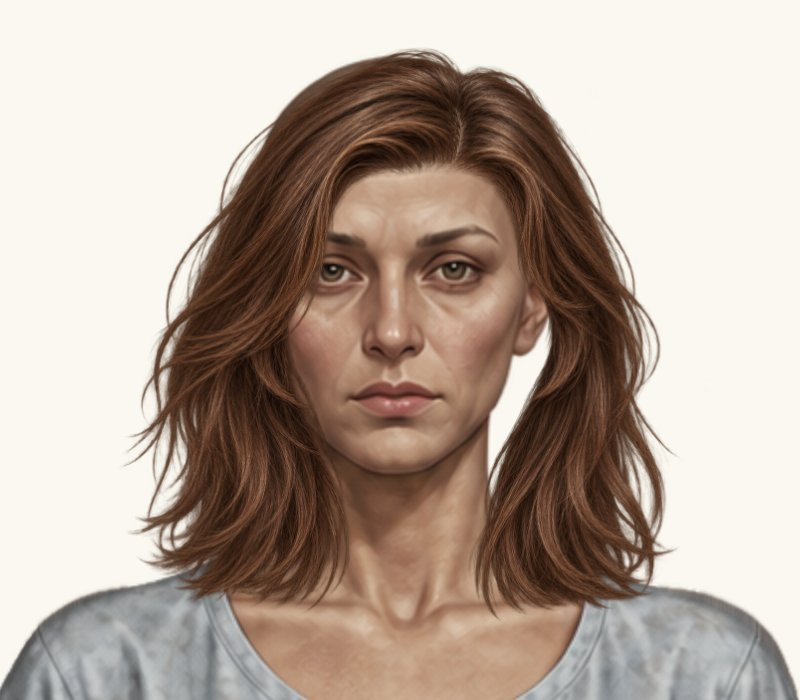
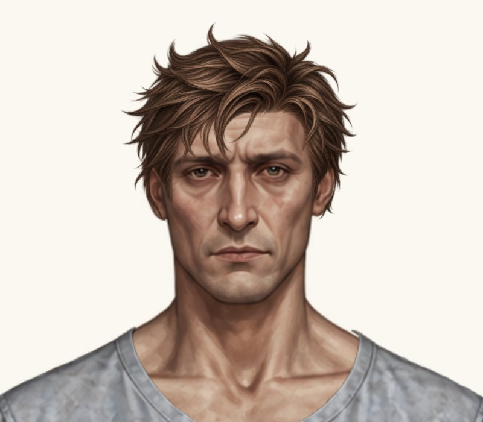
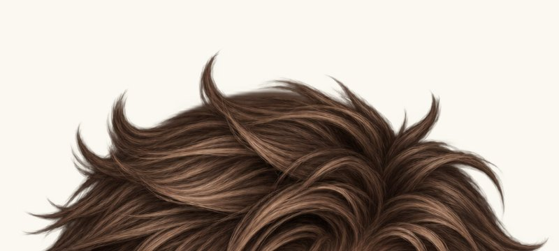
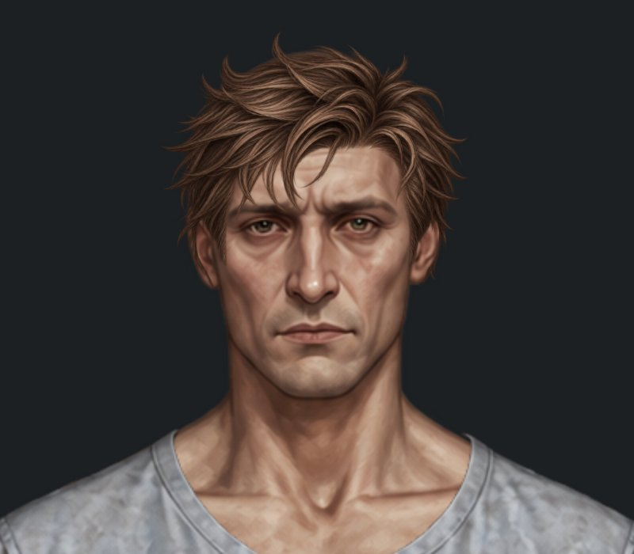

# П’ять додаткових правок посадки — до / після

Гілка `feature/new-hairstyles-pack-02`. У `main` не перенесено; очікується погодження власника.

До: код `4eb28416ed166303008a49b613b732f5ec58b17c`. Після: код `d0f743f49dc6044eecfa163ec47abdb1d2252362`.

Це справжній браузерний рендеринг ігрового Paper Doll, без генерації або редагування PNG. Крупні плани — DOM-копії цілого відрендереного компонента у масштабі 2×, однакові кадри 800×700 px, світлий фон #faf8f0. Натисніть на зображення для повного розміру. Попередні знімки взято без змін із попереднього перегляду.

| Зачіска | До | Після |
| --- | --- | --- |
| Чоловіча класична коротка |  |  |
| Жіноча класична коротка |  |  |
| Чоловіча коротка текстурована |  |  |
| Жіноче волосся до плечей |  |  |
| Чоловіча розкуйовджена |  |  |

## Точні параметри

Координати полотна 941×1672. `scale` — відносно оригінального PNG; ширина й висота завжди масштабовані однаково.

| Зачіска | x: до → після | y: до → після | scale: до → після | width × height: після |
| --- | --- | --- | --- | --- |
| Чоловіча класична коротка | 373 → **371** | 0 → **0** | 0.16 → **0.16** | 200.64 × 200.64 |
| Жіноча класична коротка | 375 → **373** | -5 → **-5** | 0.157 → **0.157** | 196.878 × 196.878 |
| Чоловіча коротка текстурована | 363.1766 → **364.531302** | -10.8282 → **-9.691554** | 0.1746 → **0.169362** | 212.379948 × 212.379948 |
| Жіноче волосся до плечей | 313.5 → **318.345** | 11.7155 → **12.123335** | 0.2565 → **0.248805** | 312.00147 × 312.00147 |
| Чоловіча розкуйовджена | 365.06 → **368.3582** | -30.32 → **-26.7104** | 0.188 → **0.18236** | 204.60792 × 255.66872 |

Класичні стрижки зміщені лише на −2 px. Три інші зачіски рівномірно зменшені на 3%. Центрування виконано відносно голови (x = 475), а не верхнього лівого кута PNG. Тому сирий x чоловічої текстурованої після зменшення збільшився, хоча додаткове зміщення після перецентрування становить саме −2 px. Верхній видимий край текстурованої та жіночої до плечей збережено; у чоловічої розкуйовдженої збережено опорну точку біля чола (475, 90).

## Вуха й маківка розкуйовдженої

На світлому й темному крупних планах нового просвіту маківки або помітного яскравого ореолу не виявлено. Гострі бокові кінчики біля вух залишаються частиною вихідного PNG; вони не домальовувалися й не видалялися. Художню посадку належить погодити власнику.

| Маківка до, 4× | Маківка після, 4× | Після, темний фон |
| --- | --- | --- |
|  |  |  |

## Перевірки

[Прогін коду d0f743f](https://github.com/neverl1ke/palata404/actions/runs/38794389362): **128 успішних перевірок** (65 Node + 63 Python), включно з перевіркою незмінності PNG та браузерною приміркою. Перевірено гардероб, обидві статі, «Пацієнт» / «Трип», перемикання, «Без зачіски», збереження після перезавантаження й viewport 1280×800, 390×844, 320×568 у Chromium. Фізичний телефон не використовувався.

Змінено лише п’ять відповідних `placementByGender`, кеш-версію каталогу та матеріали перегляду. Усі PNG, аватари, туніки, затверджені каре, пучки, жіноча розкуйовджена, жіноча текстурована й чоловіче волосся до плечей незмінні. Відомий дефект чоловічого волосся до плечей з попереднього огляду залишається поза цим завданням.

## Повні примірки

- Чоловіча класична коротка: [гардероб](male-hair-classic-short-wardrobe.jpg), [світлий фон](male-hair-classic-short-head.jpg), [темний фон](male-hair-classic-short-head-dark.jpg).
- Жіноча класична коротка: [гардероб](female-hair-classic-short-wardrobe.jpg), [світлий фон](female-hair-classic-short-head.jpg), [темний фон](female-hair-classic-short-head-dark.jpg).
- Чоловіча коротка текстурована: [гардероб](male-hair-textured-short-wardrobe.jpg), [світлий фон](male-hair-textured-short-head.jpg), [темний фон](male-hair-textured-short-head-dark.jpg).
- Жіноче волосся до плечей: [гардероб](female-hair-shoulder-length-wardrobe.jpg), [світлий фон](female-hair-shoulder-length-head.jpg), [темний фон](female-hair-shoulder-length-head-dark.jpg).
- Чоловіча розкуйовджена: [гардероб](male-hair-messy-wardrobe.jpg), [світлий фон](male-hair-messy-head.jpg), [темний фон](male-hair-messy-head-dark.jpg).
