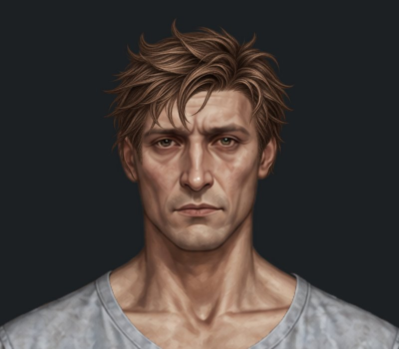

# Пробні мікроправки п’яти зачісок — до / після

Гілка `feature/new-hairstyles-pack-02`. **Це пробна посадка, яка очікує погодження. Main не змінено.**

До: `26fd19324ee56b4c8db1ae0c0500a42d3de31800`. Після: код `e25472ba1f6b8a17717f6187c3ca4982a8a95c3d`.

Реальні скриншоти браузерного рендерингу Paper Doll. Крупні плани — точні DOM-копії ігрового компонента, збільшеного цілком до 2×. Однакові кадри 800×700 px, світлий фон #faf8f0. Натисніть на зображення для повного розміру. Попередні кадри з попереднього огляду збережено без змін. Ніякої генерації або редагування PNG.

| Зачіска | До | Після |
| --- | --- | --- |
| Чоловіча класична коротка |  |  |
| Жіноча класична коротка |  |  |
| Чоловіча коротка текстурована |  |  |
| Жіноче волосся до плечей |  |  |
| Чоловіча розкуйовджена |  |  |

## Точні параметри до → після

Полотно 941×1672. Scale відносно оригінального PNG.

| Зачіска | x | y | scale | width × height після |
| --- | --- | --- | --- | --- |
| Чоловіча класична коротка | 371 → **370.5** | 0 → **0** | 0.16 → **0.16** | 200.64 × 200.64 |
| Жіноча класична коротка | 373 → **372.5** | -5 → **-5** | 0.157 → **0.157** | 196.878 × 196.878 |
| Чоловіча коротка текстурована | 364.531302 → **366.74067596** | -9.691554 → **-8.95652292** | 0.169362 → **0.16597476** | 208.13234904 × 208.13234904 |
| Жіноче волосся до плечей | 318.345 → **321.4781** | 12.123335 → **12.3870683** | 0.248805 → **0.2438289** | 305.7614406 × 305.7614406 |
| Чоловіча розкуйовджена | 368.3582 → **368.3582** | -26.7104 → **-28.7104** | 0.18236 → **0.18236** | 204.60792 × 255.66872 |

Обидві класичні стрижки зміщені лише на 0.5 px вліво. Чоловічу текстуровану та жіноче волосся до плечей пропорційно зменшено на 2% навколо x = 475. Після цього додаткові горизонтальні зсуви не застосовувалися. Збережено канонічну висоту верхнього видимого краю: y + 217 × scale = 27.06 у текстурованої; y + 53 × scale = 25.31 у жіночої до плечей. Зміна y компенсує зміну масштабу відносно верхнього лівого кута PNG.

Чоловіча розкуйовджена піднята рівно на 2 px; x, width, height і scale незмінні.

## Маківка й краї розкуйовдженої

| Маківка до, 4× | Маківка після, 4× | Після, темний фон |
| --- | --- | --- |
|  |  |  |

На світлому крупному плані та збільшенні маківки нового просвіту не виявлено. Підняття на 2 px зберігає покриття черепа; крайові кінчики біля вух залишаються частиною незміненого PNG. Остаточна оцінка лінії чола й прилягання належить власнику.

## Перевірки та межі

[Браузерний прогін коду e25472b](https://github.com/neverl1ke/palata404/actions/runs/38798571602): **128 успішних перевірок** (65 Node + 63 Python). Перевірено фактичне накладання у гардеробі, обидві статі, «Пацієнт» / «Трип», головний HUD, перемикання й збереження після перезавантаження; viewport 1280×800, 390×844 та 320×568 у Chromium. Фізичний телефон не використовувався. Окремо звірено, що змінено рівно п’ять потрібних посадок, обидва зменшення рівномірні й дорівнюють 2%, а PNG та історичні скриншоти незмінні. Кеш-версію paper-doll-data.js оновлено до hairstyles-pack-02-5.

Змінено лише п’ять відповідних placementByGender та кеш-версію каталогу. Усі PNG, аватари, туніки, інші предмети, затверджені каре й пучки, жіноча розкуйовджена, жіноча текстурована та чоловіче волосся до плечей не змінені. Попередній дефект чоловічого волосся до плечей не входить до цієї правки. Main не змінювався.

## Повні примірки

- Чоловіча класична коротка: [гардероб](male-hair-classic-short-wardrobe.jpg), [світлий фон](male-hair-classic-short-head.jpg), [темний фон](male-hair-classic-short-head-dark.jpg).
- Жіноча класична коротка: [гардероб](female-hair-classic-short-wardrobe.jpg), [світлий фон](female-hair-classic-short-head.jpg), [темний фон](female-hair-classic-short-head-dark.jpg).
- Чоловіча коротка текстурована: [гардероб](male-hair-textured-short-wardrobe.jpg), [світлий фон](male-hair-textured-short-head.jpg), [темний фон](male-hair-textured-short-head-dark.jpg).
- Жіноче волосся до плечей: [гардероб](female-hair-shoulder-length-wardrobe.jpg), [світлий фон](female-hair-shoulder-length-head.jpg), [темний фон](female-hair-shoulder-length-head-dark.jpg).
- Чоловіча розкуйовджена: [гардероб](male-hair-messy-wardrobe.jpg), [світлий фон](male-hair-messy-head.jpg), [темний фон](male-hair-messy-head-dark.jpg).
