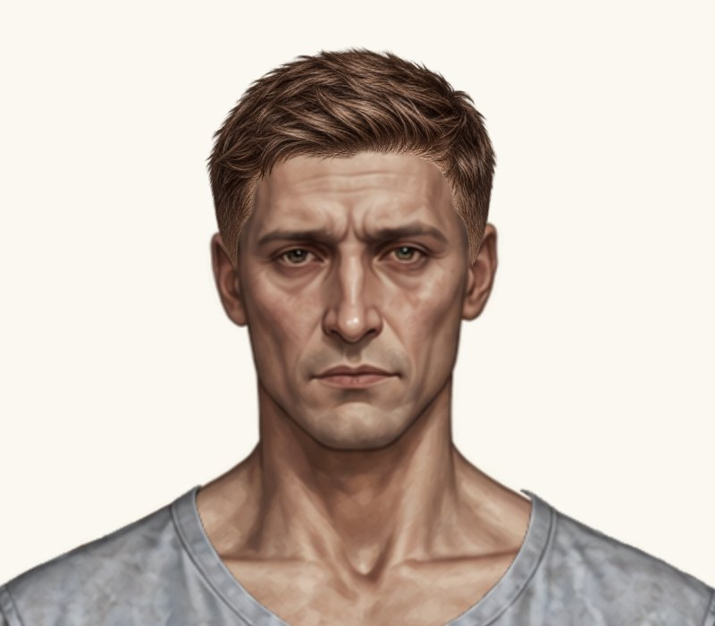
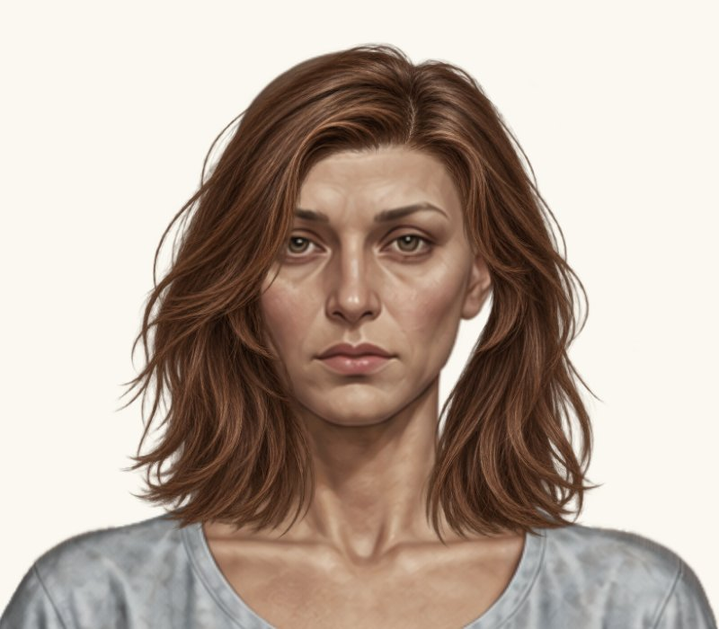
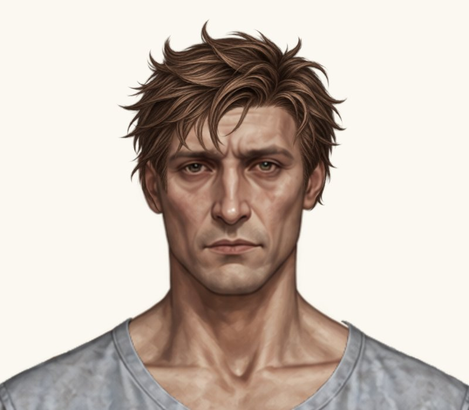
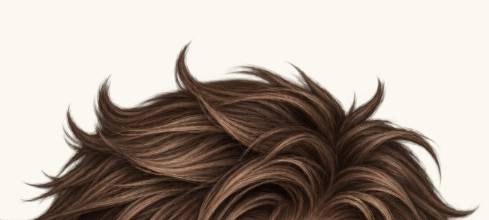
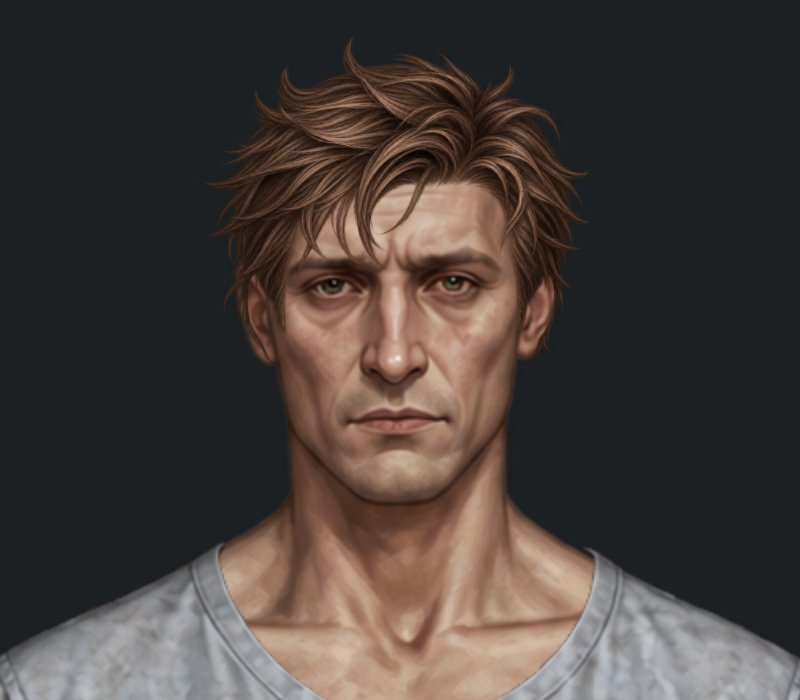

# Три зачіски — наступна проба посадки

Гілка `feature/new-hairstyles-pack-02`. **Main не змінено. Нові три посадки очікують погодження. Обидві класичні короткі стрижки вже затверджені й залишені без змін.**

До: `4c899c487b912aa0933ee6fb09983b07bb75d640`. Після: код `6cc97f07cfcc8bf44beaff5bd6c9b17d034799dd`.

Реальні браузерні скриншоти ігрового Paper Doll, без генерації або редагування PNG. Для порівняння використано однакові кадри 800×700 px на світлому фоні #faf8f0. Компонент примірки скопійовано цілком і пропорційно збільшено до 2×. Натисніть на зображення для повного розміру. Знімки «до» з попереднього огляду не перезаписувалися.

| Зачіска | До | Після |
| --- | --- | --- |
| Чоловіча коротка текстурована |  |  |
| Жіноче волосся до плечей |  |  |
| Чоловіча розкуйовджена |  |  |

## Точні параметри до → після

Координати полотна 941×1672. Scale відносно вихідного PNG.

| Зачіска | x | y | scale | width × height після |
| --- | --- | --- | --- | --- |
| Чоловіча коротка текстурована | 366.74067596 → **369.9884556812** | -8.95652292 → **-7.8760272324** | 0.16597476 → **0.1609955172** | 201.8883785688 × 201.8883785688 |
| Жіноче волосся до плечей | 321.4781 → **327.618976** | 12.3870683 → **12.903985568** | 0.2438289 → **0.234075744** | 293.530982976 × 293.530982976 |
| Чоловіча розкуйовджена | 368.3582 → **367.824991** | -28.7104 → **-29.293952** | 0.18236 → **0.1832718** | 205.6309596 × 256.9470636 |

Чоловіча текстурована зменшена рівномірно на 3%, жіноче волосся до плечей — на 4%. Центрування збережено відносно голови (x = 475). Верхній видимий край не зміщується: y + 217 × scale = 27.06 у текстурованої, y + 53 × scale = 25.31 у жіночої до плечей. Зміни x/y компенсують масштабування PNG разом із прозорими полями.

Розкуйовджена збільшена рівномірно лише на 0.5% навколо поточної опорної точки біля чола (475, 88). Зберігається підняття на 2 px з попередньої проби; жодних наступних довільних зсувів або змін масштабу немає.

## Маківка та краї чоловічої розкуйовдженої

| До, маківка 4× | Після, маківка 4× | Після, темний фон |
| --- | --- | --- |
|  |  |  |

На світлому й темному крупних планах та збільшенні маківки не виявлено нового просвіту або явного погіршення правої сторони. Різниця від збільшення на 0.5% дуже мала; помітний край біля лівого вуха залишається, тому вважати його усунутим не можна. Це може бути особливість контуру вихідного PNG. Подальших довільних зсувів, масштабувань чи правок PNG не виконано. Пробу залишено для оцінки власником.

## Перевірки

[Прогін коду 6cc97f0](https://github.com/neverl1ke/palata404/actions/runs/38802046843): **128 успішних перевірок** (65 Node + 63 Python), включно з незмінністю байтів ресурсів і реальною браузерною приміркою. Перевірено обидві статі, «Пацієнт» / «Трип», гардероб і головний HUD, перемикання / «Без зачіски», збереження після перезавантаження, старі збереження та viewport 1280×800, 390×844, 320×568 у Chromium. Фізичний телефон не використовувався.

Звірено різницю каталогу з попереднім комітом: рівно три запитані placementByGender, без змін інших полів. Обидві класичні короткі стрижки залишено точно x/y/scale = 370.5/0/0.16 та 372.5/−5/0.157. Жіноча текстурована, чоловіче волосся до плечей, жіноча розкуйовджена, обидва каре та пучки незмінні. Усі PNG, базові аватари, туніки, інші предмети, логіка й формат збережень незмінні. Кеш-версію каталогу оновлено до hairstyles-pack-02-6.

Відомий дефект чоловічого волосся до плечей залишається поза поточним завданням. Main не змінено; перенесення можливе лише після окремого погодження власника.

## Повні примірки

- Чоловіча коротка текстурована: [гардероб](male-hair-textured-short-wardrobe.jpg), [світлий фон](male-hair-textured-short-head.jpg), [темний фон](male-hair-textured-short-head-dark.jpg).
- Жіноче волосся до плечей: [гардероб](female-hair-shoulder-length-wardrobe.jpg), [світлий фон](female-hair-shoulder-length-head.jpg), [темний фон](female-hair-shoulder-length-head-dark.jpg).
- Чоловіча розкуйовджена: [гардероб](male-hair-messy-wardrobe.jpg), [світлий фон](male-hair-messy-head.jpg), [темний фон](male-hair-messy-head-dark.jpg).
