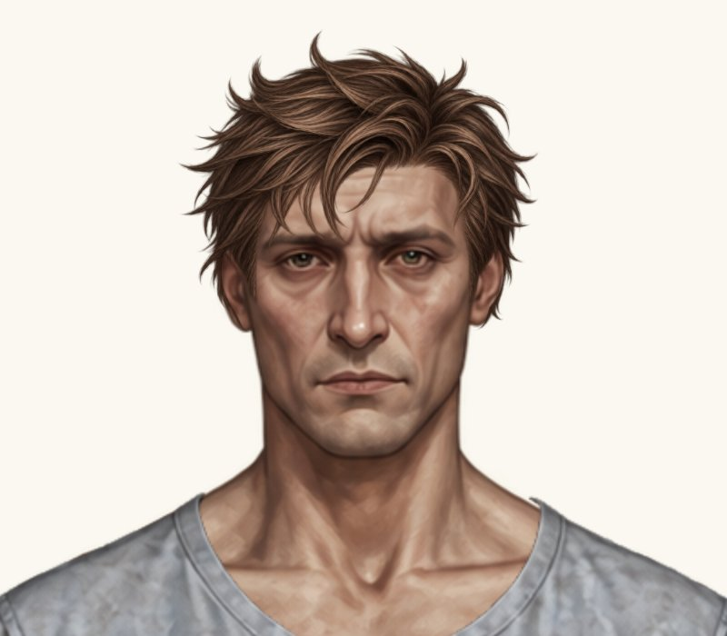
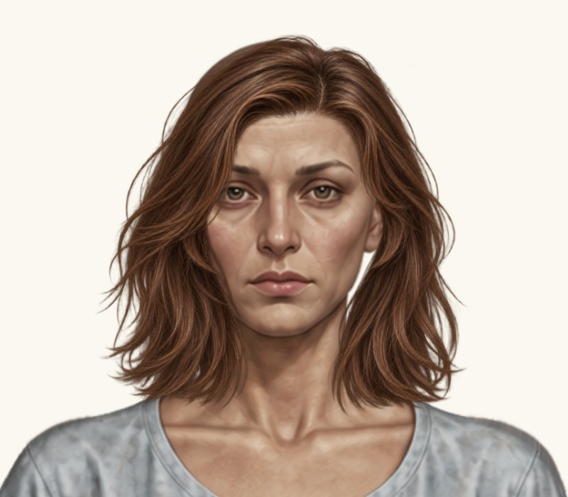
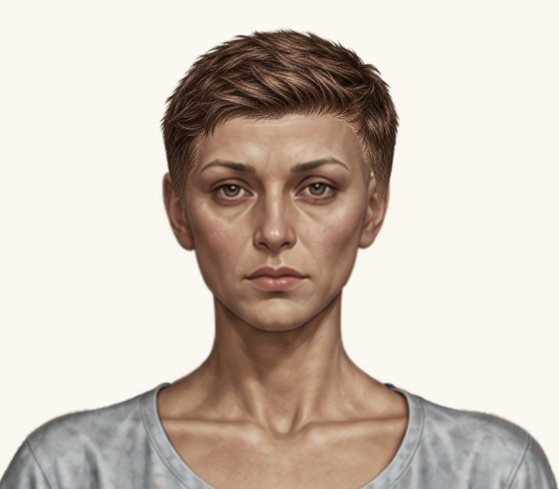
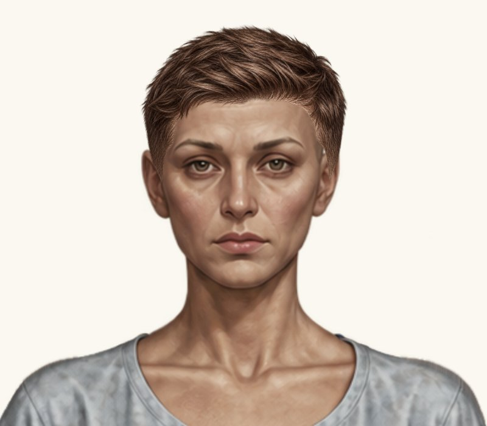
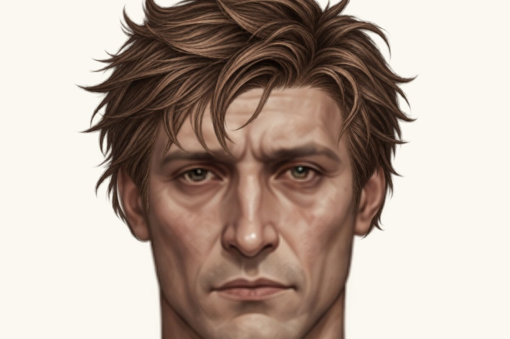
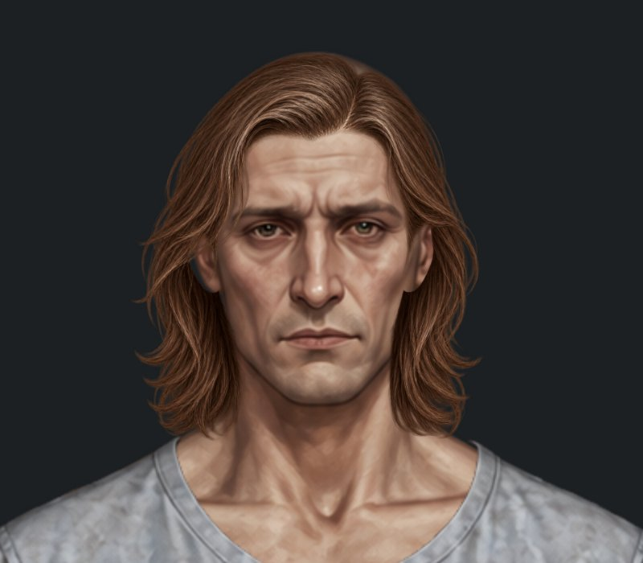

# Чотири зачіски — порівняння від поточного стану

Гілка `feature/new-hairstyles-pack-02`. **Main не змінено. Нові чотири посадки очікують погодження. Обидві класичні короткі та чоловіча текстурована фінально затверджені й не змінені.**

До: `7b4e0a3b094900a014b0183feda879ae0fecba1e`. Після: код `e46470bb2df279a3e39ee669dac483685a581ce2`.

Це реальні браузерні скриншоти з оригінальними PNG та чинним рендерером Paper Doll. Обидва стани кожної зачіски зняті в одному прогоні, в однакових кадрах 800×700 px на світлому фоні #faf8f0. Ігровий компонент збільшений цілком до 2×; жодного генерування або редагування графіки. Натисніть на зображення для повного розміру.

| Зачіска | До | Після |
| --- | --- | --- |
| Чоловіча розкуйовджена |  |  |
| Жіноче волосся до плечей |  |  |
| Жіноча коротка текстурована |  |  |
| Чоловіче волосся до плечей |  |  |

## Точні параметри до → після

Координати полотна 941×1672; scale відносно вихідного PNG.

| Зачіска | x | y | scale / scaleY | width × height після |
| --- | --- | --- | --- | --- |
| Чоловіча розкуйовджена | 365.824991 → **362.339805814815** | -29.293952 → **-29.293952** | 0.1832718 → **0.1832718** | 211.116144785185 × 256.9470636 |
| Жіноче волосся до плечей | 327.618976 → **325.618976** | 12.903985568 → **12.903985568** | 0.234075744 → **0.234075744** | 293.530982976 × 293.530982976 |
| Жіноча коротка текстурована | 365 → **366.65** | -17 → **-16.430375** | 0.175 → **0.172375** | 216.15825 × 216.15825 |
| Чоловіче волосся до плечей | 336.866667 → **340.320000325** | 22.5 → **22.61025** | 0.21 → **0.20475** | 256.7565 × 256.7565 |

## Чоловіча розкуйовджена — додатковий екранний піксель вліво

У звичайному гардеробі при viewport 1280×800 ширина полотна персонажа становить 270 CSS px. Масштаб = 270 / 941. Тому додатковий 1 px на екрані = **941 / 270 = 3.485185185185 px Paper Doll**. На цю величину збільшено width й зменшено x. Це приблизно 0.97 px зсуву реального лівого видимого краю, враховуючи прозоре поле PNG; рамка розширюється рівно на 1 CSS px.

- Правий край: x + width = **573.4559506**, без змін.
- y = −29.293952, height = 256.9470636, scaleY = 0.1832718 — без змін.
- width: 207.6309596 → **211.116144785185**.
- scaleX: 0.185054331194296 → **0.188160556849541** приблизно.
- widthScale відносно пропорційного PNG: 1.009726161877037 → **1.026674899518317** приблизно.
- Використовується вже наявний локальний stretchX; рендерер і глобальні стилі не змінювалися.

При іншому viewport весь персонаж масштабується разом: це не глобальне фіксоване CSS-розтягування на 1 px для кожного розміру екрана. Правий край залишається зафіксованим у всіх режимах. Горизонтальні внутрішні точки волосся отримують мінімальне перетворення; y, висота, вертикальна лінія посадки чола / маківки незмінні.

| До — скроні й вуха 4× | Після — скроні й вуха 4× |
| --- | --- |
|  |  |

## Інші три правки

Жіноча до плечей: тільки x −2 px, масштаб / y / розміри незмінні. Жіноча текстурована: рівномірне зменшення на 1.5%, центрування відносно x = 475; видимий верхній край збережений через опорний рядок PNG 217. Чоловіча до плечей: рівномірне зменшення на 2.5%, центрування відносно x = 475; верхній видимий край збережений через рядок 21.

## Чоловіче волосся до плечей — світлий / темний фон

| До, темний фон | Після, темний фон |
| --- | --- |
|  |  |

Світлий проміжок зліва — прозора / майже прозора ділянка наданого PNG, яка місцями виходить за контур базового вуха. Це не біла фарба: у відповідній зоні джерела alpha = 0–3, а на темному фоні проміжок стає темним. Наприклад, у вихідному male_medium_shoulder_length.png піксель (277, 679) має RGBA (0, 0, 0, 0). Поряд із ним у базового аватара також майже прозорий край. Праворуч перевірені пасма мають нормальний темно-коричневий RGB та alpha близько 250–253; асиметрію вихідного силуету не виправляли. Прозорість PNG та його контур не редагувалися.

## Висновки фактичного огляду

- Чоловіча розкуйовджена: додаткове покриття зліва помітне на збільшенні; правий край зафіксований, нових просвітів маківки чи помітного перекосу не виявлено. Внутрішні точки волосся трохи змінюються по X через погоджене розширення; вертикальна посадка незмінна.
- Жіноча до плечей: зсув −2 px зменшив праве зміщення; маківка не змінилася по висоті, явного погіршення біля вух не виявлено. Альтернативу −1 px не додаємо, оскільки явного надмірного зсуву не видно.
- Жіноча текстурована: об’єм зменшився на 1.5%; нових просвітів біля вух на крупному плані не виявлено.
- Чоловіча до плечей: ширина біля щік зменшилася; лівий проміжок став меншим, але тонка прозора зона залишається. На темному фоні нових білих артефактів біля вух не виявлено. Місцями прилягання до верхнього контуру голови все ще потребує художнього погодження. Повністю виправленим PNG-контур не вважаємо.

Подальших довільних зсувів, масштабувань чи графічних правок не виконано.

## Перевірки

[Прогін коду e46470b](https://github.com/neverl1ke/palata404/actions/runs/38806946902): **128 успішних перевірок** (65 Node + 63 Python). Перевірено накладання в гардеробі й головному HUD, обидві статі / режими, перемикання, «Без зачіски», перезавантаження, незмінність ресурсів та viewport 1280×800, 390×844, 320×568 у Chromium. Для розкуйовдженої окремо перевірено правий край і +1 CSS px у контрольному viewport. Фізичний телефон не використовувався.

Каталог звірено з попереднім комітом: змінено рівно чотири відповідні placementByGender, без змін інших полів. Затверджені чоловіча класична (370.5 / 0 / 0.16), жіноча класична (372.5 / −5 / 0.157), чоловіча текстурована (369.9884556812 / −7.8760272324 / 0.1609955172) незмінні. Інші зачіски, усі PNG, аватари, туніки, фони, інтерфейс та формат збережень незмінні. Кеш каталогу оновлено до hairstyles-pack-02-8.

## Змінені файли

`paper-doll-data.js`, кеш-версія в `index.html`, наявна браузерна перевірка `tests/test_game.py` та матеріали огляду / документація. `paper-doll.js` і стилі не змінювалися.

Після цієї проби роботу зупинено для рішення власника. Перенесення у main не виконано.
