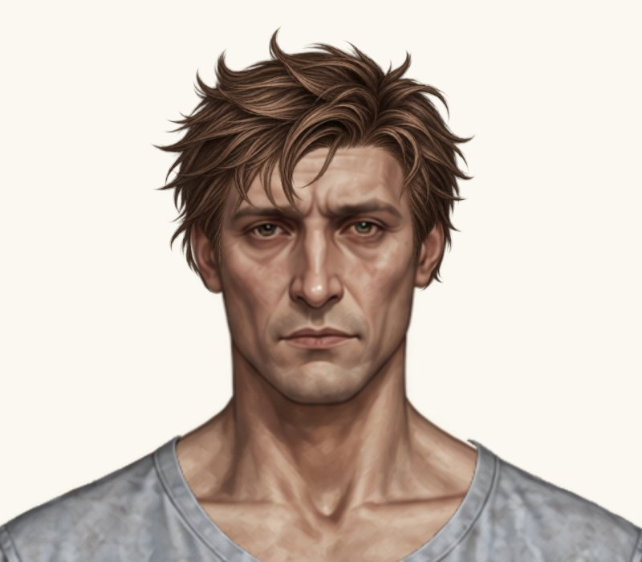
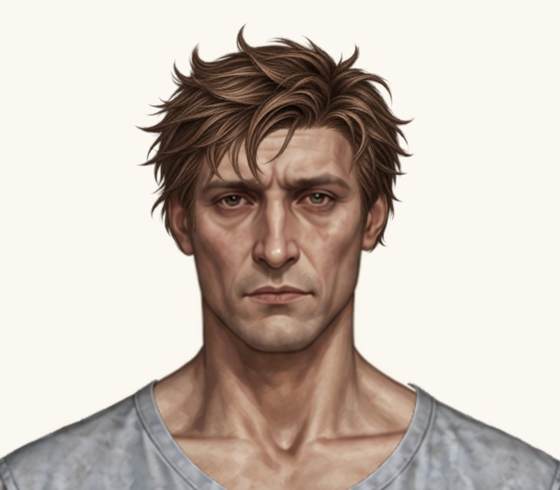
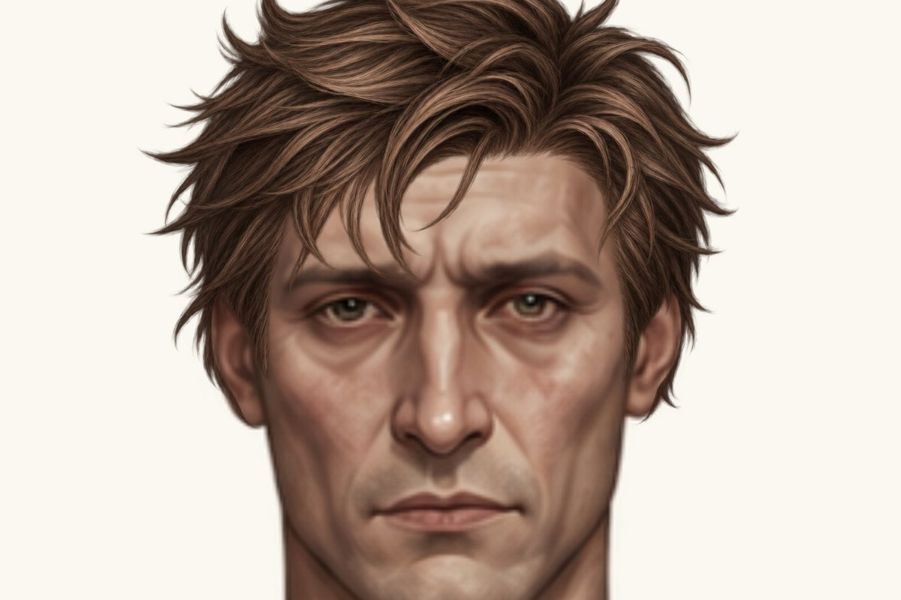
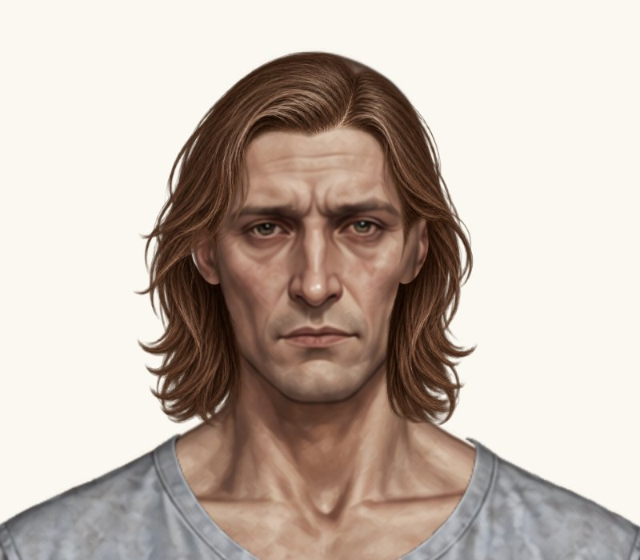
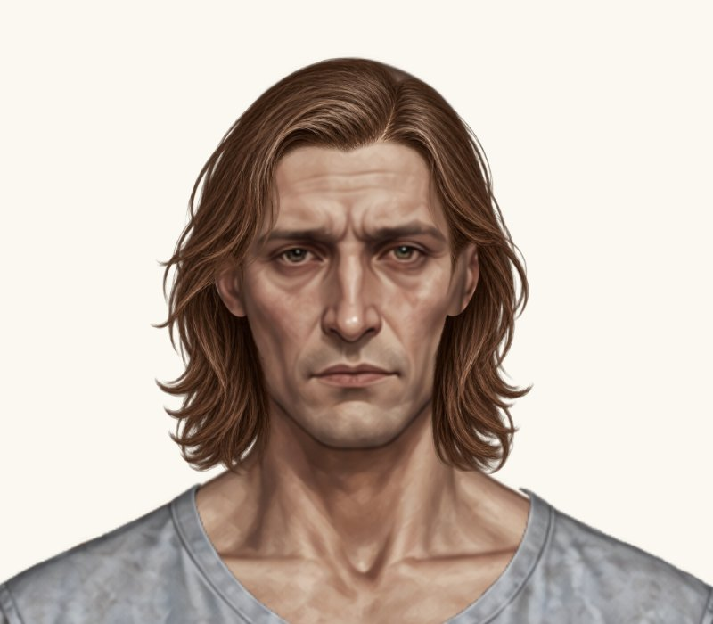
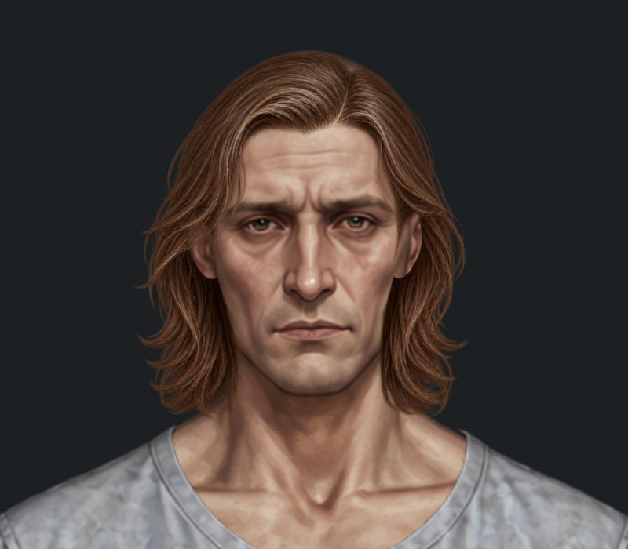

# Чотири точкові мікроправки — до / після

Гілка `feature/new-hairstyles-pack-02`. Main не змінено. Чотири нові проби очікують погодження власника; PNG, аватари, одяг, фони, UI та інші зачіски незмінні.

Поточний базовий стан: `888d06e88db863471cbf6ad0a93919666900d8c1`. Код після правок: `173aa0c5878f73561b6907e97ba8bf2e9bf60f81`.

Усі кадри — реальний рендеринг Paper Doll у браузері. До й після знято в одному прогоні, однакові ракурс, фон #faf8f0 та кадри 800×700 px. Ігровий компонент збільшений цілком до 2×. Нових зображень не генерували, PNG не редагували. Натисніть на кадр для повного розміру.

## 1. Чоловіча розкуйовджена

Звуження лише по X назад на 0.5 CSS px у контрольній десктопній примірці (полотно 270 px при viewport 1280×800). У координатах Paper Doll це width −1.742592592593, x +1.742592592593. Правий край x + width = 573.4559506, y / height / scaleY незмінні. Наявний stretchX: true збережено; рендерер не змінено. На інших viewport величина масштабується разом із персонажем.

| До | Після |
| --- | --- |
|  |  |

| Параметр | До | Після |
| --- | ---: | ---: |
| x | 362.339805814815 | **364.082398407408** |
| y | -29.293952 | **-29.293952** |
| scale | 0.1832718 | **0.1832718** |
| width | 211.116144785185 | **209.373552192592** |
| height | 256.9470636 | **256.9470636** |
| scaleX, приблизно | 0.188160556849541 | **0.186607444021918** |
| widthScale, приблизно | 1.026674899518317 | **1.018200530697674** |
| stretchX | true | **true** |
| Правий край | 573.4559506 | **573.4559506** |

У рядку scale вказаний незмінний scaleY = 0.1832718. Горизонтальний коефіцієнт визначається через width; нового поля scaleX не додано. Фіксований правий край не означає нерухомість кожної внутрішньої точки волосся: мінімальне горизонтальне перетворення зменшується до нуля біля цього краю.

| До — скроні й вуха 4× | Після — скроні й вуха 4× |
| --- | --- |
|  |  |

За крупними планами лівий об’єм трохи зменшився назад; правий край збережений, нового просвіту маківки чи помітного перекосу не виявлено. Крайні пасма біля вуха залишаються частиною вихідного PNG.

[Повна сцена гардероба](male-hair-messy-wardrobe.jpg).

## 2. Жіноче волосся до плечей

Лише додатковий x −2 px у координатах Paper Doll. Y, ширина, висота та масштаб незмінні. Додаткових зсувів після цієї проби не виконували.

| До | Після |
| --- | --- |
|  |  |

| Параметр | До | Після |
| --- | ---: | ---: |
| x | 325.618976 | **323.618976** |
| y | 12.903985568 | **12.903985568** |
| scale | 0.234075744 | **0.234075744** |
| width | 293.530982976 | **293.530982976** |
| height | 293.530982976 | **293.530982976** |

Волосся зміщене ще на 2 px вліво. Вертикальна посадка маківки незмінна; явних нових просвітів біля вух не виявлено. Художню оцінку центрування залишаємо власнику.

[Повна сцена гардероба](female-hair-shoulder-length-wardrobe.jpg).

## 3. Жіноча коротка текстурована

Пробне рівномірне зменшення на 1% від поточного масштабу. Центрування відносно голови (x = 475), видимий верхній край збережено через опорний рядок PNG 217. Чоловічий варіант текстурованої не змінено.

| До | Після |
| --- | --- |
|  |  |

| Параметр | До | Після |
| --- | ---: | ---: |
| x | 366.65 | **367.7335** |
| y | -16.430375 | **-16.05632125** |
| scale | 0.172375 | **0.17065125** |
| width | 216.15825 | **213.9966675** |
| height | 216.15825 | **213.9966675** |

Об’єм зменшився рівномірно на 1%. На крупному плані явних нових просвітів біля вух не виявлено; верхній видимий край і лінія росту збережені. Тонкий вихідний контур не редагувався.

[Повна сцена гардероба](female-hair-textured-short-wardrobe.jpg).

## 4. Чоловіче волосся до плечей

Пробний зсув лише x +1 px у координатах Paper Doll. Y та масштаб залишено незмінними. Подальших довільних коригувань не виконували.

| До | Після |
| --- | --- |
|  |  |

| Параметр | До | Після |
| --- | ---: | ---: |
| x | 340.320000325 | **341.320000325** |
| y | 22.61025 | **22.61025** |
| scale | 0.20475 | **0.20475** |
| width | 256.7565 | **256.7565** |
| height | 256.7565 | **256.7565** |

| До — темний фон | Після — темний фон |
| --- | --- |
|  |  |

Зсув +1 px вправо виконаний без зміни розміру й висоти. На світлому й темному фонах нових білих артефактів біля вух не виявлено. Залишкова прозора зона зліва та місцеве прилягання вихідного контуру все ще потребують погодження; повністю виправленими їх не вважаємо.

[Повна сцена гардероба](male-hair-shoulder-length-wardrobe.jpg).

## Перевірки та межі

[Повторний прогін коду 173aa0c](https://github.com/neverl1ke/palata404/actions/runs/38809990273): **128 успішних перевірок** (65 Node + 63 Python). Перевірено реальне накладання у гардеробі / HUD, обидві статі / режими, перезавантаження, перемикання, «Без зачіски», незмінність ресурсів та viewport 1280×800, 390×844, 320×568 у Chromium. Правий край перевіряється в екранних пікселях із допуском 0.05 CSS px через субпіксельне округлення верстки; математично x + width незмінне. Півпіксельне звуження окремо перевірено при ширині персонажа 270 px. Фізичний телефон не використовувався.

Каталог звірено з попереднім комітом: змінені рівно чотири placementByGender. Обидві класичні короткі й чоловіча коротка текстурована, обидва каре, пучки та всі інші не згадані варіанти незмінні. Жодного PNG не змінено. Рендерер, загальні стилі, базові тіла, одяг, фон, інвентар і збереження не змінювалися.

Файли: `paper-doll-data.js`; кеш-версія каталогу в `index.html`; наявна браузерна перевірка `tests/test_game.py` для актуальних знімків і півпіксельного звуження; матеріали огляду / документація. Кеш — hairstyles-pack-02-9, без візуальних змін UI.

Після цієї проби роботу зупинено. Подальші правки та перенесення в main — лише за новим рішенням власника.
