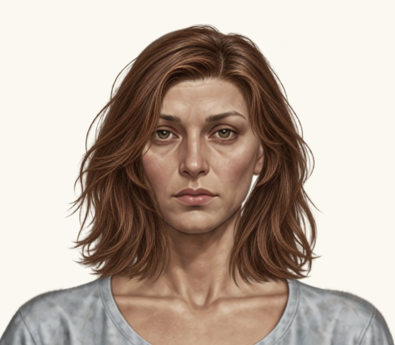
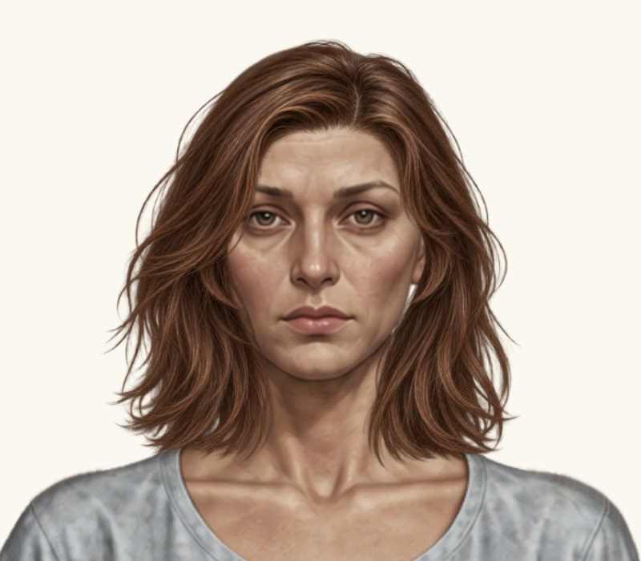
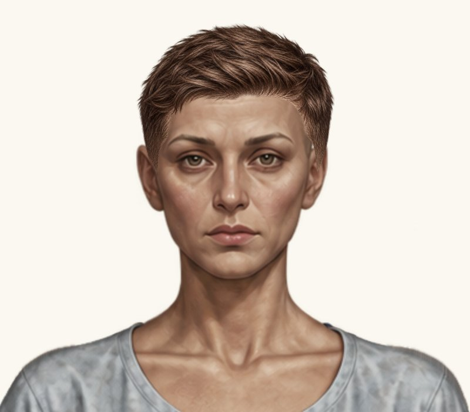

# Дві жіночі зачіски — фінальна проба до / після

Гілка `feature/new-hairstyles-pack-02`. **Main не змінено. Змінено лише два жіночі placementByGender. Нові посадки очікують погодження власника.**

До: `6717cd2bb01ea677fd329abd91dc372e3bdb9bb1`. Після: код `5dcb6e40526729cd0fca609cab4c3e6cee97ffed`.

Реальні браузерні скриншоти гри з чинним рендерером та оригінальними PNG. До — незмінені кадри попереднього стану, після — новий прогін. Однакові світлий фон #faf8f0, кадр 800×700 px, ракурс і масштаб 2× цілого ігрового компонента. Нових зображень не генерували й PNG не редагували. Натисніть на кадр для повного розміру.

## 1. Жіноче волосся до плечей

| До | Після |
| --- | --- |
|  |  |

| Параметр | До | Після |
| --- | ---: | ---: |
| x | 323.618976 | **321.618976** |
| y | 12.903985568 | **12.903985568** |
| scale | 0.234075744 | **0.234075744** |
| width | 293.530982976 | **293.530982976** |
| height | 293.530982976 | **293.530982976** |

Виконано новий додатковий зсув x −2 px від поточного положення. Масштаб, y, width і height незмінні. Попередній зсув не застосовувався повторно.

На крупному плані новий зсув вліво помітний відносно обличчя. Вертикальна посадка маківки не змінилася; явних нових просвітів біля скронь або вух не виявлено. Природну асиметрію вихідних пасом збережено. Остаточне центрування належить погодити власнику.

[Повна сцена гардероба](female-hair-shoulder-length-wardrobe.jpg), [крупний план на темному фоні](female-hair-shoulder-length-head-dark.jpg).

## 2. Жіноча коротка текстурована

| До | Після |
| --- | --- |
|  |  |

| Параметр | До | Після |
| --- | ---: | ---: |
| x | 367.7335 | **369.87883** |
| y | -16.05632125 | **-15.315694825** |
| scale | 0.17065125 | **0.167238225** |
| width | 213.9966675 | **209.71673415** |
| height | 213.9966675 | **209.71673415** |

Масштабування рівномірне: нові width / height становлять 98% від поточних. Центрування відносно голови x = 475; опорний видимий верхній край збережено: y + 217 × scale = 20.975. Зміна y компенсує масштабування відносно верхнього лівого кута PNG. Чоловічий варіант текстурованої не змінено.

Після рівномірного зменшення волосся компактніше біля верхньої частини голови. Видима верхня опорна точка збережена; явних нових просвітів біля вух і скронь на світлому крупному плані не виявлено. Вихідні крайові пасма не редагувалися. Художнє погодження залишається за власником.

[Повна сцена гардероба](female-hair-textured-short-wardrobe.jpg), [крупний план на темному фоні](female-hair-textured-short-head-dark.jpg).

## Перевірки та незмінені ресурси

[Прогін коду 5dcb6e4](https://github.com/neverl1ke/palata404/actions/runs/38812366003): **128 успішних перевірок** (65 Node + 63 Python). Перевірено накладання в гардеробі / головному HUD, обидві статі й режими, перемикання, «Без зачіски», збереження після перезавантаження, незмінність ресурсів та viewport 1280×800, 390×844, 320×568 у Chromium. Фізичний телефон не використовувався. Окремо звірено додатковий x −2 px без зміни інших полів першої зачіски, рівномірні 98% розміру другої та незмінність її верхньої опорної точки.

Повну різницю каталогу звірено з базовим комітом: змінені лише жіночі hair-shoulder-length та hair-textured-short. Усі інші записи каталогу побайтово незмінні, включно з остаточно погодженими:

- чоловіча та жіноча класичні короткі;
- чоловіча коротка текстурована;
- чоловіча розкуйовджена, її stretchX та всі параметри правого якоря;
- чоловіче волосся до плечей;
- усі інші раніше погоджені зачіски.

Усі PNG, аватари, одяг, туніки, фони, UI, рендерер, механізм горизонтального розтягування та формат збережень незмінні. Наявні тести не переписувалися.

## Змінені файли

- `paper-doll-data.js`: лише два жіночі placementByGender.
- `index.html`: тільки кеш-версія каталогу hairstyles-pack-02-10, без візуальних змін UI.
- `docs/HAIRSTYLES_PACK_02.md`, оглядова README та цей каталог JPEG-скриншотів / звіт.

Після цієї проби роботу зупинено. Подальші зміни й перенесення у main можливі лише після нового рішення власника.
