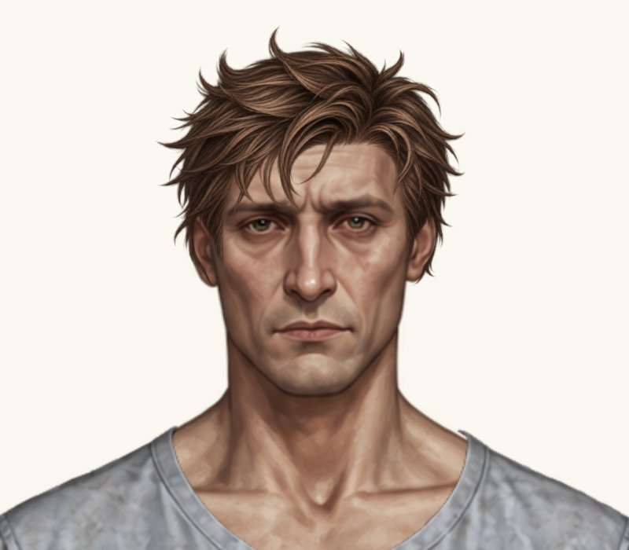
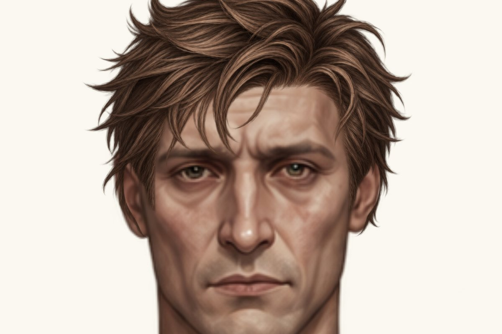
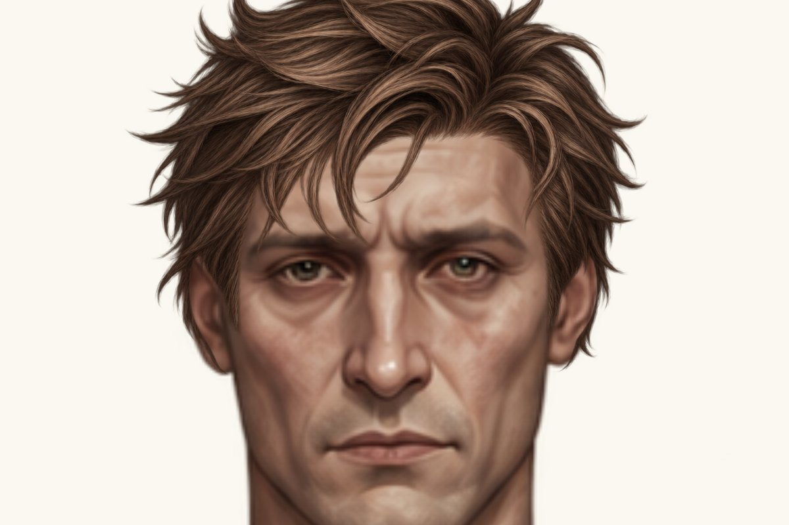

# Чоловіча розкуйовджена — фіксація правого краю

Гілка `feature/new-hairstyles-pack-02`. Main не змінено. PNG, аватари, туніки й параметри інших зачісок незмінні. Це проба для погодження власником.

Код примірки: `42aae02a89d983dbcac242e63eb0f403d60cd5de`. Базовий стан: `7c9577e7341d0fa1d0ce7c5fd724aa3c0078d642`.

## До / A / B — світлий фон

Фактичний рендеринг Paper Doll у браузері з оригінальними PNG. Однакові кадри 800×700 px, фон #faf8f0, весь ігровий компонент збільшений до 2×. Натисніть на зображення для повного розміру. Варіанти перемикаються через чинний рендерер; зображення не генерувалися й не редагувалися.

| До | A: +1 px вліво | B: +2 px вліво |
| --- | --- | --- |
|  |  |  |

## Скроні й вуха — однакове збільшення 4×

| До | A: +1 px вліво | B: +2 px вліво |
| --- | --- | --- |
|  |  |  |

## Як зафіксовано правий край

Використано наявну реєстрацію x/y/width/height. Для розширення на d пікселів задаємо x = oldX − d та width = oldWidth + d. Тому x + width = **573.4559506** для всіх трьох станів. Висота й y незмінні. Це еквівалент масштабування по X з якорем на правому краї, без окремого CSS transform.

Одного збільшення width недостатньо: чинний object-fit: contain зберіг би пропорції PNG усередині ширшої рамки. Тому лише чоловічий placement цієї зачіски має opt-in `stretchX: true`; рендерер використовує object-fit: fill. Під час кожного рендеру значення очищається для всіх інших реєстрацій, повертаючи їм contain. Жіноча розкуйовджена й інші зачіски не отримують розтягування.

Фіксується правий край; точки всередині PNG отримують дуже мале горизонтальне перетворення, яке зменшується до нуля на цьому краї. Вертикального масштабування, переміщення голови або переробки арту немає.

Усі зсуви нижче — в координатах Paper Doll 941×1672. Їхній видимий розмір змінюється разом із масштабом усього персонажа у viewport.

| Параметр | До | A | B — проба в каталозі |
| --- | ---: | ---: | ---: |
| x | 367.824991 | 366.824991 | 365.824991 |
| y | -29.293952 | -29.293952 | -29.293952 |
| width | 205.6309596 | 206.6309596 | 207.6309596 |
| height | 256.9470636 | 256.9470636 | 256.9470636 |
| Базовий scale / scaleY | 0.1832718 | 0.1832718 | 0.1832718 |
| scaleX, приблизно | 0.1832718 | 0.184163065597148 | 0.185054331194296 |
| widthScale, приблизно | 1 | 1.004863080938518 | 1.009726161877037 |
| stretchX | відсутній / false | true | true |
| Правий край x + width | 573.4559506 | 573.4559506 | 573.4559506 |

ScaleX = width / 1122; scaleY = height / 1402. Окремого поля scaleX або глобального масштабу не додано: ці значення описують фактичне відображення PNG. `stretchX` — єдиний додатковий параметр у цьому placement.

## Візуальний висновок

За крупними планами проба B дає трохи більше покриття зліва біля скроні / вуха, ніж A, без помітного перекосу, нового просвіту маківки або явного погіршення правої сторони. У каталозі залишено B як кращу з цих двох проб. Різниця дуже мала: приблизно 0.49% / 0.97% додаткової ширини. Кінчики й форма контуру біля лівого вуха залишаються частиною PNG; повністю усунутим цей художній дефект не вважаємо. Подальших довільних правок не робили. Остаточне погодження — за власником.

[Проба B у гардеробі](male-hair-messy-wardrobe.jpg), [світлий фон](male-hair-messy-head.jpg), [темний фон](male-hair-messy-head-dark.jpg), [маківка 4×](male-hair-messy-crown-audit-4x.jpg).

## Перевірки й змінені файли

[Прогін коду 42aae02](https://github.com/neverl1ke/palata404/actions/runs/38804622981): **128 успішних перевірок** (65 Node + 63 Python). Перевірено геометрію правого краю в обох прев’ю для до/A/B, фактичне розтягування по X, повернення contain при зміні предмета / статі, незмінність PNG, обидва режими, перезавантаження, вибір «Без зачіски» та viewport 1280×800, 390×844, 320×568 у Chromium. Фізичний телефон не використовувався.

- `paper-doll-data.js`: лише чоловіча розкуйовджена, проба B; усі інші записи каталогу побайтово незмінні.
- `paper-doll.js`: локальний opt-in stretchX та обов’язкове очищення objectFit при кожному рендері.
- `index.html`: кеш-версії каталогу та рендерера.
- `tests/test_game.py`: реальні три примірки та знімки, перевірка правого краю в обох прев’ю, пропорцій решти зачісок і повернення contain.
- `tests/game-logic.test.cjs`: перевірка відсутності витоку fill на іншу стать або предмет.
- Документація та цей каталог JPEG-скриншотів. Жоден PNG не змінений.

Main не змінено. Варіанти очікують погодження власником; жодних наступних довільних правок не виконано.
