[Найновіше порівняння двох жіночих зачісок](../hairstyles-pack-02-fit13/README.md).

[Найновіше порівняння двох жіночих зачісок](../hairstyles-pack-02-fit12/README.md).

[Найновіше порівняння двох жіночих зачісок](../hairstyles-pack-02-fit11/README.md).

[Остання проба: дві жіночі мікроправки від f61c538](../hairstyles-pack-02-fit10/README.md).

[Поточний звіт: лише дві жіночі зачіски](../hairstyles-pack-02-fit9/README.md). Чоловічі класична / текстурована / розкуйовджена / до плечей та жіноча класична остаточно погоджені й не змінювалися.

[Поточний звіт: наступні чотири мікроправки](../hairstyles-pack-02-fit8/README.md).

[Останній звіт: чотири зачіски від поточного стану](../hairstyles-pack-02-fit7/README.md). Попередні огляди нижче збережені як історія; актуальні знімки цих чотирьох варіантів дивіться у звіті.

# Палата 404 — нові зачіски, комплект 02

**Гілка для погодження:** `feature/new-hairstyles-pack-02`. У `main` зміни не перенесено. Гілка каре `preview/bob-cheek-direction` не змінена.

Додано три предмети, чотири незмінені PNG та шість незалежних реєстрацій. Усі картинки нижче — реальні браузерні скриншоти гри. Крупний план є точною DOM-копією відрендереного компонента, пропорційно збільшеного цілком до 2×; новий арт не генерувався. Загальні плани зняті зі звичайної сцени гардероба.

[Остання проба лише чоловічої розкуйовдженої: фіксований правий край, A / B](../hairstyles-pack-02-right-anchor/README.md).

Обидві класичні короткі стрижки фінально затверджені й не змінені. [Нова проба трьох інших посадок — до / після](../hairstyles-pack-02-fit5/README.md).

## Шість примірок — огляд

### Чоловік

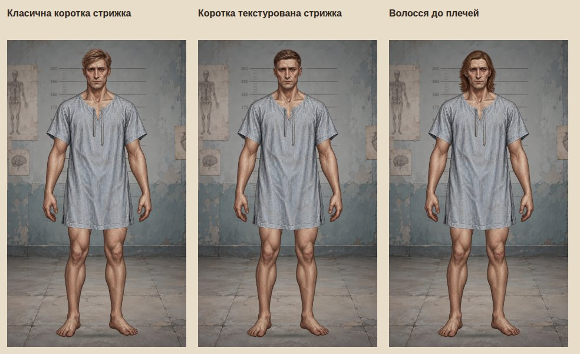

### Жінка

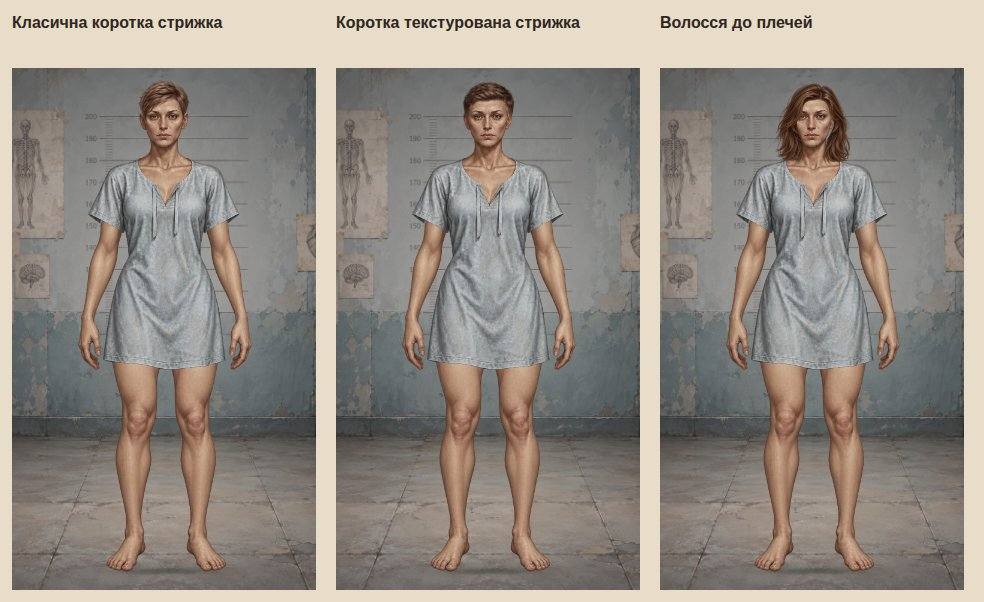

## Загальний вигляд і крупні плани

Натисніть на зображення, щоб переглянути його у повному розмірі. Крупні плани мають 800×700 px; світлий фон #faf8f0, темний #1c2023.

| Примірка | Загальний вигляд | Крупний план | Темний фон |
| --- | --- | --- | --- |
| Класична коротка стрижка — Чоловік | 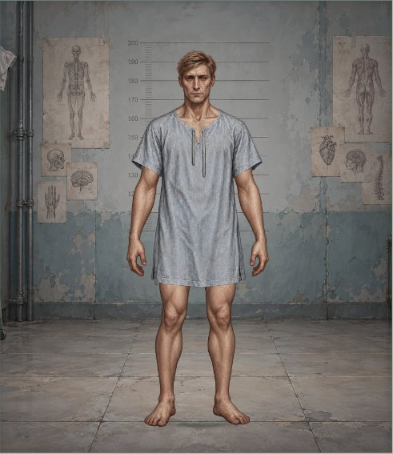 | 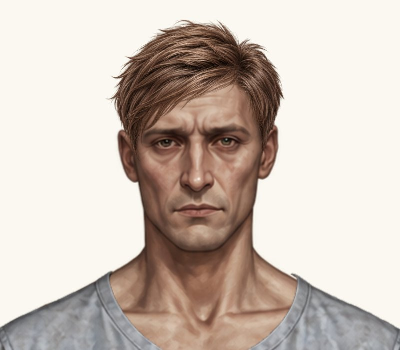 | [Відкрити](../hairstyles-pack-02-fit4/male-hair-classic-short-head-dark.jpg) |
| Класична коротка стрижка — Жінка |  | 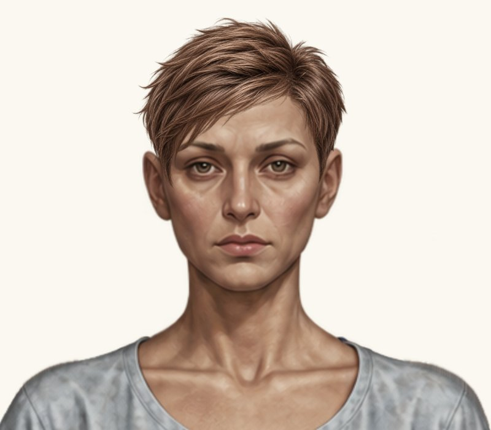 | [Відкрити](../hairstyles-pack-02-fit4/female-hair-classic-short-head-dark.jpg) |
| Коротка текстурована стрижка — Чоловік | 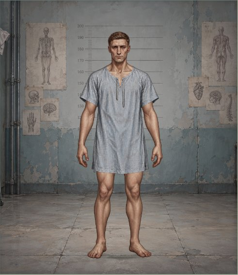 | 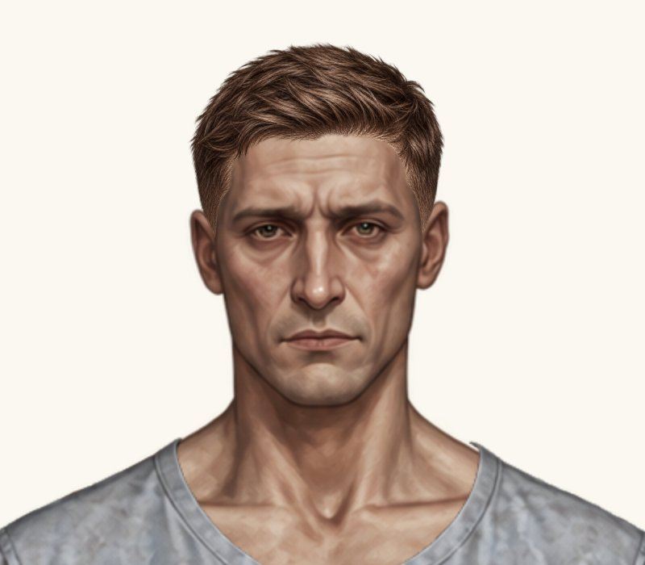 | [Відкрити](../hairstyles-pack-02-fit5/male-hair-textured-short-head-dark.jpg) |
| Коротка текстурована стрижка — Жінка | 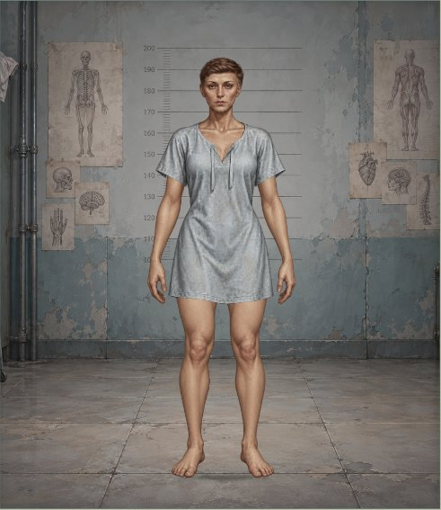 |  | [Відкрити](female-hair-textured-short-head-dark.jpg) |
| Волосся до плечей — Чоловік | 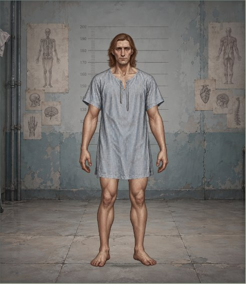 | 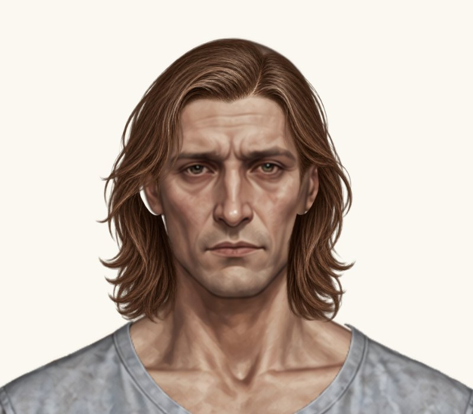 | [Відкрити](male-hair-shoulder-length-head-dark.jpg) |
| Волосся до плечей — Жінка | 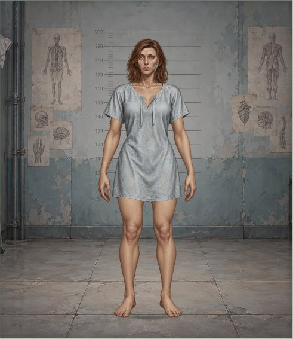 | 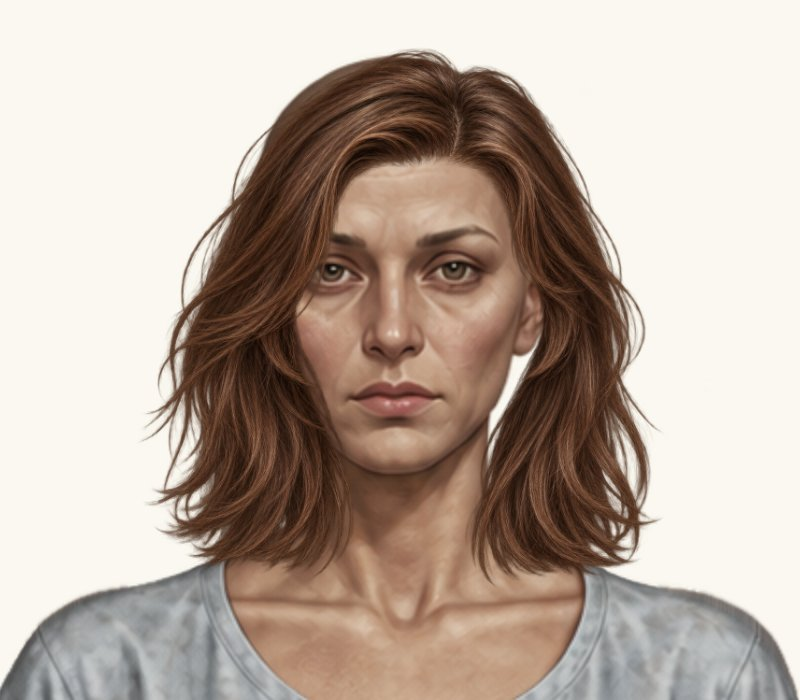 | [Відкрити](../hairstyles-pack-02-fit5/female-hair-shoulder-length-head-dark.jpg) |

## Залишковий дефект чоловічого волосся до плечей

На масштабі 0.21 залишився світлий проміжок зліва біля вуха й місцями читається контур маківки. Зменшення до 0.20 ще звужує отвори, але робить зачіску коротшою та сильніше відкриває верх базової голови. Початкові 0.225 дають більші отвори біля обох вух. У каталозі залишено 0.21 як пробний компроміс; альтернативи нижче — лише порівняння.

| 0.225 — початковий | 0.21 — у каталозі | 0.20 — діагностична проба |
| --- | --- | --- |
| 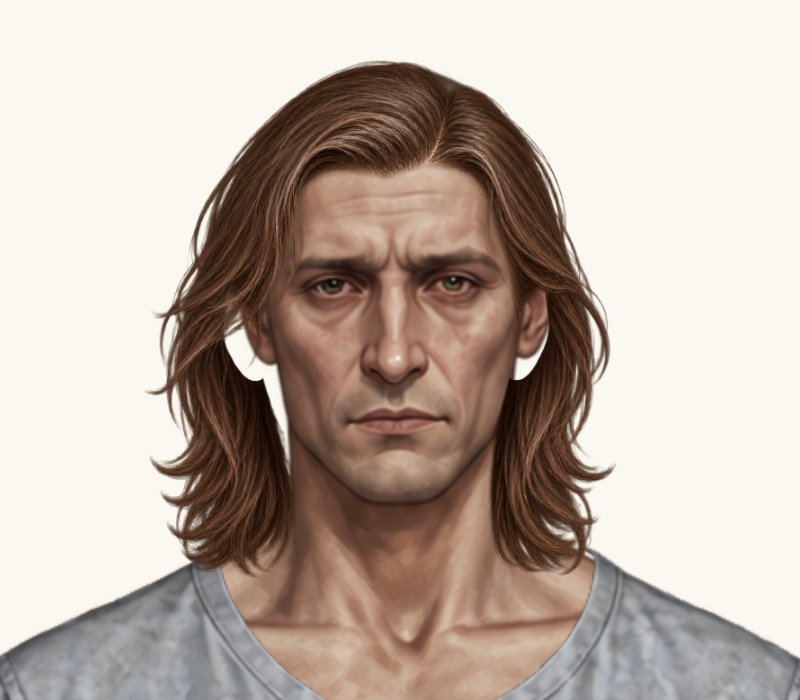 |  | 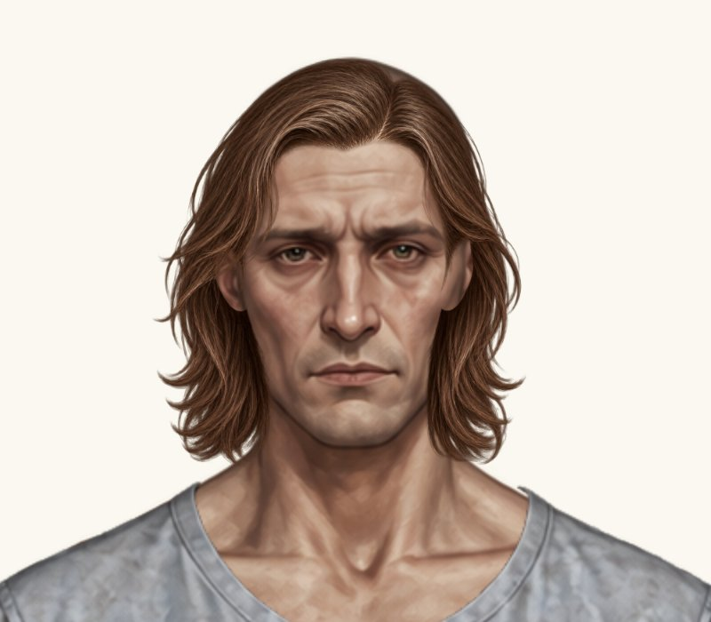 |

Повністю усунути дефект перевіреними пропорційними перетвореннями не вдалося. PNG не редагувався: маски шкіри, дублікати голови, домальовані пасма й сторонні шари не додавалися. Потрібне окреме рішення власника щодо цього ресурсу. Решта п’ять варіантів не мають виявлених великих просвітів, непрозорих фонів, помітних яскравих ореолів або перекриття обох очей; остаточна оцінка посадки належить власнику.

## Предмети та точні параметри

| Назва | ID | PNG |
| --- | --- | --- |
| Класична коротка стрижка | `hair-classic-short` | [`classic_short_unisex_style_A.png`](../../assets/wardrobe/hair/classic_short_unisex_style_A.png) |
| Коротка текстурована стрижка | `hair-textured-short` | [`classic_short_unisex_style_B.png`](../../assets/wardrobe/hair/classic_short_unisex_style_B.png) |
| Волосся до плечей | `hair-shoulder-length` | [`male_medium_shoulder_length.png`](../../assets/wardrobe/hair/male_medium_shoulder_length.png) [`female_medium_shoulder_length.png`](../../assets/wardrobe/hair/female_medium_shoulder_length.png) |

Координати на полотні 941×1672; scale відносно вихідного PNG 1254×1254. Для обох осей однаковий коефіцієнт.

| ID | Стать | x | y | width | height | scale |
| --- | --- | ---: | ---: | ---: | ---: | ---: |
| `hair-classic-short` | male | 370.5 | 0 | 200.64 | 200.64 | 0.16 |
| `hair-classic-short` | female | 372.5 | -5 | 196.878 | 196.878 | 0.157 |
| `hair-textured-short` | male | 369.9884556812 | -7.8760272324 | 201.8883785688 | 201.8883785688 | 0.1609955172 |
| `hair-textured-short` | female | 374.0210235314683 | -13.885696649022648 | 201.45305805472074 | 201.45305805472074 | 0.16064837165448225 |
| `hair-shoulder-length` | male | 341.320000325 | 22.61025 | 256.7565 | 256.7565 | 0.20475 |
| `hair-shoulder-length` | female | 317.618976 | 12.903985568 | 293.530982976 | 293.530982976 | 0.234075744 |

## Перевірки та межі

[Браузерний прогін коду 6cc97f0](https://github.com/neverl1ke/palata404/actions/runs/38802046843): 65 Node + 63 Python — усі **128** успішні. Серед них 8 перевірок PNG / SVG, точних байтів та альфа-каналів. Перевірено перемикання між новими й попередніми зачісками, «Без зачіски», обидві статі, «Пацієнт» / «Трип», головний HUD і гардероб, туніки, збереження вибору після перезавантаження та старі збереження. Перевірено 1280×800, 390×844 і 320×568 у Chromium; фізичний телефон не використовувався.

Чотири джерела скопійовані без зміни байтів, усі RGBA 1254×1254 з alpha 0–255. У style B та жіночому волоссі до плечей є поодинокі кутові alpha-1 пікселі, які не видалялися. Оригінальні бази з архіву збігаються з базами проєкту; приклади примірок не використовуються як накладки. Шість попередніх PNG незмінні; серед їхніх placements лише чоловіча розкуйовджена отримала запитане зменшення на 3% у попередній правці й підняття на 2 px, а в поточній пробі — збільшення на 0.5%. Аватари, туніки, інші предмети та схема збережень незмінні.

Зміни: `paper-doll-data.js`, кеш каталогу в `index.html`, чотири PNG в `assets/wardrobe/hair/`, розширені наявні тести та маніфест нового пакета, [технічний опис](../../docs/HAIRSTYLES_PACK_02.md), ці матеріали перегляду. Система Paper Doll не переписувалася.

**Обидві класичні стрижки погоджені. Решта пробних посадок очікують погодження; злиття в main не виконано.**
