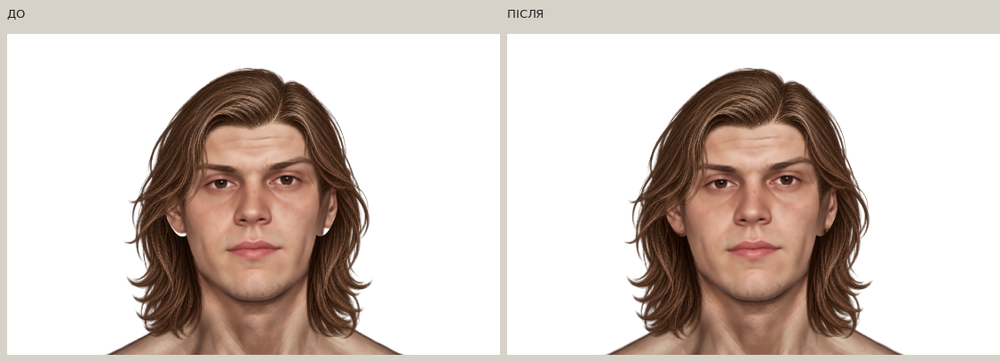
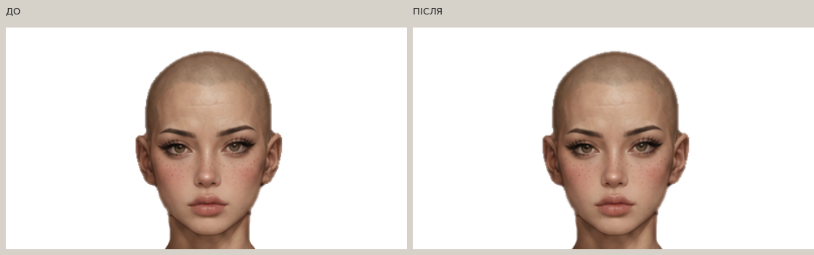
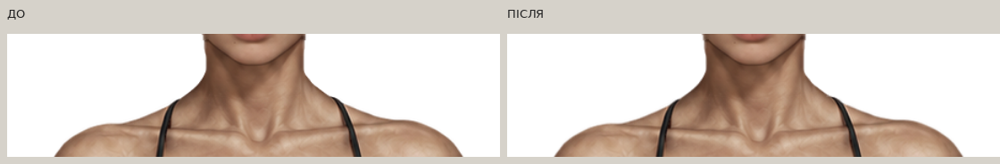

> **Історичний аудит 9d5691f / 8bcf183.** Наступний цільовий фікс пропорцій, контурів, шиї, тону та перекриття вух: [новий звіт](../paper-doll-targeted-fix/README.md). Цю галерею та її попередні результати не перезаписано.

# Paper Doll — повторний аудит контурів, стиків і гардероба

Робота виконана безпосередньо в `main`, від `dbbcddff2f79a3393271ac6afc4d261221d9b77e`. Перед змінами `HEAD` дорівнював `origin/main`, відстежуване дерево було чистим; історію не переписано. [Передумови](preflight.json). Попередні звіти й галереї збережено як історичні матеріали.

**Художня стилізація нового чоловічого портрета залишається відкритою.** Цей прохід виправляє контури та композит, але не видає автоматичну фільтрацію за авторський repaint. Детальніше — нижче.

## Зображення з реальної гри

[Відкрити повну галерею](gallery.html) · [Галерея через GitHub Pages](https://neverl1ke.github.io/palata404/review/paper-doll-audit-2026-10/gallery.html).

Знімки отримано Chromium з основного `index.html`, а не з окремої намальованої примірки. ДО — точний стан `dbbcddf`, ПІСЛЯ — поточний рендер. Для збільшених PNG обох фаз використано однаковий масштаб 1.2 від координат полотна. Монтаж лише розташовує справжні знімки поруч і додає підписи. Оригінальні PNG містять білий, сірий, чорний і зелений фони; компактні порівняння нижче показують білий.

### Чоловіче волосся до плечей



### Нова жіноча голова та шия





### Усі комбінації

| Персонажі | Оригінальний колір | Білий колір |
|---|---|---|
| 6 чоловічих облич × 7 зачісок | [42 комбінації](matrix-male-original.jpg) | [42 комбінації](matrix-male-white.jpg) |
| 6 жіночих облич × 8 зачісок | [48 комбінацій](matrix-female-original.jpg) | [48 комбінацій](matrix-female-white.jpg) |

Матриці показують білий фон. У каталогах [ДО](before/) і [ПІСЛЯ](after/) кожна повна таблиця `*-{original|white}.jpg` містить **усі чотири фони**: рядки — зачіски, стовпці — білий, сірий, чорний, зелений. Кожна фаза: **90 унікальних комбінацій, 720 рендерів** (90 × 2 кольори × 4 фони), `page_errors: []`, `http_errors: []`. [Протокол ДО](before/capture.json), [протокол ПІСЛЯ](after/capture.json). Окремі `*-target-palette-*` перевіряють також black, red, blue для чоловічого shoulder-length та original/black/white для жіночого каре з чубчиком.

## Підтверджені дефекти, причини й виправлення

| Дефект | Причина | Виправлення та перевірка |
|---|---|---|
| Слабкий шум поза силуетом тіл і волосся | Експортні пікселі з альфою 1–16, зокрема з’єднані з основним компонентом | Аналіз від альфи 1; локальне згасання тільки слабкої віддаленої альфи. Пальці й пасма зі значущою альфою збережені |
| Темний matte по частині напівпрозорих країв | RGB деяких крайових пікселів уже був помножений на альфу | Вибіркове unpremultiply тільки за відповідністю RGB/альфи й близькості непрозорого донора; природні темні штрихи не відбілювались масово |
| Зубчасті шкірні краї | Перехід сильної альфи на окремих пікселях | Вузьке згладжування лише межі альфи шкіри; RGB обличчя не розмивався |
| Подвійні краї голова → тіло | Незалежно згладжені голова й маска давали різну сумарну непрозорість | Спільний розрахунок head alpha та body mask у зоні шиї, контроль сумарного силуету й непрозорості |
| Азійські голови: залишки старої голови та різкий нижній край | Для цих двох накладок не було окремої маски; вихідний PNG закінчувався раніше за старі профілі neck join | Додано `male_asian_body.png`, `female_asian_body.png`, з’єднано шию до нижньої межі PNG. Положення голови 0/0, 941×1672 не змінено |
| Чоловіче shoulder-length: світлі прогалини біля вух | Надто широкий внутрішній виріз переднього шару; додаткове збільшення всього волосся погіршувало б обличчя | Окремий локальний задній шар із текстури чинного волосся, позаду тіла/голови. Передня посадка збережена |
| Рубані ділянки crown clip | Рідкі кутові точки polygon | Квадратична інтерполяція контуру з дрібнішими сегментами та мінімальним внутрішнім запасом; відсоткові координати й локальність обрізання збережені |
| Мобільний каталог перекривався керуванням | Вкладені прокрутки, велика палітра та довгий sticky-опис | Одна прокрутка каталогу; компактна палітра; для одягу й спорядження довгий опис іде після картки, не накриває її |
| Незрозумілий вибір проти екіпірування | Огляд і застосування візуально мало відрізнялися | Окреме позначення «Огляд», збережений стан «Екіпіровано», доступна дія й підпис фактично вдягненого волосся/кольору |

До додавання азійських масок поза новим силуетом у верхній зоні залишалися **601 чоловічий та 704 жіночі пікселі** базової голови. Після виправлення всі десять пар head/mask проходять перевірку приховування старого черепа вище y=210, цілісності сильного композита та внутрішньої непрозорості шиї.

## Які PNG змінено

**32 наявні ресурси очищено/узгоджено, 3 додано; перевірено 37 активних PNG.** Повний пофайловий список, SHA-256 ДО/ПІСЛЯ, кількість змінених альфа-пікселів і RGB-корекцій (поля `final_*` враховують також остаточний neck join; початкові `alpha_changed`/`edge_rgb_corrected` описують крайовий прохід): [edge-repairs.json](edge-repairs.json). Маніфест усіх активних ресурсів: [resource-manifest.json](resource-manifest.json).

- `base_male.png`, `base_female.png`: альфа-край і окремі RGB-пікселі matte; без зміни полотна, пози або анатомії.
- Усі 10 накладок у `assets/wardrobe/faces/`: крайова обробка, спільний neck join із відповідною маскою. Внутрішній RGB контрольної області обличчя `(435,90)–(515,205)` збережено побайтно.
- 8 наявних масок у `assets/wardrobe/faces/masks/` перераховано разом із головами; додано 2 азійські маски.
- Усі 11 активних передніх PNG у `assets/wardrobe/hair/`: видалено слабкий віддалений шум, виправлено підтверджені matte-пікселі. **Кожен вихідний байт альфи ≥17 та RGB кожного вихідного непрозорого пікселя волосся збережено.**
- `female_neckline_skin_underlay.png`: очищено слабку альфу й крайовий matte.
- Додано `male_medium_shoulder_length_rear.png`.
- **Обидві туніки `patient_tunic_male.png`, `patient_tunic_female.png` залишено побайтно незмінними.**

Контроль на рівні сильного силуету тіл: bbox за альфою 128 змінюється не більше ніж на 1 px, площа — менш ніж на 0.1%. Це не глобальний erosion/dilation. Нижнє тіло після з’єднання голови від y=310 збігається з очищеною базою.

### Технічні параметри обробки

Слабка альфа 1–16: відстань до ядра α≥32, початок згасання 2 px оригінального PNG, smoothstep до 3.5 px. Сильна альфа волосся не фільтрується. Відокремлений компонент видаляється лише якщо **вся** його альфа ≤16. Для шкіри — σ=0.42 у межовій смузі близько 1.5 px, без RGB blur; neck join узгоджується окремо.

RGB matte виправляється тільки для α<220, донора α≥240 на відстані ≤3 px та відповідності відношення яскравостей альфі з допуском 0.16; результат обмежений локальним кольором донора ±25.

За однаковим набором початкових ресурсів число слабких пікселів α1–16 далі 4 px від ядра скоротилося **408599 → 750**. Решта 750 належить нижнім плавним переходам head/mask, які композитяться з тілом; це не зовнішній шум волосся. Для тіл, волосся й верхніх зон голів таких віддалених пікселів після обробки немає. Відокремлені ненульові пікселі тіл: чоловік **971 → 0**, жінка **345 → 0**.

[Повний RGBA-аналіз ДО](rgba-before.json) · [ПІСЛЯ](rgba-after.json). Темні/світлі RGB-відмінності та однопіксельні виступи у звіті — **кандидати для огляду**, а не автоматичні помилки: тест не оголошує природні щілини, штрихи й пасма дефектами.

## Чоловіче shoulder-length та порядок шарів

Передній шар залишено в затвердженій посадці: **x=330.705600351, y=21.61907, width=height=277.29702, scale=0.22113**. Попередні +8% повторно не застосовано.

Новий задній PNG зареєстрований на повному полотні **941×1672, x=0, y=0**, `renderOrder=-1`. Видимі ділянки обмежені зоною приблизно y=128…217; центр обличчя x=435…510 прозорий. Текстуру взято з наявних пасом, із локальним зміщенням вибірки на 22 px назовні та 23/36 px угору. Це не нова генерація та не плоска заливка.

Порядок: **задні пасма (-1) → тіло (0) → голова (1) → переднє волосся (9)**. Верхній шар волосся завжди над головою. Шари одягу/головних уборів збережено. Кореневі ID переднього волосся залишаються `layer-hair`, `wardrobe-layer-hair`; задній елемент видаляється при зміні зачіски/статі.

Для заднього шару `colorReference` посилається на передній PNG: використовується його медіана освітлення, щоб original/black/white/red/blue не давали різнокольорової вставки позаду вуха. Альфа при фарбуванні не змінюється.

Crown clip зберігає вихідні точки, додає по 4 квадратичні вибірки на ділянку та внутрішній запас 0.35 px; наявний окремий запас 1.2 px для нового чоловічого обличчя + messy залишено. Усі інші placement та погоджене горизонтальне розтягування messy не змінені.

## Мобільний гардероб

Перевірено Chromium-viewport **320×568, 360×640, 390×844, 430×844, 768×844**, обидва комплекти й усі категорії/слоти. Окремі старі регресійні тести також перевіряють 768×1024 і горизонтальний екран 844×390.

- `.wardrobe-items` — спільна вертикальна прокрутка; внутрішня сітка не створює другої обрізаної області.
- Перемикач статі та згорнута палітра доступні під час прокрутки. Палітра відкривається кнопкою ≥44 px з `aria-expanded`.
- Закріплена нижня дія використовується для компактного огляду облич і волосся; довгі описи одягу/спорядження прокручуються у звичайному потоці.
- До 430 px кнопки слотів без зайвих іконок; три слоти зовнішності вміщуються в рядок, довші набори слотів прокручуються горизонтально без розбиття кожного слова на літери. Назви карток переносяться.
- Для огляду облич/волосся до 800 px наближається **весь спільний контейнер** (300%), а не окремі PNG. Одяг і базове тіло мають повноростовий режим. Координати Paper Doll не змінюються.
- Фактичне натискання карток, палітри й кнопок перевірено через `elementFromPoint`, а не лише наявність DOM. Горизонтального переповнення сторінки немає.

[320 px](after/wardrobe-320-hair.jpg) · [390 px](after/wardrobe-390-face.jpg) · [768 px](after/wardrobe-768-hair.jpg) · [десктоп](after/wardrobe-1440-hair.jpg). Це браузерна емуляція розмірів; фізичний телефон у цьому середовищі недоступний.

## Збережені механіки

Каре з чубчиком доступне лише жінкам, original залишається каштановим `#704632`, black — тільки після вибору палітри. Чоловічий старий сейв із цим каре переходить на `hair-none`. Схема збереження не змінювалась. Обличчя, волосся й колір спільні; одяг «Пацієнта» / «Трипу» окремий. Палітра HEX, інвентар, характеристики, прогрес, бій і нагороди не змінені.

## Перевірки та відтворення

**75/75 JavaScript та 85/85 унікальних Python/Chromium-перевірок після адресних повторних запусків.** [Точний протокол](test-results.json), журнали — у `logs/`. Перший повний прогін мав 3 проблемні тестові функції: застарілу вимогу повноростового портрета, реальне перекриття картки туніки на 320 px та шрифт слотів 12 px замість мінімальних 13. Вимогу кадрування уточнено; два UI-дефекти виправлено. Всі три повторно перевірені успішно, включно з посиленим натисканням карток у кожній категорії. Свіжий повний CI-прогін після push відображено в publication.json. Старі результати 72/76 попереднього етапу не зараховуються як цей запуск.

```sh
pip install -r requirements-dev.txt
python -m playwright install chromium
node --test --test-isolation=none tests/game-logic.test.cjs
python -m unittest discover -s tests -v
python tools/audit-paper-doll-png.py --output test-results/png-quality.json
```

Нові перевірки захищають α≥17 волосся, непрозорий RGB пасом, реєстрацію й внутрішній RGB облич; виявляють навіть з’єднаний з основою шум α=1; контролюють сумарний neck join, задню текстуру, clip-path, кольорову альфу, 90 комбінацій, доступність мобільних карток, 404/JS errors і reload. Вони не доводять художню якість портрета автоматично; її оцінено окремо.

Інструменти:

- `tools/audit-paper-doll-png.py` — повторний аналіз усіх активних PNG або вибраних шляхів, пороги 1/8/16/32/128/240.
- `tools/clean-paper-doll-edges.py --snapshot DIR` — відтворення ремонту з незмінного знімка ДО; повторне застосування до вже очищеного PNG не потрібне.
- `tools/refresh-paper-doll-audit.py --snapshot DIR` — хеші, cache query та контракти, з окремим збереженням джерельних хешів.
- `tools/review-paper-doll-audit.py --phase after` — браузерна матриця.
- `tools/capture-paper-doll-details.py --phase after` — збільшені контрольні PNG.
- `tools/verify-paper-doll-pages.py` — повторна перевірка 90 комбінацій у фактичній опублікованій HTTPS-грі.

Точний перелік змінених файлів і призначення груп: [changed-files.md](changed-files.md).

## Відкриті художні питання й межі перевірки

**Нове чоловіче альтернативне обличчя все ще гладше та фотографічніше за старі портрети.** У цьому проході його особистість, геометрію та внутрішній RGB збережено; виконано лише безпечне очищення крайових пікселів і композит. Повноцінний мальований repaint шкіри та світлотіньових площин тут не виконано й не позначено як закритий. Рекомендація: окремий ручний прохід художника за старими чоловічими PNG, на тому самому полотні й із зафіксованими очима/черепом/реєстрацією.

Пасма навмисно не зроблено симетричними, природні прозорі проміжки поза черепом залишено. При надмірному наближенні низькорозмірних PNG видно їх вихідну дискретність; тотальне розмивання не застосовувалось. Дрібні природні тонові відмінності шкіри можливі; контрольні знімки наведено без приховування.

Фізичний сенсорний пристрій не перевірявся. Автоматичний аналіз знаходить підозрілі краї, але не замінює художній перегляд.

## Публікація

Код і ресурси: [`9d5691f`](https://github.com/neverl1ke/palata404/commit/9d5691f3dedb94c002a21fc33209be1f320dcd15). На опублікованій HTTPS-грі повторно перевірено **90 комбінацій / 720 перевірок фону й кольору**, reload та мобільні 320/390/768 px, без JS errors і 404: [live-browser.json](live-browser.json). Опубліковані 48 runtime-файлів, включно з 37 PNG, побайтно збіглися з локальним результатом.


**GitHub Actions для `9d5691f`: success — 75/75 JS і 85/85 Python/Chromium (442.278 с).** [Запуск](https://github.com/neverl1ke/palata404/actions/runs/39061447098), [витяг журналу](logs/ci-9d5691f-summary.log). [GitHub Pages: success](https://github.com/neverl1ke/palata404/actions/runs/39061446879). Звітування та додані знімки HTTPS-перевірки йдуть окремим наступним комітом, без зміни runtime/PNG.

Статус комітів, GitHub Actions та перевірки фактичних HTTPS-ресурсів GitHub Pages наведено в [publication.json](publication.json). Посилання на гру: https://neverl1ke.github.io/palata404/ .
