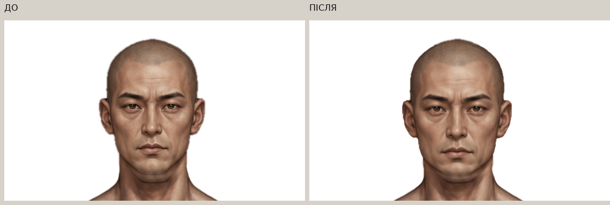
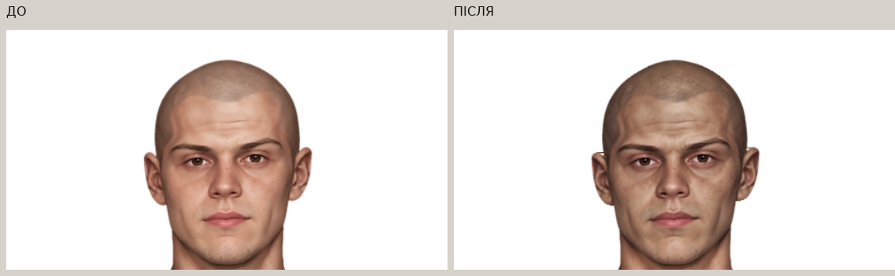
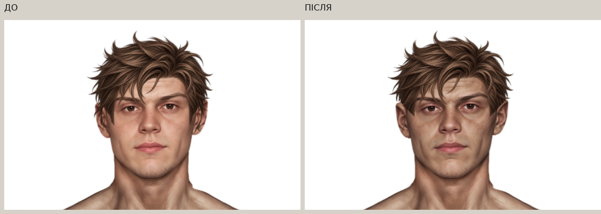
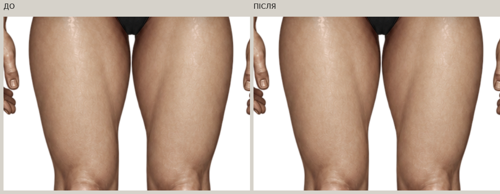

# Paper Doll — цільовий фікс після аудиту

Робота виконана прямо в `main`, від `8bcf1830429008113c145e15c016a9bc709e35a1`. Перед змінами локальний `main` дорівнював `origin/main`, робоче дерево було чистим. [Передумови](preflight.json). Попередню галерею не перезаписано.

[Відкрити нову галерею через GitHub Pages](https://neverl1ke.github.io/palata404/review/paper-doll-targeted-fix/gallery.html) · [HTML галереї](gallery.html) · [маніфест PNG](resource-manifest.json) · [точні параметри правок](repairs.json).

## Що підтвердилося

| Пункт | Встановлена причина | Виконана правка |
|---|---|---|
| Чоловіче азійське обличчя | Ширина біля вух була близькою до інших голів, але нижня частина обличчя вужча; додатково край мав ширшу напівпрозору смугу | Обережні **+3.5%** верхньої голови навколо `(474,30)` із плавним поверненням до зареєстрованої шиї; уточнення покриття краю та індивідуальний neck join |
| Жіноча альтернативна голова | У частині рядків під вухами альфа досягала непрозорої шкіри через кілька пікселів; залишалися темні крайові RGB-пікселі | Локальне уточнення напівпрозорого краю, виправлення темного matte. Загальну форму, позицію та профіль стику шиї не перероблено |
| Інші голови | Окремі широкі AA-переходи та крайовий темний matte залишалися в різній кількості | Перевірено всі 10 накладок і обидві базові голови; змінено тільки підтверджені крайові смуги накладок |
| Жіноча exhausted | Проблема нижнього переходу після попередніх деформацій шиї; даних для нового масштабування всієї голови не було | Новий криволінійний перехід у базову шию; масштаб голови не змінено |
| Чоловіча messy | Передні бокові фрагменти PNG проходили поверх вух | Локально вкорочено перекриття біля вух у самому alpha PNG; маківка, ширина та placement збережені |
| Внутрішні стегна жіночої бази | Вихідне затемнення додатково посилювалося попереднім тоновим перенесенням | Лише локальна додатна RGB-корекція внутрішнього краю стегон; збережено альфу, текстуру й природну об’ємну тінь |
| Чоловіче альтернативне обличчя | Рожевіший і світліший тон та фотографічна фактура відрізнялися від тіла й старих портретів | Локальна мальована RGB-ретуш існуючого портрета, реєстрація за рисами, збереження початкових очей/носа/губ у суміші та тонове узгодження з базою |
| Жіноче альтернативне: тон | Потрібне невелике зближення відтінку з тілом | Окремий легкий тоновий прохід. Цей прохід не змінює альфу, посадку або шию; очищення контуру належить окремому пункту вище |
| Чоловіче shoulder-length | Частина передніх пасом біля вух мала бути за головою | Локальні вікна в передньому PNG відкривають вуха; уже доданий rear-layer і весь placement залишено побайтно/чисельно незмінними |

## Реальні ДО / ПІСЛЯ

Всі контрольні знімки зроблено Chromium з основного `index.html` і чинного `renderPaperDollAt`. ДО — незмінний знімок `8bcf183`; ПІСЛЯ — цей фікс. Монтаж лише розташовує справжні знімки поруч. На звичайних деталях масштаб **1.2 від координат полотна**, на спеціальних ділянках вух — **4**, однаковий у двох фазах.









Окремі збільшення: [лівий край жіночої альтернативної](female-alternative-ear-left-before-after.png), [правий](female-alternative-ear-right-before-after.png), [exhausted — шия](female-exhausted-neck-before-after.png), [shoulder-length](male-shoulder-before-after.png). Повні оригінальні PNG кожної деталі містять **білий, сірий, чорний і зелений** фони: [ДО](before/), [ПІСЛЯ](after/).

## Повна матриця

| Стать | Original | White |
|---|---|---|
| 6 чоловічих облич × 7 зачісок | [42 комбінації](matrix-male-original.jpg) | [42 комбінації](matrix-male-white.jpg) |
| 6 жіночих облич × 8 зачісок | [48 комбінацій](matrix-female-original.jpg) | [48 комбінацій](matrix-female-white.jpg) |

Для **кожної фази** знято 90 унікальних комбінацій × 2 кольори × 4 фони = **720 рендерів**. [Протокол ДО](before/capture.json), [ПІСЛЯ](after/capture.json): `page_errors: []`, `http_errors: []`. Збільшені деталі — 22 випадки на чотирьох фонах. Окремі таблиці перевіряють original/black/white/red/blue для чоловічого shoulder-length та original/black/white для жіночого каре.

У матрицях переглянуто маківку, вуха, щоки, підборіддя, внутрішній край волосся, шию та зовнішню альфу. Природні проміжки між локонами й анатомічні тіні не залито. На десктопі та мобільних viewport перевірено чинний гардероб, обидві статі й комплекти.

## Точні параметри

### Азійська чоловіча голова

Полотно та системна реєстрація залишаються **941×1672, x=0, y=0**. Локальне збільшення верхнього вмісту PNG: **1.035**, якір `(474,30)`, поступове повернення до шиї у y=216…256. Ширина bbox α≥128 у верхній контрольній зоні змінилася **164 → 170 px**; це не довільне велике масштабування.

Новий профіль neck join: `(center=474, radius=72, start=234, end=262, arc=10)`. Відповідна азійська маска залишилася окремим активним ресурсом. Маківка лишається в межах 1 px від початкової позиції. Уточнений край проходить перевірку вузької смуги AA, а не широкого feather.

### Контури всіх накладок

Перерахунок застосовано лише до рядків із широкою напівпрозорою крайовою смугою, а не до всього зображення. Межа α=128 уточнюється максимум на **0.55 px**; використовується приблизно однопіксельне субпіксельне покриття. Для зареєстрованої збільшеної азійської голови цей край уточнюється в усіх контрольних рядках.

Темний matte виправляється у вузькій крайовій смузі за сусідньою затіненою шкірою. Глибокі природні тіні всередині вуха та під щелепою збережено. Слабкі відокремлені фрагменти після нових локальних вирізів прибрано; попереднє очищення віддаленої альфи не скасовано.

### Жіноча exhausted

Профіль: `(473,63,234,260,11)`. Верх голови до y=218 збережено після власне крайового очищення. Нового масштабування немає. Від y=272 композит точно збігається з базовим тілом; внутрішня шия не отримує додаткової прозорості щодо бази.

Важлива умова тесту: затверджена база має місцями внутрішню альфу **253**, тому перевіряється відсутність **додаткової** прозорості та точне повернення бази, а не підміна всього тіла альфою 255.

### Альтернативні портрети

Чоловічий портрет: вихідним зображенням для локальної AI-assisted RGB-ретуші був саме наявний портрет, стильовим орієнтиром — раніше затверджене молоде чоловіче обличчя. [Чернетка ретуші](sources/male-alternative-repaint-draft.png), [зареєстрований RGB](sources/male-alternative-painted-rgb.png), [реєстрація](sources/portrait-registration.json) збережені для відтворення.

У гру використовується RGB із збереженням первісної альфи й реєстрації голови, крім незалежного очищення краю. В ділянках очей, брів, носа та губ переважає початковий малюнок. Кореляція яскравості контрольних рис із джерелом: **0.985–0.994**. Це допоміжна перевірка збереження рис, не автоматичне доведення художньої якості.

Медіана тону контрольної шкіри чоловічого портрета `Lab8`: **169/17/20 → 148/14/18**, орієнтир бази **144/14/17**. Жіночий портрет змінено набагато слабше: **155/15/19 → 153/14/18**, орієнтир бази **148/14/18**. [Вимірювання](metrics.json). Значення в `repairs.json` для входу тонового етапу чоловічого портрета виміряні вже після мальованої ретуші; це окремий етап від початкового ДО.

### Жіночі стегна

Локальна область: **x=340…604, y=823…1104**; фактично змінено **9613 шкірних пікселів** біля внутрішніх країв. Максимальна поправка RGB: **+14/+10/+7**, зі згасанням уздовж і впоперек ділянки. Білизна відсіяна за кольором. Альфа незмінна побайтно, високочастотна фактура збережена; темна об’ємна тінь не видалена повністю й не замінена плоскою заливкою.

### Волосся

**Усі `placementByGender`, x/y/width/height і `stretchX` збережені.**

| Чоловіча зачіска | x | y | width | height |
|---|---:|---:|---:|---:|
| messy | 364.082398407408 | -29.293952 | 209.373552192592 | 256.9470636 |
| shoulder-length | 330.705600351 | 21.61907 | 277.29702 | 277.29702 |

 Для чоловічої messy змінено лише нижні бокові альфа-фрагменти біля вух; маківка та передня центральна частина не рухались.

Для shoulder-length додано два невеликі вирізи у передній альфі навколо `(404,155)` та `(542,153)` у координатах Paper Doll, радіуси приблизно `8×19 px`, із локальним субпіксельним згасанням. RGB пасом, що залишилися видимими, збережено точно. `male_medium_shoulder_length_rear.png` залишено **побайтно незмінним**. Кольори й спільний reference для фарбування front/rear збережені.

## Які файли та PNG змінені

**15 активних PNG**: усі десять накладок голів (локальні краї, а для зазначених вище — тон/ретуш/реєстрація), `masks/male_asian_body.png`, `masks/female_exhausted_body.png`, `male_messy_hair.png`, `male_medium_shoulder_length.png`, `base_female.png`.

**22 інші активні PNG незмінні**, включно з `base_male.png`, двома туніками, накладкою горловини, rear-layer та рештою зачісок. У [resource-manifest.json](resource-manifest.json) наведено всі 37 шляхів із SHA-256 ДО/ПІСЛЯ. [repairs.json](repairs.json) містить точну кількість змінених RGB/alpha-пікселів для кожної правки.

Runtime: `paper-doll-data.js` — тільки версії URL змінених PNG. `index.html` та HTML-примірки — кеш-версії. `paper-doll.js`, `hair-color.js`, `wardrobe.js`, `style.css`, `script.js` не змінені. Нового слоту, ID обличчя, схеми збереження або механізму рендеру немає.

Інструменти: `refine-paper-doll-targeted.py`, `register-painted-head.py`, `refresh-targeted-paper-doll.py`, `build-targeted-review.py`; чинні браузерні capturer-и отримали параметр вихідної папки й цільові ділянки. Публічний verifier визначає чинну cache-version з index та за замовчуванням пише у `test-results`, щоб не перезаписувати історичну галерею.

## Перевірки

**Локальний повний прогін: 75/75 JavaScript і 91/91 Python/Chromium, без збоїв.** Точні поточні результати — [test-results.json](test-results.json), журнали — у `logs/`. Нові шість перевірок контролюють:

1. Дозволені області зміни альфи/RGB та побайтну незмінність усіх інших активних ресурсів.
2. Обережний масштаб азійської голови, нерухому маківку та ширину AA по всіх накладках.
3. Неперервну шию exhausted, відсутність додаткової прозорості й точне повернення бази.
4. Зближення альтернативних тонів із тілом та збереження контрольних рис.
5. Локальність поправки стегон, незмінну альфу й збережену текстуру.
6. Реальне зменшення передньої альфи біля вух, незмінні кольори решти пасом, placement та rear-layer.

Перша діагностична перевірка шиї хибно вимагала альфу 255 навіть там, де затверджена база має 253. Правильний критерій — не додавати прозорості щодо бази та від y=272 точно повернути її RGBA; він пройшов. Початковий діагностичний журнал збережено окремо від успішного повного прогону.

Пороги попереднього очищення шуму не послаблено. Попередні контракти збережені в полях `pre_targeted_fix_*`; нові незалежні області дозволених змін визначені від знімка 8bcf183, а не від довільного bbox отриманого результату. Під час розробки цей контроль виявив зайву зміну RGB на маківці exhausted через nearest-color extension — її усунуто, верх голови збережено.

Збережені інваріанти: жіноче каре та його каштановий original `#704632`; міграція старих чоловічих сейвів у hair-none; палітра та alpha при фарбуванні; окремі комплекти «Пацієнт/Трип»; спільна зовнішність; reload; порядок rear → тіло → голова → front; бойові характеристики й прогрес; попередній мобільний UI.

## Відтворення

```sh
node --test --test-isolation=none tests/game-logic.test.cjs
python -m unittest discover -s tests -v
python tools/audit-paper-doll-png.py --output test-results/png-quality.json
```

Ремонт відтворюється лише від незмінного знімка `8bcf183`, а не повторно від уже виправлених PNG:

```sh
python tools/register-painted-head.py --snapshot /path/to/8bcf183
python tools/refine-paper-doll-targeted.py --snapshot /path/to/8bcf183
python tools/refresh-targeted-paper-doll.py --snapshot /path/to/8bcf183
python tools/review-paper-doll-audit.py --phase after --output-dir review/paper-doll-targeted-fix
python tools/capture-paper-doll-details.py --phase after --targeted --output-dir review/paper-doll-targeted-fix
python tools/build-targeted-review.py
```

## Що закрито та що потребує художнього погодження

Локальні технічні виправлення масштабу, альфи, neck join, кольору стегон і перекриття вух виконано та перевірено. Тон альтернативних голів узгоджено; жіночий тоновий етап навмисно мінімальний.

Чоловічий портрет отримав справжню мальовану ретуш замість попереднього простого згладжування. **Остаточне художнє погодження характеру мазка й ступеня стилізації залишається за власником.** Не стверджую, що ручний художній прохід більше ніколи не знадобиться: наявні голови мають різну вихідну фактуру й роздільність. На ×4 помітна дискретність вихідних малих головних PNG; вона не приховується загальним blur.

Фізичний телефон у цьому середовищі недоступний. Мобільний інтерфейс перевіряється Chromium на заданих viewport; вихідні UI-файли цим фіксом не перероблялися.

## Публікація

Підсумок комітів, GitHub Actions, Pages і перевірки реальних HTTPS-ресурсів: [publication.json](publication.json). Гра: https://neverl1ke.github.io/palata404/ .


### Підтвердження опублікованої версії

Реалізація: `e1a7b2d6fb680655d3d9d719e61650049d88592d` у `main`. [GitHub Actions](https://github.com/neverl1ke/palata404/actions/runs/39068545215) — успішно: **75 JavaScript і 91 Python/Chromium**. [GitHub Pages](https://github.com/neverl1ke/palata404/actions/runs/39068544829) — успішно.

Через HTTPS перевірено 48 runtime-файлів (37 PNG): HTTP 200 і точний збіг байтів. Усі 163 початкові зображення та HTML цієї галереї також повернули HTTP 200 із точним збігом. Chromium завантажив саме опубліковані HTTPS-дані: **90 комбінацій, 720 перевірок фонів/кольорів**, reload і 320/390/768 px; жодних JS/HTTP-помилок. [Результат браузера](live-browser.json), [короткий журнал Actions](logs/github-actions-summary.log).

Нові знімки опублікованої гри: [чоловік](live-male-white.jpg), [жінка](live-female-white.jpg), [320 px](live-mobile-320.jpg), [390 px](live-mobile-390.jpg), [768 px](live-mobile-768.jpg). Вони доповнюють локальні порівняння ДО/ПІСЛЯ та не замінюють історичні матеріали.
