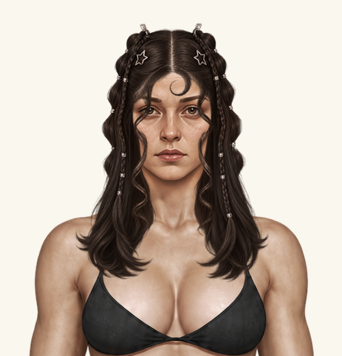

# Одна пробна зачіска: коси з локонами

Створено та локально підключено в `main` від `adffd71`. **Push і публікація не виконувались.** Один окремий жіночий каталожний ID: `hair-trial-braided-curls`, назва «Коси з локонами — пробна».

Вибір у локальній грі: **Гардероб → Зовнішність → Зачіски → Жінка → Коси з локонами — пробна → Обрати**. За замовчуванням новий варіант сам не надягається.

## Поточна правка: контур щік, щелепи та шиї

Локально відведено основну бічну масу від контуру обличчя; передні локони залишаються поверх щік і щелепи та чіткіше відділені напрямком пасом і локальною світлотінню. Волосся обрамляє шию з боків. Не вирізалась вертикальна прозора смуга. Нижнє волосся на трапеціях, ключицях і грудях **не редагувалось**. Розмір кінцевого PNG **941×1672**, runtime **x0 / y0 / scale1**, вихідна реєстрація **scale0.3 / x325.5 / y−6** не змінені. Базові аватари, голови, решта зачісок, загальна палітра, довжина й прикраси незмінні.

Використано локальне редагування з `image_gen` та перенесення лише внутрішніх ділянок на поточний PNG. Першу спробу відхилено при фактичній примірці: вона змінила вигини локонів біля рота. Фінал — друга локальна редакція; повне зображення редактора не замінює затверджене джерело. Маска обмежує зміни двома внутрішніми областями джерела `(295,600)–(435,1070)` і `(550,600)–(685,1070)` з локальним згладжуванням краю8px. Пікселі поза маскою, верх доy570 та нижні пасма відy1120 збігаються з попередньою версією **точно**. Локальні світлі штрихи передніх локонів — частина запитаної світлотіні, загальне перефарбування не застосовувалось.

[Поточний знімок гри](result.png) · [ДО / ПІСЛЯ, ліворуч до](contour-before-after.png) · [Крупний план2×](contour-detail.png) · [Попереднє джерело](before-contour-source.png) · [Маска](contour-edit-mask.png) · [Примірка до](before-contour-fit.png).

Відтворення: `bash tools/apply-trial-contour-edit.sh`; джерела та параметри — `registration.json`. Оновлено хеш URL тільки пробного PNG у `paper-doll-data.js` та версію підключення цих даних в `index.html`. Решта допоміжних змін — маска, робоча редакція, контрольні знімки/галерея, звіт, один тест збереження неохоплених ділянок та інструмент складання.

Фактичні перевірки: **90/90 JavaScript, 6/6 цільових Python** (`test-logs/contour-js.log`, `test-logs/contour-python.log`). Основний `index.html`, Chromium151: 17жіночих варіантів; original/black/white на світлому, сірому, чорному й зеленому фонах; вибір через картку, reload, «Пацієнт / Трип», зняття та виключення з чоловічого каталогу. JS errors0, HTTP errors0. Мобільні320/390 — емуляція, не фізичний пристрій. Візуально оглянуто світлу й зелену примірки та крупний план шиї/щелепи. Повний загальний Python-набір цього проходу не запускався.

Аналіз PNG: віддалених слабких пікселів0, відокремлених компонентів0. Діагностичні кандидати темних/світлих країв929/37 не прирівнюються автоматично до дефектів: волосся має природні тіні й тонкі пасма. Художнє погодження залишається за користувачем. **Робота локально в main, без commit/push і публікації цього проходу.**

## Попередній етап: нижні локони та перекриття вух

За позначками користувача змінено **лише цю пробну зачіску**. Нижні вигини бічних локонів опущено від рівня кутиків рота до щелепи / верхньої шиї. Локальний бічний об’єм біля вух розширено; маківка, загальна довжина, прикраси, колір і початковий малюнок поза маскою не змінені. Голови, тіла, інші зачіски, палітра й рендерер не редагувалися.

Збережено [точне затверджене джерело](approved-texture-source.png), [локальну заготовку](local-jaw-ear-edit.png) і [маску перенесення](local-edit-mask.png). Перша художня локальна спроба все ще лишала вигини біля рота; її не прийнято за фінал. Для нижніх локонів використано геометричне переміщення **початкових пікселів**, без перефарбування: зворотне зміщення по y = `130 × sin²(π(y−570)/650)` у межах y570…1220 джерела. Воно обмежене двома зонами маски; верхні локони й проділ не зміщувалися. Для ділянок біля вух — локальна заготовка та додаткове плавне розширення до20px джерела з кожного боку (до6px ігрового полотна). Повна вихідна заготовка не підміняла затверджену зачіску: переносились лише потрібні фрагменти.

Змішування повного RGBA замість source-over прибирає стару позицію локона, не залишаючи прозорого дубля. Усі пікселі поза маскою **точно збігаються** із затвердженим джерелом; це перевіряється тестом. Складання збережено у `tools/apply-trial-local-edit.sh`. Реєстрація незмінна: source scale0.3, x325.5, y−6; runtime **x0, y0, scale1, 941×1672**, renderOrder9.

[ДО / ПІСЛЯ — ліворуч до, праворуч після](jaw-ear-before-after.png) · [Вуха й щелепа, збільшення2×](jaw-ear-detail.png) · [Поточна примірка](result.png).

Перевірки поточного проходу: **90/90 JavaScript, 5/5 цільових Python**; Chromium через основний `index.html`, 17жіночих варіантів, original/black/white та4фони, reload, комплекти, зміна статі, зняття; емуляція320/390px. Логи: `test-logs/jaw-ear-js.log`, `test-logs/jaw-ear-python.log`, `browser-check.json`. Повний загальний Python-набір цього проходу не запускався. Художню посадку вважаємо пробною до рішення користувача; верхні локони біля зовнішніх кутиків очей збережені за поточним затвердженим малюнком.

Файли гри: `assets/wardrobe/hair/trial/female_braided_curls.png`, тільки URL цього ID у `paper-doll-data.js`, версія підключення даних у `index.html`. Допоміжні зміни: цей звіт і знімки, джерело/маска/реєстрація, два інструменти підготовки та цільовий тест. **Push і публікація не виконувались.**

## Попередній етап: повернення початкового PNG

Після локального коміту `5dda086` користувач обрав **першу генерацію** з детальнішою текстурою. Саме її повернуто в той самий єдиний пробний ID. Джерело має SHA-256 `34920119dd7eccfeaa4e1f5054d235cd908b0caadda9559ade3f64aff45c42a6`. Нової генерації, тонової корекції, висвітлення або зміни палітри цього разу немає. Готовий ігровий PNG повторно зареєстрований тим самим рівномірним scale0.3 /tx325.5 /ty−6; runtime x0/y0/scale1 не змінився.

Основна примірка показує **«Оригінальний»**: у цьому режимі рендер бере PNG напряму, без перефарбування. Якщо в сейві вибраний білий/світлий колір, для авторського вигляду треба вручну обрати «Оригінальний»; чужий вибір кольору глобально не скидався.

Разом із джерельною текстурою повернулися початкові локони. Вони трохи перекривають зовнішні куточки очей; попередні outward-корекції більше не застосовуються. Це показано явно, без спроб приховати зміну геометрії. [Однаковий масштаб ДО/ПІСЛЯ](selected-source-comparison.png).

Поточні перевірки: **90/90 JS і5/5 цільових Python-тестів**; повторно зняті всі17 жіночих варіантів, original/black/white на4фонах, UI, зняття, зміна статі та reload. 0 JS errors /HTTP errors. Старі журнали8Python-тестів нижче стосуються попереднього локального етапу й збережені історично. Поточні журнали — `test-logs/restored-source-tests.log` і `test-logs/restored-js.log`. Тест, який вимагав відкинутої outward-форми біля очей, замінено перевіркою незакритої центральної зони лиця та точного SHA вибраного джерела; нові художні критерії не видаються за виконані старі.

## Результат справжнього рендеру

[Гардероб, десктоп](wardrobe-desktop.png) · [Центральна сцена](room-desktop.png) · [Усі17 жіночих голів](all-female-heads.webp) · [320px](wardrobe-mobile-320.png) · [390px](wardrobe-mobile-390.png).

Референс із повідомлення використаний для силуету, проділу, бічних косичок, хвилястих пасом, зірочок і маленького центрального завитка. Стиль і світлотінь адаптовано за реальним ігровим аватаром; обличчя манекена, фон і фотографічна текстура не переносились. Історично використано `image_gen`: одна початкова генерація та дві локальні корекції бічних локонів. Поточний вибір користувача повертає першу генерацію; див. оновлення вище та [першу примірку](first-fitting-eyes.webp). Бічний об’єм частково приховує вуха, як у зразку.

## Геометрія

Фактичний еталон `face-young` підтверджений у файлах і коді: 941×1672, голова з вухами x385…560, ширина176, вісь472.5, верх шкіри маківки33. Голови/тіла не зміщувалися й не масштабувалися.

Для генерації використано [незмінений ігровий еталон у робочому збільшенні](working-reference.png): crop (300,0)–(660,560), збільшення3×, 1080×1680. Генератор фактично повернув979×1606, тому його результат зареєстровано окремо: рівномірний scale=0.3, tx=325.5, ty=−6; вісь проділу джерела x≈490 переходить у x472.5. Це **параметри підготовки нового волосся**, а не зсув голови чи runtime-накладки.

Готовий RGBA PNG має повне полотно941×1672 без обрізання по силуету. Накладання: **x=0, y=0, width=941, height=1672, scale=1**, передній шар **9**, голова1, тіло0. Доповнення `clip-path` або масок не знадобилося: верхній об’єм самого PNG перекриває маківку. Чинний задній шар інших зачісок не змінювався.

[Відтворювані параметри та SHA-256](registration.json) · [Фінальне згенероване джерело](generated-source.png) · [Діагностика альфи](png-quality.json).

Мініатюра картки спочатку була надто дрібною через повне полотно. Окремий `assets/wardrobe/hair/trial/preview.css` збільшує **лише іконку цього ID** у4рази всередині її рамки. Сам ігровий PNG не обрізається; глобальні CSS, розміри карток і посадки персонажів не змінені.

## Перевірки попереднього етапу `5dda086` (історія)

- **90/90 JavaScript**, включно з жіночою доступністю, reload, повним полотном, незмінними ігровими даними й безпечним відображенням `hair-none` після відсутнього каталожного ID.
- **8/8 вибраних Python-тестів**: чотири нові перевірки ресурсу/каталогу/альфи, дві наявні перевірки незмінних ресурсів/точних шляхів, дві чинні браузерні матриці.
- Перша матриця: 8 жіночих облич ×9 зачісок ×original/black/white; друга —96 комбінацій шести чоловічих/шести жіночих типів із дозволеним волоссям, original/white та4фони. Назва старого тесту `all_90` збережена історично, фактична кількість тепер96. Наявні тести адаптовано до одного явного нового ID; перевірка точних даних усіх затверджених зачісок збережена.
- Окремо зроблено реальні знімки **всіх17 жіночих варіантів** із новою зачіскою; еталон — original/black/white на світлому, сірому, чорному й зеленому фонах. Перевірено туніку, «Пацієнт / Трип», справжній вибір картки, зняття, зміну статі та reload.
- Chromium, основний `index.html` і фактичний `renderPaperDollAt`; мобільна емуляція320/390, не фізичний телефон. JS errors0, HTTP404/errors0. [Машинний результат браузера](browser-check.json).
- Немає віддалених слабких пікселів чи відокремлених альфа-компонентів у фінальному PNG. На попередній outward-редакції була нульова альфа на краях полотна та в контрольних ділянках райдужок; ця геометрична умова більше не заявляється для повернутого початкового малюнка. Кандидати темного/світлого краю діагностичного інструмента не оголошені автоматично дефектами; краї переглянуто на контрастних фонах.
- Повний загальний Python-прогін цього разу **не запускався**; наведені тільки фактично виконані перевірки. Існуюча проблема альфа-шуму чоловічої бази не виправлялася в цій жіночій пробі.

Сирі журнали — `test-logs/`. Перший виклик одного старого тесту містив помилкову назву методу й дав loader error; команда виправлена, у фінальному запуску всі6asset-перевірок і2browser-перевірки успішні. Початковий журнал збережений окремо, не підмінений фінальним.

## Змінені файли та видалення проби

- `paper-doll-data.js` — лише одна нова картка з жіночим ресурсом та повнорозмірною посадкою.
- `index.html` — версія data-скрипта й один link до ізольованого CSS мініатюри.
- `assets/wardrobe/hair/trial/female_braided_curls.png`, `preview.css` — новий ресурс та оформлення тільки його картки.
- `tools/prepare-trial-braided-curls.py` — технічна реєстрація збереженого джерела; `tools/review-trial-braided-curls.py` — реальні примірки.
- `tests/test_trial_braided_curls.py`, `tests/game-logic.test.cjs` — регресії проби; `tests/test_female_faces.py`, `tests/test_paper_doll_audit.py`, `tests/test_project_audit.py` — підтримка одного додаткового варіанта в кількостях/історичних перевірках.
- `review/trial-braided-curls/` — джерело, геометрія, знімки та журнали.

Немає змін `paper-doll.js`, `wardrobe.js`, `style.css`, `hair-color.js`, аватарів, голів, масок, схеми сейва чи інших зачісок. Автоматичні хеші й порівняння старого каталогу це перевіряють.

Проба починається локальним комітом `5dda086`; поточне повернення джерела оформлюється окремим локальним комітом. Обидва можна відкотити, не торкаючись попередньої нормалізації голів. Або видалити лише цей запис каталогу, PNG/CSS та link CSS; вихідні докази й спеціальні тести можна прибрати/архівувати окремо. Якщо старий сейв міститиме видалений ID, чинний рендер показує `hair-none`, без404 чи JS-помилки; прогрес не скидається. При подальшому виборі іншого волосся ID заміниться штатно.
